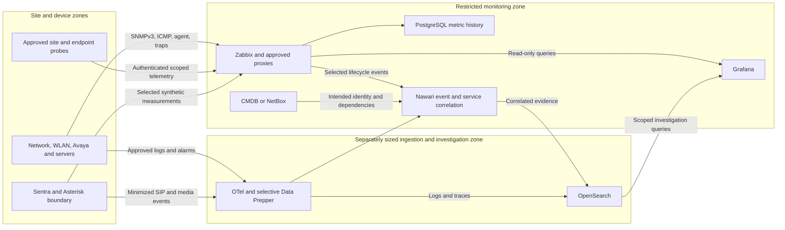

# Nawari enterprise observability plan

PLAN review draft · 9 November 2026 · Evidence scope: development checkout and local Docker Desktop only. Historical phase documents remain evidence for their stated environments and dates. This plan organizes the next commissioning cycle around KQ network operations, employee experience, communications, service availability and reproducible investigation.

## Evidence baseline

| Status | Evidence | Implication |
| --- | --- | --- |
| VERIFIED | One worktree on `feat/github-actions-cicd-pipeline` at `782e504`. Local `main` and cached `origin/main` point to `dd609a7`. Modified export workflow and Python exporter, untracked CSV and JSON exports. | Preserve all four working changes and classify exports before distribution. Cached refs do not establish remote parity. |
| VERIFIED | Local Docker socket and Compose labels show `compose.yaml` plus `compose.dev.yaml`. PostgreSQL, Zabbix server/web, trap receiver, Grafana, mock SNMP and Asterisk are running. Zabbix API reports 7.4.16, PostgreSQL 17.11, Grafana 11.6.0 with database OK and plugin manifest 6.10.2. | Runtime differs from checked-in production overlay, which specifies Zabbix 7.4.0 tags and plain Grafana 11.6.0. Resolve effective configuration per environment before synchronization. |
| VERIFIED | Read-only local PostgreSQL queries found 23 enabled regular/discovered host rows. Enabled items give 17 hosts with SNMP and 18 with ICMP keys. In the preceding 15 minutes, unsigned history had 55 SNMP items across 2 hosts and 22 ICMP items across 18 hosts. Of the 18 hosts with fresh base ping outcomes, 2 had a successful result on at least one base ping item. | Counts describe a local sample, including potential fixtures. Other history types, production availability, item validity and physical inventory membership were outside the query. |
| VERIFIED | Five host manifests plus group definitions, 12 Zabbix templates, action/media/user provisioning, 14 evidence snapshots and API reconciliation code. Templates include generic network/SNMP, Avaya families, SIP, synthetic voice and endpoints. | Host definition, template link, item support and fresh valid sample are distinct evidence levels. |
| VERIFIED | Two Grafana providers point to 13 network and 11 communications files. A further 24 JSON files sit in the archive subtree, nine consolidated files sit outside provider roots, and one endpoint dashboard is separate. Three consolidated UIDs overlap active-source UIDs: enterprise overview, communications overview and voice correlation. Grafana proxies Zabbix JSON-RPC via zabbix-web. Unauthenticated dashboard search returned HTTP 401. | A mounted provider tree does not establish loaded UID ownership or query success. Prior Phase 13.14B acceptance and the reported 31-dashboard runtime inventory require environment reconciliation. |
| VERIFIED | Nawari contains Asterisk configuration, AMI client, SIP parsing, two correlation layers, RTP/RTCP analysis and a Zabbix sender. Local Asterisk is healthy by container check. Sentra is referenced as a separate system. | Live interoperability, event ownership and valid media samples are UNKNOWN. |
| VERIFIED | Python endpoint agent includes platform adapters, allowlisting, spool and DNS/TCP/TLS/HTTP/traceroute code. Shell/PowerShell endpoint provisioning and Zabbix Agent 2 provide a second path. Hub daemon starts the endpoint gateway/Zabbix sender. Topology, assurance, incident, analytics, actions and multisite packages provide additional source capabilities. Edge, proxy and hub manifests are separate deployment candidates. | Source and fixtures establish implementation surfaces. Local Docker inventory did not show the core gateway or distributed collectors running. |
| VERIFIED | README defers OpenSearch and OTel and excludes Data Prepper from core. No active pipeline manifests were found in the inspected deployment trees. | Preserve external Sentra integrations and inspect them separately. Treat a Nawari investigation tier as PROPOSED and external ingestion as UNKNOWN. |
| VERIFIED | CI, deployment, rollback, backup/restore, deployment gating and inventory export artifacts exist. CI accepts PRs targeting main and uses self-hosted runners. | GitHub environment protection, runner isolation and actual deployment/restore history are UNKNOWN. |
| REPORTED | Historical production host is mon-grafana01 with 2 vCPU, about 7.8 GiB RAM and a 147 GB root disk around 89% used. Historical notes report 11 reference devices reconciled, 12 existing hosts preserved and seven runtime-only dashboard UIDs. | Production access and evidence are BLOCKED pending owner-provided snapshots or explicit authorization. No production sizing decision follows from the local results. |

Evidence references: [core Compose](../../docker/compose.yaml), [production overlay](../../docker/compose.prod.yaml), [Grafana providers](../../docker/grafana/provisioning/dashboards/dashboards.yaml), [historical dashboard acceptance](../phase13/phase13-14b-dashboard-operational-acceptance.md), [physical telemetry report](../phase13/phase13-9-physical-telemetry-commissioning-report.md), [source roadmap](implementation-roadmap.md), [CI](../../.github/workflows/ci.yml), [deployment workflow](../../.github/workflows/deploy.yml).

## Target architecture and contracts



- **Placement.** Keep the central monitoring tier small. Place pollers and probes near approved targets, with bounded outbound queues and destination allowlists. Size the event tier from measured ingest and retention. Place flow and any packet capture on separate infrastructure. Management and deployment access belong in an admin zone with audited roles.
- **Metrics.** Zabbix owns polling, item freshness, thresholds, maintenance and native availability actions. Grafana consumes supported series using a least-privilege API identity. Distinguish zero, unsupported, stale, unreachable and uncommissioned. Keep raw item history in PostgreSQL.
- **Identity.** Intended inventory owns stable device, site, interface, circuit, path, endpoint, application, service, check, synthetic-test, probe and collector IDs. Maintain scoped source-ID crosswalks and explicit unmatched records. Topology distinguishes observed edges from intended service dependencies. Source Zabbix host IDs are instance-scoped. SIP Call-ID, AMI ActionID and AMI Uniqueid are source-scoped correlation keys, with privacy-preserving representation where possible.
- **Events.** Proposed versioned envelope contains event and source IDs, source and ingestion timestamps in UTC, device/site/service references, type, severity, lifecycle state, correlation IDs, value/unit/validity, evidence references and processing provenance. Render local time in Africa/Nairobi. Persist idempotency keys and checkpoints, retain original event time, bound clock-skew and late-event reconciliation, replay within the retention window, quarantine invalid payloads and expose loss, lag and backpressure.
- **Contract ownership.** Network operations owns Zabbix polling/traps and inventory mapping. Voice owns Sentra/Asterisk event publication, identifier semantics and media validity. Platform owns authenticated gateway/OTLP, enrichment, index lifecycle and delivery health. Service owners approve dependency graphs and SLI populations. Each onboarding record specifies sender, receiver, transport, auth, sensitivity, peak rate, retention, retry/recovery and operational owner.
- **Data governance.** Separate operational metrics, restricted identities/signalling, and highly restricted capture. Export redacted summaries by default. Derive retention and quotas from measured source volume, legal requirements and recovery objectives. Require access auditing and a deletion test per data class.

## Technology decisions

All candidates below were listed as unarchived with recent upstream pushes in GitHub repository metadata during this review. A repository push is evidence of activity. Before each build, record an exact release/digest, transitive licenses and SBOM, vendor advisories and scan results, supported compatibility matrix, lab resource measurements and rollback version. This review does not approve a new version or establish advisory clearance.

| Decision | Upstream and license | Pilot or decision gate |
| --- | --- | --- |
| Retain Zabbix, PostgreSQL and Grafana-Zabbix | [Zabbix](https://github.com/zabbix/zabbix) and [Docker](https://github.com/zabbix/zabbix-docker) AGPL-3.0, [community templates](https://github.com/zabbix/community-templates) MIT repository metadata, [plugin](https://github.com/grafana/grafana-zabbix) Apache-2.0 | Validate supported API/plugin pairing, template provenance, exact MIB/firmware and graph semantics. |
| CMDB first, evaluate NetBox | [NetBox](https://github.com/netbox-community/netbox), [Docker](https://github.com/netbox-community/netbox-docker) and [topology views](https://github.com/netbox-community/netbox-topology-views) Apache-2.0, [device library](https://github.com/netbox-community/devicetype-library) CC0-1.0 | Inventory authority and stable ID fit first. Pilot optional plugin only if version and lifecycle are supportable. NetBox adds database/cache/worker operations. |
| Compare probes against existing Python/Zabbix path | [Blackbox Exporter](https://github.com/prometheus/blackbox_exporter) Apache-2.0 | Pilot HTTP/DNS/TCP/TLS/ICMP using a scoped scrape path and restricted targets. Retain path semantics separately, including ambiguous traceroute hops. |
| Evaluate endpoint collection reuse | [Telegraf](https://github.com/influxdata/telegraf) MIT and existing Agent 2 | Compare Windows 11 supported inputs, identity/privacy, distribution, transport/spool and overhead. Add Windows 10/macOS only after compatibility evidence. |
| Reuse supported telemetry pipelines | [OTel Contrib](https://github.com/open-telemetry/opentelemetry-collector-contrib), [Data Prepper](https://github.com/opensearch-project/data-prepper), [OpenSearch](https://github.com/opensearch-project/OpenSearch) Apache-2.0 | Pilot OTLP, selected syslog/events and logs/traces with schema, auth, queue and retention tests. Add Data Prepper when a defined transform/routing or APM need justifies it. |
| Extend isolated voice fixtures | [SIPp](https://github.com/sipp/sipp) | Confirm selected release license and bundled components. Validate TLS/SIP scenarios alongside Sentra and Asterisk. Require independent RTCP evidence for media claims. |
| Evaluate flow on dedicated collector | [pmacct](https://github.com/pmacct/pmacct) | Verify GPL terms and file/dependency exceptions at selected release. Check exporter sampling, template churn, sequence gaps, loss and aggregation. |
| Defer packet capture | [Arkime](https://github.com/arkime/arkime) Apache-2.0 | Requires approved scope, dedicated sensors/storage, investigation roles, retention and deletion evidence. |
| Adapt Nawari for KQ-specific integration | Existing topology, assurance, incidents and voice packages | Select one owner for each correlation, state and alert lifecycle. Prefer a module in an existing process until independent deployment is justified. |

## Risk and verification register

| Priority | Evidence and exposure | Exit evidence |
| --- | --- | --- |
| P0 before API exposure | Hardcoded default HMAC key in `services/multisite/site_rbac.py`; gateway TLS is conditional and hub bind defaults to all interfaces inside its environment. API reachability is unverified. | Fail closed without injected key or approved TLS termination, role and invalid-token tests, scoped reachability and rotation evidence. |
| P0 before deployment | PR CI uses self-hosted runners. Runner isolation, branch/environment protection and separation from credentialed jobs are unverified. | Prove ephemeral/isolated PR execution and separate credentialed deployment identity; demonstrate deny-path on main and rollback. |
| P0 before opening ingress | Production override publishes UDP traps on all interfaces. Local development publishes Zabbix TCP 10051 on all interfaces. Host/network ACLs and approved sender reachability are unverified. UDP filtering does not authenticate a source. | Capture effective binds and ACL decisions; use authenticated transport where supported, bound input and classify unverified sender identity. |
| P0 before expanding telemetry | Historical storage pressure and unknown current disk growth. | Fresh host/resource/volume snapshot, representative growth and recovery headroom, measured retention and isolated restore. |
| P1 before dashboard migration | Shared UIDs, UI edits allowed, provider deletion enabled and differing deployment configurations. | Effective provider and UID ownership map, backup of each affected UID, query validation and restore rehearsal. |
| P1 before using exports | Temporary workflow uploads detailed host inventory. The working copies are unreviewed operational data. | Confirm artifact readers, expiry and least-privilege API role. Keep network identifiers inside the approved evidence boundary. |
| P1 before enabling outbound integrations | Parallel endpoint paths, native and Nawari notification/lifecycle paths, and potentially overlapping Sentra/Nawari voice processing. | One producer/owner per signal, explicit deduplication and recovery tests, fixture-only delivery by default. |

Keep `LIVE_CALLS_ENABLED=false`, `AUTOMATION_ENABLED=false`, `SMTP_DELIVERY_ENABLED=false` and `HARD_PRODUCTION_DENY`. Verify effective gate enforcement per entry point before commissioning. Production deployment, device mutations, telephony, traffic capture, real notifications and security-sensitive actions require separately recorded approval. No SNMP SET or automatic remediation.

### Owner-run production snapshot

Run within the approved administrative session on the monitoring host. Return redacted metadata through the approved project channel. Review filenames before sharing. Avoid raw environment dumps, rendered Compose with interpolation, container environment inspection and raw API exports.

```sh
cd /opt/nawari
git rev-parse HEAD
git status --short --branch
git worktree list
git diff --name-status
git diff --cached --name-status
docker compose -p nawari -f docker/compose.yaml -f docker/compose.prod.yaml config --services
docker compose -p nawari -f docker/compose.yaml -f docker/compose.prod.yaml config --images
docker ps --filter label=com.docker.compose.project=nawari --format '{{.Names}} {{.Image}} {{.Status}} {{.Ports}}'
docker stats --no-stream --format '{{.Name}} {{.CPUPerc}} {{.MemUsage}} {{.BlockIO}}' $(docker ps -q --filter label=com.docker.compose.project=nawari)
df -hT /
df -ih /
free -m
nproc
uptime
docker system df
timedatectl show -p NTPSynchronized
```

Run the stats line only if the filtered container list is nonempty. Obtain mounted-path usage, backup age/restore evidence and trends over an agreed observation window. Through existing scoped API access, collect Zabbix version, enabled host/interface/template inventory, item support/error categories, sample timestamps, trigger/action status and maintenance coverage. Collect Grafana version/plugin, datasource health, dashboard UIDs/folders, provisioning ownership and selected panel results. Return counts, opaque IDs and approved redacted error summaries. Compare source digests and effective settings by field in the approved environment. API evidence and controlled live probes are separate activities.

## Requirements traceability and exit gates

Effort ranges are initial engineer-day estimates for a constrained pilot and associated evidence. Infrastructure, review lead times and estate rollout are separate. Each row is a proposed work package or release epic, with implementation status BACKLOG except A01 PLANNED. Owners are roles pending assignment. Foundation planning is in progress until baseline review and production evidence disposition.

| ID | Scope and business value | Dependency and candidate implementation surface | Effort / owner / environment | Evidence for acceptance and rollback |
| --- | --- | --- | --- | --- |
| FDN-01 | Source/runtime parity, product scope, capacity, security and commissioning baseline | This plan, existing architecture/operations/phase records, owner snapshot | 3–6 / platform + security / local and owner read-only | Classify each component and environment; disposition unknowns and record approval path. Evidence-only, supersede report revision. |
| A01–A07 | Reliable LAN/WAN device and server monitoring, thresholds, recovery, datasource and dashboard evidence | FDN-01 baseline for production claims; detailed packages below | 12–28 / NOC + platform / local and staging, separately approved production | At least one representative approved target per in-scope family, explicit exceptions, valid sample-to-panel chain and observed recovery. |
| B01 | Inventory, IPAM, device ownership, circuits and physical/logical topology | A inventory and CMDB access; `services/topology`, `services/integrations/cmdb_adapter.py` | 8–16 / inventory + network / sandbox then pilot | Reconcile stable IDs, links, LLDP/CDP observations and drift with explicit conflicts; revert import batch/crosswalk. |
| C01 | Distributed DNS/TCP/TLS/HTTPS/ICMP, WAN/MPLS/SD-WAN route and path experience | A+B identities, approved representative sites, collector budgets; `services/endpoint/path`, `services/multisite` | 10–22 / network / lab then sites | Outbound scope, loss/latency and path provenance, site comparison and disconnect/replay; remove pilot collector. |
| D01 | Wireless WLC/AP/RF/client experience and RADIUS/NAC, plus endpoint OS/adapter/VPN/experience | B identity, C probe contract, approved Windows 11 cohort and privacy; `services/endpoint`, `provisioning/endpoint` | 15–30 / EUC + wireless / enrolled pilot | Distinguish WLC counters from endpoint observations; measure heartbeat, overhead, roaming/auth cases and privacy; remove policy/agent. |
| E01 | Avaya CM/SM/System Manager/SBCE, media gateways, PBX, CMS/WFO, trunks, SIP and RTP/RTCP assurance | A/B, voice/firmware inventory, vendor documentation and isolated SIP lab; `services/voice`, `docker/asterisk` | 15–30 / voice / isolated lab then separately approved pilot | Supported observables, bounded polling, SIP lifecycle and separately evidenced media; call authorization, restoration and privacy evidence; disable scenarios/revert template deltas. |
| F01 | App and shared service checks, trace ingestion, business service dependencies, SLI/SLO/SLA | B/C, service owners, event tier for traces; `services/assurance`, `services/multisite/service_catalog.py` | 12–25 / app + SRE / staging then pilot | Validate transaction denominators, DNS/DHCP/NTP/auth and app paths, trace provenance, exclusions and alert/recovery; withdraw versioned check/rule. |
| G01 | Flow analytics and optional packet investigation | B, network export authorization, dedicated collector/storage; separate ingest contract | 12–25 / network + security / isolated collector | Reconcile sampling, loss and retention, prove authorized scoped investigations; stop export/collector and apply approved data disposition. |
| H01 | Cross-domain event normalization, evidence timelines, impact and recovery | B plus selected A/C/D/E/F sources, sized investigation tier; `services/assurance`, `services/incidents` | 15–30 / integration + NOC / replay lab then pilot | Versioned schema, duplicate/out-of-order replay, labeled incidents, auditable hypothesis versus verified cause; revert consumer version and checkpoint safely. |
| I01 | Production operations, CI/CD, RBAC, recovery, capacity, DR, support and handover | Starts with A guardrails; acceptance depends on commissioned release scopes; `scripts/{backup,deploy}`, `.github/workflows` | 15–30 / platform + SRE / isolated restore and controlled promotion | Measured RTO/RPO, protected deployment and rollback, platform health and support drills; restore prior image/config via approved procedure. |
| J01 | Baselining, forecasting and evidence-grounded read-only investigation | H labeled data, I controls and approved local compute; `services/analytics` | 12–25 / analytics + security / isolated evaluation | Accuracy, abstention, authorization and audit tests; disable read-only endpoint and revoke scoped identity. |

Critical path runs through foundation evidence, reliable monitoring, authoritative identities and service dependency mapping, then correlation and operational acceptance. Security and recovery planning start immediately. C and E pilots can proceed independently once their dependencies clear. G needs its own infrastructure and approval and is not a prerequisite for H.

### Acceptance measures

Record the scope, collection time and fixture/physical classification with every result. Thresholds are proposed after baseline measurement.

| Measure | Numerator / denominator and window |
| --- | --- |
| Inventory and device coverage | Reconciled devices / in-scope authoritative devices; enabled monitored devices / reconciled devices, as of snapshot. Availability and valid-resource coverage use devices with a valid result / devices expected to produce that signal within max(3 polling intervals, 15 minutes). Report unsupported and stale separately, per expected device/item population. |
| Links, paths, WLAN, endpoints | Fresh monitored critical interfaces / approved critical interfaces; healthy probes / required sites; fresh wireless devices or authorized experience cohorts / inventory in scope; healthy enrolled agents / expected managed pilot devices. Use three expected intervals per signal and report scope exclusions. |
| Voice and business services | Services with verified signalling, verified media or validated dependency models / applicable service inventory, independently reported. Use the agreed synthetic schedule for observations and the current approved service inventory for dependency coverage. |
| Alerts and investigation | Correct notifications and recoveries / expected in each labeled drill; false positives and false negatives / labeled negative and positive cases respectively. Correct correlated scenarios / labeled scenarios, with dedup and evidence traceability measured per test run. |
| Reliability and capacity | Accepted / attempted telemetry per interval, ingest lag percentiles and missing sequence counts; successful platform checks / scheduled checks, with explicit exclusions; remaining disk/memory / usable budget, observed growth, restore duration and data loss per drill. |

## Release A review queue

Use PLAN → BUILD → EXECUTE → ANALYZE → TEST per package. Review PLAN before changing source. Run fixture or staging tests first. Revert only the package delta with a prior snapshot where relevant. Escalate production work as a separate approval record with scope, owner, preconditions, safety checks, window, rollback and evidence.

| ID / status | Scope, owner and estimate | Plan, evidence, acceptance and rollback |
| --- | --- | --- |
| A01 PLANNED | One existing Zabbix item to one Grafana panel; NOC/platform, 1–2 days | Start with current exporter, provider and existing dashboard audit. Document instance/host/item/datasource/panel IDs, support, freshness, units and validity. Fixture case set covers fresh positive, measured zero, stale, unsupported, missing selector and fixture-only provenance. Local only. Evidence and documentation delta reversible. |
| A02 BACKLOG | Physical SNMPv3/ICMP and vendor capability; network, 2–5 days pilot | After A01 and owner-approved inventory, compare approved reference device settings and device-specific MIB evidence at approved vantage. Document supported/unsupported distinctions, interval, load, privacy, expected unit and item evidence. Use template manifests. Isolate and restore only pilot template/link deltas under approved change. |
| A03 BACKLOG | Dashboard UID/datasource ownership and repair; Grafana/NOC, 2–4 days | After A01 and runtime API evidence, use dashboard inventory/generators and effective provider mounts. Reconcile every runtime/source UID including reported runtime-only set, prove query and drill-down for selected panels, export pre-change model and restore by UID. |
| A04 BACKLOG | Zabbix trigger dependencies and recovery in simulation; NOC, 2–4 days | After A02 pilot signals and maintenance inventory, reuse notification fixtures and native actions. Prove fault, suppress, duplicate, resolve and restart behavior with no real delivery; revert rule/action changes. |
| A05 BACKLOG | Platform health, capacity and restore; SRE, 2–5 days | After FDN evidence, use existing backup/recovery scripts in isolation. Measure disk growth, Zabbix queue, PostgreSQL/Grafana health, time and backup age. Restore a representative protected backup to isolated storage and compare RTO/RPO with proposed budgets. Dispose of isolated restore according to policy. |
| A06 BACKLOG | Selected event exports and Sentra boundary; integration + voice, 1–3 days | After A01 and external owner evidence, prove source IDs and a synthetic Zabbix problem/recovery export and Sentra fixture through scoped contracts. Classify which OTel/OpenSearch paths exist; defer heavy deployment to an approved tier. Revert exporter config and test sink. |
| A07 BACKLOG | Access and deployment guardrails; security + platform, 2–5 days | Parallel with A01 in planning. Inspect runner settings, key injection, effective binds, ACLs and safety gates. Prove local deny cases for absent secrets, unauthorized ingress/actions and deployment; rollback source change with API kept restricted. |

### A01 implementation plan for approval

Use a reproducible local evidence procedure first. Reuse [the inventory exporter](../../scripts/zabbix/export_host_inventory.py) as the host identity reference and [the existing dashboard verifier](../../scripts/verify_dashboard_operational_acceptance.py) as the query and navigation reference. Review the script before use and restrict credentials and actions to the development instance. Prefer scoped Zabbix and Grafana read-only API calls. Retain an aggregate database check as an independent cross-check. Never rely on direct database access as a production integration.

Expected BUILD delta is a short procedure and one evidence row in the [existing dashboard acceptance record](../phase13/phase13-14b-dashboard-operational-acceptance.md) or its linked evidence record, preserving the historical result. A script change needs a demonstrated gap and review of the already-modified exporter before editing it. Execution requires local read-only Grafana and Zabbix access or a fixture endpoint for the initial contract check. Analyze the first broken link in the chain before testing the failure matrix. The exit gate is one reproducible valid panel result or a classified and evidenced first broken link, plus explicit separation of simulation from physical telemetry. A missing Grafana credential remains a runtime acceptance blocker. The only rollback is reverting the package's documentation or fixture delta.

## Documentation ownership

Use this plan as the program traceability and review record. Extend the existing architecture, dashboard, deployment and operations records for their respective evidence rather than replacing historical reports. Phase 13.9 supplies the starting device capability matrix, Phase 13.10–13.13 the voice/path/service/SLO evidence, and Phase 13.14–13.16 the dashboard, resilience and handover evidence. Detailed boundary threat models, versioned schemas, retention limits, signed acceptance results and the production approval register are release deliverables with accountable owners and actual evidence. Record approvals against the relevant package and evidence revision before its execution window.
