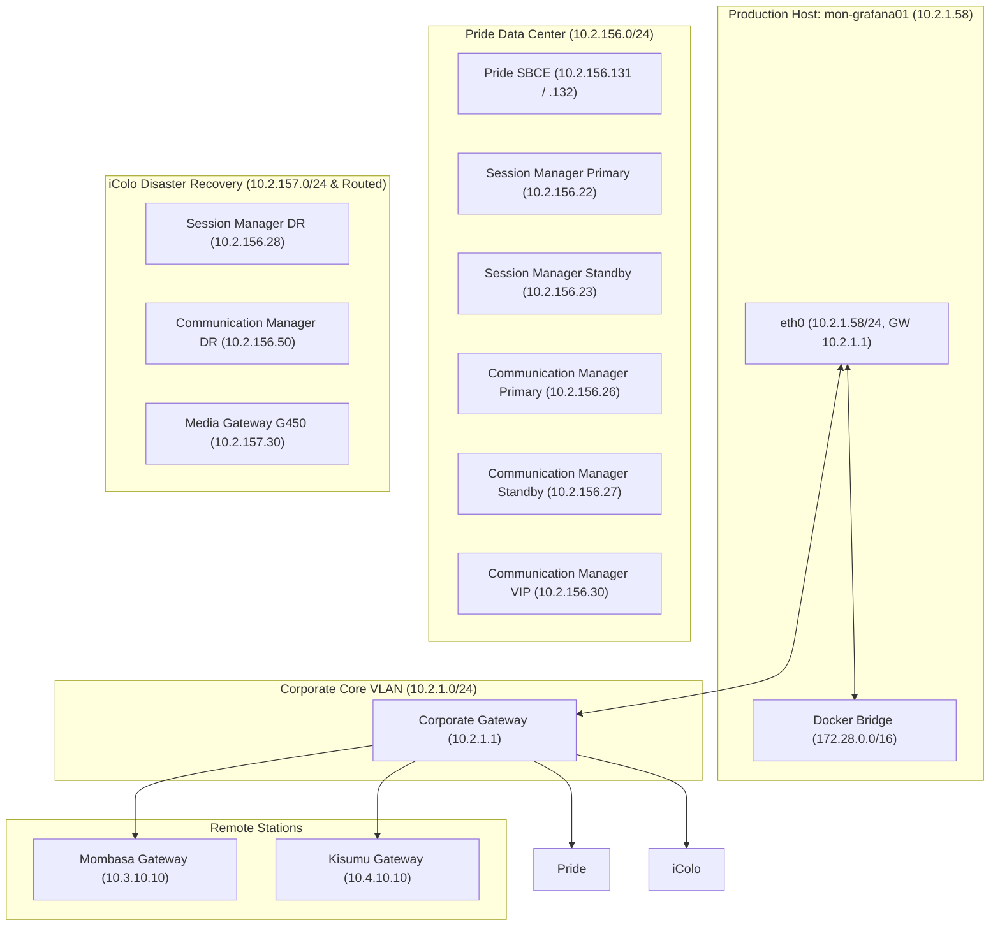

# Nawari Network Architecture Specification

**Status:** Technical Baseline  
**Date:** 2026-11-07  
**Scope:** Local Development, Docker Bridging, Enterprise Telephony Routing & Security Zones

---

## 1. Network Topology & Subnet Segmentation

Nawari monitors an enterprise communications and network estate spanning multiple physical data centers and remote branch stations.



---

## 2. Port & Protocol Matrix

| Service / Function | Port | Protocol | Direction | Source | Destination | Purpose |
|---|---|---|---|---|---|---|
| **SNMP Polling** | `161` | UDP | Outbound | `zabbix-server` (Host `10.2.1.58`) | Network devices & Avaya appliances (`10.2.156.x`, etc.) | Device polling (System, CPU, Memory, Interfaces) |
| **SNMP Traps** | `162` | UDP | Inbound | Network devices, Avaya SBCE, SM, CM | `zabbix-snmptraps` (Host `10.2.1.58:162`) | Real-time hardware, link, and application alarm delivery |
| **ICMP Echo** | N/A | ICMP | Outbound | `zabbix-server` / `nawari-api` | All monitored targets | Availability, RTT latency, and packet loss measurement |
| **SIP Signaling (TLS)** | `5061` | TCP | Bidirectional | `asterisk` (`10.2.1.58`) | Avaya Session Managers (`10.2.156.22`, `.23`, `.28`) | Synthetic call setup and SIP OPTIONS keep-alive |
| **SIP Signaling (UDP)** | `5060` | UDP | Bidirectional | `asterisk` (`10.2.1.58`) | Avaya Session Managers | Standard SIP testing (unencrypted fallback if permitted) |
| **RTP Media Streams** | `10000-10100` | UDP | Bidirectional | `asterisk` (`10.2.1.58`) | Avaya Media Processors / Gateways | Synthetic call media flow, jitter, and packet loss validation |
| **Asterisk AMI** | `5038` | TCP | Internal Loopback | `nawari-api` (`127.0.0.1` or internal bridge) | `asterisk` (`127.0.0.1:5038`) | Automated call origination, channel monitoring, event correlation |
| **Zabbix Server Trap/Sender** | `10051` | TCP | Inbound / Internal | `nawari-api`, `asterisk`, external agents | `zabbix-server` (`10051`) | Trapper metric injection (SIP test results, synthetic probes) |
| **Zabbix Agent** | `10050` | TCP | Outbound | `zabbix-server` | Managed endpoints (Windows/Linux) | Active/passive endpoint agent telemetry |
| **Zabbix Web UI / API** | `8080` | TCP | Inbound Loopback | Reverse Proxy / Admin (`127.0.0.1`) | `zabbix-web` (`8080`) | Administrative configuration and JSON-RPC API calls |
| **Grafana UI** | `3001` | TCP | Inbound Loopback | Reverse Proxy / Browser (`127.0.0.1`) | `grafana` (`3001`) | Operational dashboards and service visualization |
| **Nawari API** | `8000` | TCP | Inbound Loopback | Reverse Proxy / Admin (`127.0.0.1`) | `nawari-api` (`8000`) | Reconciliation triggers, correlation status, health reporting |
| **PostgreSQL Database** | `5432` | TCP | Internal Docker Only | `zabbix-server`, `zabbix-web` | `postgres` (`5432`) | Relational persistence (never bound to host interface) |

---

## 3. Network Environment Differentiation

A critical engineering principle in Nawari is that **local development networking is fundamentally different from enterprise production networking**:

### Local Development (macOS ARM64)
- Docker Desktop runs inside a lightweight virtualization framework VM (Apple Hypervisor).
- Host IP (e.g. `10.2.5.148` or DHCP WiFi) is behind Docker Desktop NAT.
- Direct layer-2 or un-NATted egress to corporate subnets is not possible without VPN or physical network attachment.
- **Local Scope**: Validates container boot ordering, configuration syntax, database migrations, API integrations, and mock SNMP/SIP fixtures.

### Production Environment (`mon-grafana01` on Ubuntu 24.04 LTS)
- Bare-metal or VMware ESXi virtual machine with native Linux network stack (`eth0` on `10.2.1.58`).
- Docker uses native Linux `iptables` / `nftables` bridge routing.
- Egress packets to `10.2.156.0/24` originate from `10.2.1.58` with real source IP.

---

## 4. Source IP Preservation & SIP Contact Address Requirements

In enterprise SIP infrastructures (especially Avaya Aura Session Manager):
1. **Access Control Lists (ACLs)**: Session Managers authenticate SIP entities based on both TLS client certificate CN/SAN and the originating IPv4 address.
2. **Contact Header & SDP**: Outbound SIP INVITE messages contain the client's signaling IP in the `Contact:` header and media IP in the `c=IN IP4 ...` SDP line.
   - If Asterisk advertises an internal Docker IP (e.g. `172.28.0.5`), Session Manager will attempt to send responses and RTP media back to an unroutable RFC 1918 container subnet.
   - Therefore, Asterisk PJSIP configuration must set:
     ```ini
     external_signaling_address = 10.2.1.58
     external_media_address = 10.2.1.58
     ```
3. **Decoupling from Developer IP**: In the Sentra codebase, `10.2.5.148` was used as a hardcoded fallback. Nawari enforces clean decoupling via `AVTEST_SOURCE_IP=${AVTEST_SOURCE_IP:-10.2.1.58}`, completely eliminating developer IP leakage in production.

---

## 5. Firewall Validation & Network Preflight Gates

Before deploying the voice assurance profile or claiming production reachability on `mon-grafana01`, the following network gates must be validated via shell commands:

```bash
# 1. Verify routing table to Pride Core Subnet
ip route get 10.2.156.22

# 2. Verify MTU (standard 1500 without fragmentation)
ping -M do -s 1472 -c 3 10.2.156.22

# 3. Verify TCP port reachability to Session Manager TLS
nc -zv -w 3 10.2.156.23 5061

# 4. Verify SNMP UDP port reachability to SBCE
nc -zvu -w 3 10.2.156.131 161
```

