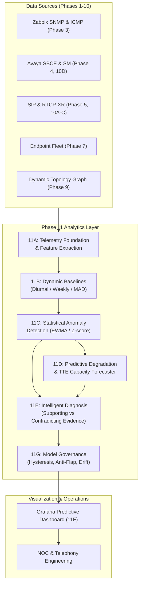

# Nawari Phase 11 — Master Technical Specification
## Evidence-Driven Analytics, Dynamic Baselines & Predictive Service Assurance

**Document Version:** 1.0.0  
**Status:** APPROVED FOR IMPLEMENTATION  
**Author:** Antigravity Engineering (Kenya Airways Project Team)  
**Date:** 2026-11-08  
**Target Environment:** Production Host `mon-grafana01` (Ubuntu 24.04 LTS, 2 vCPUs, 7.8 GiB RAM)  
**Container Resource Budget:** $\le 2.2\text{ GiB}$ total memory consumption across all Nawari services  
**Baseline Test Suite:** 258 Passing Tests (Phases 1–10)  
**Dependencies:** Phase 9 (Dynamic Topology & Canonical Identity), Phase 10 (Voice Communications Intelligence & RTCP-XR)

---

## 1. Executive Summary & Architectural Positioning

Phase 11 establishes an **evidence-driven analytics layer** for the Nawari platform, transitioning observability from static threshold alerts to dynamic behavioral baselining, statistical anomaly detection, capacity exhaustion forecasting, and evidence-ranked root-cause hypothesis generation.

### 1.1 Separation of Responsibilities

Phase 11 preserves the clear architectural boundaries of the Nawari ecosystem:
* **Zabbix:** Remains responsible for active/passive polling, deterministic metrics collection, item storage, and deterministic hard triggers.
* **Nawari Deterministic Assurance Engines:** Remain responsible for protocol parsing, multi-leg session correlation, topology graph traversal, and deterministic incident management.
* **Phase 11 Analytics Layer:** Operates asynchronously as an analytical intelligence pipeline that learns normal operational behavior, detects statistically significant deviations, forecasts degradation trends, and computes evidence-ranked diagnostic hypotheses.
* **Grafana:** Remains the authoritative visualization layer, rendering dynamic baseline bands, anomaly timelines, and predictive horizons.
* **AI & Machine Learning Boundary:** Operates exclusively on validated telemetry and topology evidence. It **never** fabricates data, overrides deterministic safety controls, or produces ungrounded speculative diagnoses.



---

## 2. Six Critical Design Principles

In strict adherence to Kenya Airways enterprise engineering standards, Phase 11 enforces six non-negotiable architectural principles:

1. **No Arbitrary AI Diagnosis:**
   Every diagnostic hypothesis must explicitly enumerate both its **supporting evidence** and its **contradicting evidence**. A diagnosis is never emitted as an ungrounded text assertion or opaque black-box probability.
2. **No Uncalibrated Confidence Percentages:**
   Confidence scores and anomaly metrics must represent statistically calibrated deviation indices or verifiable ordinal evidentiary rankings, never fabricated empirical probabilities (e.g. no arbitrary "94% probability of failure").
3. **No Prediction Without Historical Evidence:**
   Predictive trend analysis and Time-to-Exhaustion (TTE) calculations require minimum historical observations ($N \ge 15$ for trends, $N \ge 30$ for baselines) and statistical fit quality ($R^2 \ge 0.70$). If evidence is insufficient, the system outputs `INSUFFICIENT_DATA`.
4. **No Replacement of Deterministic Monitoring:**
   Statistical and predictive analytics augment, but never replace or suppress, deterministic Zabbix triggers and hard safety interlocks (such as circuit breakers or emergency dial-plan gates).
5. **No Automatic Production Remediation:**
   Phase 11 is strictly an observational, diagnostic, and predictive intelligence layer. It recommends and projects; automated closed-loop remediation actions belong exclusively in Phase 12.
6. **No False Physical Validation:**
   Models trained on simulated or fixture-based data maintain explicit provenance metadata (`SIMULATED_PROVENANCE`) and must never be represented as production-validated without on-site data capture under Phase 8.2 protocols.

---

## 3. Workstream Specifications (11A – 11H)

### Workstream 11A: Telemetry Foundation & Feature Extraction
* **Purpose:** Ingests raw telemetry streams across all five domains (network, Avaya PBX, voice signaling/media, endpoints, and topology), performs temporal alignment, validates data quality, handles gaps cleanly, and records cryptographic provenance.
* **Component Path:** `services/analytics/telemetry_foundation.py`
* **Core Responsibilities:**
  1. *Multi-Source Feature Normalization:* Maps heterogeneous telemetry streams into a unified `TelemetryObservation` record with standardized units (ms, bps, packets, percentages).
  2. *Time Bucketing & Alignment:* Normalizes irregular polling timestamps into uniform sliding time buckets (60s and 300s) using linear interpolation for minor jitter while refusing to interpolate gaps $> 2 \times$ interval.
  3. *Missing Data Handling:* Gaps are explicitly tagged as `MISSING` rather than imputed with zeros, preventing distortion of baseline statistics.
  4. *Provenance Tracking:* Every observation carries provenance: `LIVE_SNMP`, `GATEWAY_ENDPOINT`, `ASTERISK_AMI`, `MOCK_FIXTURE`, or `SIMULATED_PROVENANCE`.

### Workstream 11B: Dynamic Baselines & Temporal Profiling
* **Purpose:** Computes expected operational boundaries for every device, interface, and voice trunk based on historical behavior, day-of-week, and time-of-day variations.
* **Component Path:** `services/analytics/dynamic_baselines.py`
* **Mathematical Foundations:**
  1. *Welford's Streaming Algorithm:* Computes running sample mean $\mu$ and sample variance $\sigma^2$ in $O(1)$ space and $O(1)$ time per sample:
     $$\bar{x}_k = \bar{x}_{k-1} + \frac{x_k - \bar{x}_{k-1}}{k}, \quad M_{2,k} = M_{2,k-1} + (x_k - \bar{x}_{k-1})(x_k - \bar{x}_k), \quad s^2_k = \frac{M_{2,k}}{k - 1}$$
  2. *Robust Median Absolute Deviation (MAD):* Immune to extreme outliers during historical incidents:
     $$\text{MAD} = \text{median}(|x_i - \tilde{x}|), \quad \text{Modified } Z = \frac{0.6745 \cdot (x_i - \tilde{x})}{\text{MAD}}$$
  3. *Multi-Seasonal Matrix:*
     - 24 hourly buckets $\times$ 2 day profiles (Weekday vs Weekend).
     - Models Kenya Airways operational flight banks (e.g. Morning peak 06:00–09:00 EAT, Evening peak 19:00–23:00 EAT at JKIA).
  4. *Cold-Start Guard:* Enforces $N \ge 30$ samples per bucket before declaring a valid baseline. Returns `status="INSUFFICIENT_DATA"` when $N < 30$.

### Workstream 11C: Statistical Anomaly Detection Engine
* **Purpose:** Detects statistically significant deviations across univariate and multivariate telemetry streams without hardcoded thresholds.
* **Component Path:** `services/analytics/anomaly_detector.py`
* **Techniques Implemented:**
  1. *Adaptive Z-Score & Modified Z-Score:* Measures distance from current baseline in units of standard deviation ($\sigma$) or MAD.
  2. *Exponentially Weighted Moving Average (EWMA):*
     $$S_t = \lambda Y_t + (1 - \lambda) S_{t-1}, \quad \sigma_{S_t}^2 = \sigma^2 \left( \frac{\lambda}{2 - \lambda} \right) [1 - (1 - \lambda)^{2t}]$$
     Detects small, persistent mean shifts (e.g. gradual packet drop or memory leak) that Z-score misses.
  3. *Directional Anomaly Classification:* Categorizes anomalies as `HIGH_ABNORMAL` (spikes in loss, delay, CPU), `LOW_ABNORMAL` (abrupt traffic drops, session collapse), or `ZERO_DROP` (complete silence).
  4. *Evidentiary Severity Calibration:* Maps deviation into four calibrated tiers: `NORMAL` ($|Z| < 2.0$), `INFORMATIONAL` ($2.0 \le |Z| < 3.0$), `WARNING` ($3.0 \le |Z| < 4.5$), and `CRITICAL` ($|Z| \ge 4.5$).

### Workstream 11D: Predictive Degradation & Time-to-Exhaustion (TTE)
* **Purpose:** Projects metric trajectories into the future to forecast critical capacity exhaustion and subtle quality decay before service failure occurs.
* **Component Path:** `services/analytics/predictive_degradation.py`
* **Forecasting Capabilities:**
  1. *Holt's Linear Exponential Smoothing:*
     $$L_t = \alpha y_t + (1 - \alpha)(L_{t-1} + T_{t-1}), \quad T_t = \beta(L_t - L_{t-1}) + (1 - \beta)T_{t-1}, \quad \hat{y}_{t+h} = L_t + h T_t$$
  2. *Time-to-Exhaustion (TTE) Engine:*
     Given a ceiling limit $C_{max}$ (e.g. SBCE 500 session license, 10Gbps uplink bandwidth, 95% storage) and trend slope $m > 0$:
     $$TTE = \frac{C_{max} - y_t}{m}$$
     - Gated by Coefficient of Determination: requires $R^2 \ge 0.70$ over $\ge 15$ points.
  3. *Voice MOS Degradation Velocity:*
     Computes quality velocity $\frac{\Delta MOS}{\Delta t}$. If negative drift exceeds $-0.15\text{ MOS/min}$ over 3 consecutive intervals, flags `EARLY_VOICE_DEGRADATION` well before reaching the static 3.5 MOS alarm threshold.

### Workstream 11E: Intelligent Diagnosis & Evidence Ranking
* **Purpose:** Correlates multi-domain anomalies across the Phase 9 topology graph and ranks root-cause hypotheses with explicit supporting and contradicting evidence.
* **Component Path:** `services/analytics/intelligent_diagnosis.py`
* **Evidence-Ranking Formulation:**
  For each plausible hypothesis $H_k$, the engine gathers all relevant telemetry across domains and computes an evidential balance score:
  $$\text{Score}(H_k) = \sum_{i \in \text{Supp}} w_i \cdot \text{Evidence}_i - \sum_{j \in \text{Contra}} u_j \cdot \text{Evidence}_j$$
  - Every hypothesis output is structured as:
    ```python
    @dataclass
    class DiagnosticHypothesis:
        hypothesis_id: str
        title: str
        target_entity: str
        rank_score: float
        supporting_evidence: list[EvidenceItem]
        contradicting_evidence: list[EvidenceItem]
        recommended_investigation: str
    ```
  - Upstream Root-Cause Pinpointing: Traverses the Phase 9 Directed Acyclic Graph (DAG) upstream to identify the Lowest Common Ancestor (LCA) node experiencing local errors, suppressing downstream collateral symptoms.

### Workstream 11F: Analytics Dashboards & Visual Explanations
* **Purpose:** Delivers operational visualization of dynamic baseline bands, predictive horizons, and evidence-ranked diagnoses.
* **Component Path:** `docker/grafana/dashboards/nawari_predictive_intelligence.json`
* **Visual Panels:**
  1. *Real-Time Anomaly Radar:* Cross-domain distribution of active statistical anomalies (Voice, Network, Endpoint).
  2. *Predictive Time-to-Exhaustion (TTE) Horizon:* Bar gauge showing hours/minutes until capacity saturation.
  3. *Dynamic Baseline Corridor:* Actual metrics plotted against diurnal $[\mu - 2.5\sigma, \mu + 2.5\sigma]$ bands.
  4. *Voice Quality (MOS) Degradation Trajectory:* Projected MOS slope with early-warning decay markers.
  5. *Top Evidence-Ranked Hypotheses:* Table displaying top diagnoses with supporting and contradicting evidence counts.
  6. *Post-Dial Delay (PDD) Signaling Drift:* PDD distribution drift across carrier trunks.
* **Contextual Tooltips:** Complete hover summaries documenting measurement method, operational meaning, abnormal interpretation, and caveats.

### Workstream 11G: Model Governance & Operational Controls
* **Purpose:** Manages model lifecycle, drift detection, hysteresis thresholds, anti-flapping suppression, and false-positive controls.
* **Component Path:** `services/analytics/model_governance.py`
* **Operational Controls:**
  1. *Dual-Threshold Hysteresis:*
     - Enter anomaly state: $|Z| \ge 3.0$
     - Exit anomaly state: $|Z| < 1.5$
     - Eliminates boundary jitter and alarm flapping.
  2. *Time-Persistence Windows:* Requires anomalies to sustain across $\ge 3$ polling cycles (180s) before alerting.
  3. *Concept Drift Detection:* Uses tracking signal to detect permanent baseline distribution shifts (e.g. permanent traffic growth after new route launch) and initiates scheduled baseline re-learning.
  4. *Model Versioning & Rollback:* Version-stamped baseline parameters with instant rollback to previous stable profiles.

### Workstream 11H: Consolidated Acceptance & Verification
* **Purpose:** Consolidated regression testing, performance benchmarking, and acceptance gating.
* **Component Path:** `scripts/verify_phase11.sh`
* **Acceptance Gates:**
  1. 100% pass rate across all new Phase 11 unit and integration suites.
  2. Full preservation of all 258 regression tests from Phases 1–10 (Total $\ge 285$ passing tests).
  3. Host memory footprint strictly $\le 2.2\text{ GiB}$ RAM on `mon-grafana01`.
  4. Sentra isolation: `/Users/madeira/Desktop/Projects/sentra` verified clean and untouched.
  5. Execution of full regression suite under 180 seconds.
