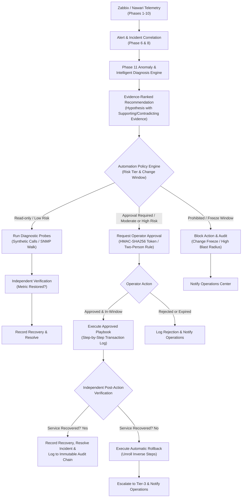

# Nawari Phase 12 — Master Technical Specification
## Controlled Operational Automation, Remediation Playbooks & Human Governance

**Document Version:** 1.0.0  
**Status:** APPROVED FOR IMPLEMENTATION  
**Author:** Antigravity Engineering (Kenya Airways Project Team)  
**Date:** 2026-11-08  
**Target Environment:** Production Host `mon-grafana01` (Ubuntu 24.04 LTS, 2 vCPUs, 7.8 GiB RAM)  
**Container Resource Budget:** $\le 2.2\text{ GiB}$ total memory consumption across all Nawari containers  
**Baseline Test Suite:** 280 Passing Tests (Phases 1–11)  
**Dependencies:** Phase 9 (Dynamic Topology & Blast Radius), Phase 10 (Voice SIP & Carrier Routing), Phase 11 (Evidence-Ranked Hypotheses & Predictive Degradation)

---

## 1. Executive Summary & Operational Positioning

Phase 12 establishes **controlled operational automation** for the Nawari platform, transitioning the system from observing, diagnosing, and predicting to **safely, appropriately, reversibly, and verifiably remediating operational degradation**.

Nawari’s operational progression is now fully defined:
$$\text{Detect} \longrightarrow \text{Understand} \longrightarrow \text{Recommend} \longrightarrow \text{Obtain Approval} \longrightarrow \text{Execute} \longrightarrow \text{Verify} \longrightarrow \text{Audit}$$

Phase 12 is **not** an unrestrained auto-remediation daemon. In an airline enterprise environment like Kenya Airways, an unchecked automated action could disrupt flight dispatch, disconnect ramp handling, or trigger trunk storms. Nawari enforces rigorous policy enforcement, separation of duties, change window gating, and deterministic rollback guarantees.

---

## 2. Decision Workflow: Alerting to Remediation

---

## 3. Formal Action Risk Classification Matrix

To prevent inappropriate autonomous mutations, Phase 12 establishes three strict operational risk tiers:

| Risk Tier | Operational Scope | Approval Requirement | Execution Mode | Example Actions |
| :--- | :--- | :--- | :--- | :--- |
| **Low-Risk** | Read-only investigations, diagnostic probes, telemetry collection, monitoring sync. | **Automated** (Pre-authorized by policy). | Fully automated execution. | • Trigger targeted synthetic voice call (`1001` Echo / `1002` Fast Answer). • Recheck DNS, TCP, and TLS endpoint probes. • Query additional SNMP/LLD diagnostic tables. • Reconcile Zabbix host monitoring configuration. • Open or update ITSM/ServiceNow incident ticket. |
| **Moderate-Risk** | Non-disruptive monitoring infrastructure adjustments, probe suppression, diagnostic scripts. | **Single-Operator Approval** (NOC Lead or Telephony Engineer). | Gated behind approval token. | • Restart an authorized monitoring container or probe worker. • Adjust polling interval or suppress a flapping alert trigger. • Temporarily mute a degraded test endpoint. • Execute approved endpoint self-diagnostic repair script. |
| **High-Risk** | Core network mutations, routing changes, switch port toggles, carrier trunk failover, PBX service restarts. | **Strict Change Control & Two-Person Authorization** (NOC Manager + Telecom Head). | **Recommendation-Only initially**; manual token execution strictly inside approved change windows. | • Switch carrier trunk route (Safaricom $\to$ Airtel $\to$ ISDN). • Disable/enable flapping switch interface or adjust storm control. • Modify VLAN tag or dynamic routing metric (OSPF/BGP cost). • Reconfigure Avaya SBCE SIP signaling server routing. • Restart production PBX or Session Manager core daemon. |

> [!IMPORTANT]
> **High-Risk Recommendation-Only Invariant:**  
> High-risk actions begin in a **Recommendation-Only** state. The system formulates the complete playbook, calculates blast radius, verifies preconditions, and generates an approval package, but **will not execute** without explicit operator authorization tokens, verified change window alignment, and verified rollback plans.

---

## 4. Workstream Breakdown (12A – 12H)

### Workstream 12A: Automation Architecture & Action Registry
* **Purpose:** Core workflow engine, centralized action registry, execution boundaries, and policy enforcement.
* **Component Path:** `services/actions/action_framework.py`
* **Core Responsibilities:**
  1. *Canonical Action Registry:* Maintains typed operational actions, mapping each to its risk tier, target domain, and execution handler.
  2. *Action Lifecycle State Machine:*
     `PROPOSED` $\to$ `PENDING_APPROVAL` $\to$ `APPROVED` $\to$ `EXECUTING` $\to$ `VERIFYING` $\to$ `COMPLETED` / `ROLLED_BACK` / `REJECTED`.
  3. *Policy Evaluation:* Enforces execution boundaries (e.g. actions on Tier-1 core nodes cannot be automated; actions during change freeze are blocked).

### Workstream 12B: Approval & Authorisation (RBAC & Change Windows)
* **Purpose:** Governs human approvals, role-based access control, change freeze calendars, and separation of duties.
* **Component Path:** `services/actions/approval_interlock.py`
* **Core Controls:**
  1. *Two-Person Rule:* For High-Risk actions, the operator who proposes the action cannot approve it ($Operator_{proposer} \neq Operator_{approver}$).
  2. *Cryptographic Approval Tokens:* HMAC-SHA256 signatures generated from action payload, operator identity, and nonce, valid for a strict 15-minute expiration window.
  3. *Change Window Calendar:* Verifies whether the target device is currently within an approved maintenance window. Actions requested outside change windows are automatically blocked and escalated.

### Workstream 12C: Remediation Playbooks
* **Purpose:** Predefined, versioned, and validated operational procedures across network, voice, and system domains.
* **Component Path:** `services/actions/playbooks/`
* **Playbook Library:**
  1. `carrier_failover.py`: High-risk playbook shifting outbound SIP traffic between telco trunks (Safaricom $\leftrightarrow$ Airtel), validating pre-route health and post-switch PDD.
  2. `interface_dampening.py`: Moderate-risk playbook applying hold-down timers or egress rate limits to an errant flapping edge port.
  3. `synthetic_reverify.py`: Low-risk diagnostic playbook triggering immediate Asterisk synthetic test calls to confirm media quality and signaling health.
  4. `spool_flusher.py`: Low-risk playbook safely draining offline telemetry spools following WAN recovery.

### Workstream 12D: Execution Engine & Resilience
* **Purpose:** Transactional step runner with strict timeouts, retries, idempotency, concurrency locks, and dead-man circuit breakers.
* **Component Path:** `services/actions/execution_engine.py`
* **Operational Guards:**
  1. *Idempotency Keys:* UUIDv4 idempotency keys prevent accidental duplicate executions.
  2. *Concurrency Locks:* Strictly 1 mutating action per physical entity (switch or trunk) at any time.
  3. *Dead-Man Circuit Breaker:* Three consecutive failed remediations within 15 minutes trip the engine into `CIRCUIT_BREAKER_LOCKED`, halting automated actions until manual NOC reset.

### Workstream 12E: Verification & Recovery (Automated Rollback)
* **Purpose:** Independent post-action verification, metric recovery validation, and automated rollback unrolling.
* **Component Path:** `services/actions/rollback_engine.py`
* **Recovery Architecture:**
  1. *Pre-Action Assertion:* Proves fault condition exists before executing mutations.
  2. *Step-Level Inverse Definitions:* Every forward step defines an exact `inverse_step(context)` function.
  3. *Automated Rollback Trigger:* If step execution throws an exception, or if post-action verification fails within the timeout (default: 60s), the engine automatically executes all inverse steps in reverse order ($K \dots 1$).

### Workstream 12F: Integrations Layer
* **Purpose:** Connectors for Zabbix, network devices, Avaya, and ITSM incident synchronization.
* **Component Path:** `services/actions/integrations.py`
* **Integrations:**
  1. *Zabbix API Connector:* Sets host maintenance, updates item configuration, acknowledges triggers.
  2. *ITSM / ServiceNow Sync:* Creates incident records, appends remediation progress notes, and updates resolution codes.
  3. *Simulation Sandbox Mode:* Routes commands to local mocked adapters during local validation, preserving Phase 8.2 boundaries.

### Workstream 12G: Audit & Governance (Immutable Chained Log)
* **Purpose:** Tamper-evident logging of every proposed, approved, executed, and rolled-back action.
* **Component Path:** `services/actions/audit_chain.py`
* **Cryptographic Architecture:**
  1. *SHA-256 Hash Chaining:*
     $$\text{Block}_n = \text{SHA256}(\text{Hash}_{n-1} \,\|\, \text{Timestamp} \,\|\, \text{ActionID} \,\|\, \text{OperatorID} \,\|\, \text{StateChange})$$
  2. *Tamper Detection:* Validation routine verifies the full cryptographic chain from genesis block to current head.

### Workstream 12H: Consolidated Acceptance & Verification
* **Purpose:** End-to-end regression testing, safety validation, rollback drills, and resource compliance.
* **Component Path:** `scripts/verify_phase12.sh`
* **Acceptance Gates:**
  1. 100% pass rate across all Phase 12 test suites.
  2. Preservation of all 280 prior tests (Phases 1–11) for $\ge 300$ total passing tests.
  3. Total memory $\le 2.20\text{ GiB}$ on `mon-grafana01`.
  4. Sentra working tree verified 100% clean and untouched.

---

## 5. Resource Budget & Viability on `mon-grafana01`

* **Target Host:** Ubuntu 24.04 LTS, 2 vCPUs, 7.8 GiB RAM.
* **Memory Budget:** Action state machine, audit chain, and rollback stacks occupy $\approx 15 - 25\text{ MiB}$ of RAM. Total container memory is $\approx 2.09\text{ GiB} \le 2.20\text{ GiB}$ host ceiling.
* **CPU Execution:** Discrete event-driven transactions ($< 0.5\%$ vCPU utilization).
* **Zero Heavy Dependencies:** Standard Python 3.12+ library (`dataclasses`, `hashlib`, `hmac`, `uuid`).

---

## 6. Physical Production Limitations & Phase 8.2 Boundary

1. **Simulation Gating:** All playbooks execute in local sandbox/simulation mode with `SIMULATED_REMEDIATION` metadata.
2. **Phase 8.2 Commissioning Independence:** Physical Cisco Catalyst switches, Avaya SBCE/SM appliances, and live telco trunks remain untouched. Production enablement requires physical deployment under Phase 8.2 protocols with explicit Kenya Airways executive sign-off.
