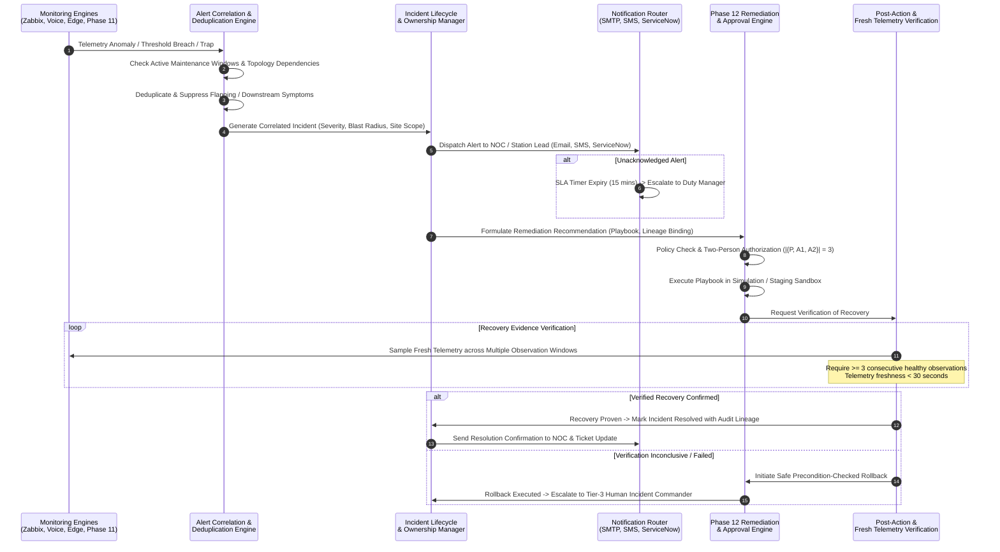
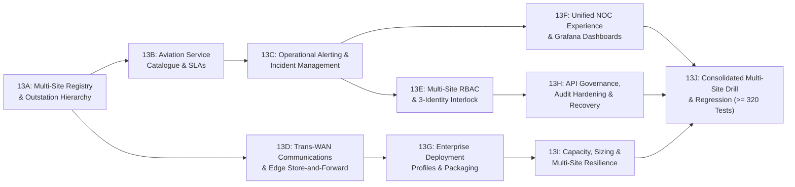

# Nawari Phase 13 — Master Technical Specification
## Enterprise Platform Productisation, Multi-Site Architecture & Service Expansion

**Document Version:** 1.0.0  
**Status:** ARCHITECTURAL SPECIFICATION & PRODUCTISATION PROGRAMME  
**Author:** Antigravity Engineering (Kenya Airways Project Team)  
**Date:** 2026-11-08  
**Target Environment:** Production Host `mon-grafana01` (Ubuntu 24.04 LTS, 2 vCPUs, 7.8 GiB RAM)  
**Edge Outstation Targets:** Distributed Edge Gateways / Micro-VMs (1 vCPU, 512 MiB – 1 GiB RAM)  
**Container Resource Budget:** $\le 2.20\text{ GiB}$ total container RAM on `mon-grafana01`  
**Baseline Test Suite:** 299 Passing Tests (Phases 1–12)  
**Dependencies:** Phase 9 (Dynamic Topology), Phase 10 (Voice SIP Assurance), Phase 11 (Evidence Analytics), Phase 12 (Controlled Remediation & Governance)  
**Deployment Designation:** Simulation & Staging Accepted; Live Production Commissioning Gated (Phase 8.2)

---

## 1. Executive Summary & Productisation Vision

Phase 13 establishes the formal **productisation** of Nawari, transforming the platform from a modular observability, analytics, and remediation engine into a unified, multi-site enterprise airline product for Kenya Airways.

Rather than merely introducing isolated monitoring metrics, Phase 13 integrates the entire operating model into a coherent platform:
1. **Multi-Site Aviation Footprint:** Complete coverage across Kenya Airways’ primary hub (JKIA), domestic stations (Moi International Mombasa, Kisumu, Eldoret, Malindi), regional outstations (Entebbe, Dar es Salaam, Kigali, Addis Ababa, Juba), and long-haul international terminals (London Heathrow T4, Dubai T1, Amsterdam Schiphol, Johannesburg OR Tambo, New York JFK).
2. **Business Service Catalogue:** Direct operational mapping from raw telemetry to mission-critical airline services (Departure Control Systems / DCS Amadeus Altea, Flight Operations & EFB Dispatch, Voice & Ground Operations, Baggage Handling / SITA, Cargo Logistics), complete with real-time SLA/SLO tracking and error budget burn rates.
3. **End-to-End Operational Alerting & Incident Management:** A closed-loop incident lifecycle linking detection, alert deduplication, suppression, incident ownership, multi-channel notifications (SMTP, SMS, ITSM), escalation matrices, controlled Phase 12 remediation, and **verified recovery requiring fresh telemetry and multiple healthy observations before incident closure**.
4. **Multi-Tenant Site-Aware RBAC:** Granular authorization boundaries separating global NOC leadership, specialized engineering teams (voice, network), regional managers, and local outstation station duty leads, enforcing the strict **three distinct identities rule** ($|\{P, A_1, A_2\}|=3$) for high-risk actions.
5. **Trans-WAN Edge Telemetry & Store-and-Forward Buffering:** Edge collectors and active proxies operating with local SQLite disk spools that buffer metrics and alerts during WAN partitions, replaying them in rate-limited batches upon circuit restoration with clock drift compensation.
6. **Enterprise Deployment Profiles & Packaging:** Four turnkey deployment profiles (`simulation`, `staging`, `single-site-production`, `multi-site-production`), containerized packaging (`hub-full`, `regional-proxy`, `edge-collector`), self-healing systemd services, and automated health watchdogs.
7. **Audit & Safety Assurance:** Cryptographically chained, tamper-evident audit ledgers with external hash anchoring, crash recovery guarantees, post-timeout state inspection, and strict retention of the **Phase 8.2 physical commissioning gates**.

### Core Platform Architectural Invariant
> **"Zabbix monitors. Grafana visualizes. Nawari discovers topology, correlates cross-domain evidence, and assures services. Asterisk provides controlled synthetic voice testing in a separately gated deployment profile. Phase 11 learns normal behavior, detects deviations, forecasts degradation, and ranks evidence-backed hypotheses. Phase 12 executes controlled, authorized, safe, and reversible operational remediation. Phase 13 packages Nawari into a unified, multi-site enterprise product, guaranteeing mission-critical airline service availability across all global outstations."**

---

## 2. Multi-Site Architecture & Outstation Hierarchy

```mermaid
flowchart TD
    subgraph CentralHub["JKIA Head Office & Core Hub (NBO / HKJK) — Deployment Profile: hub-full"]
        DC1["Data Center 1 (Pride Centre)\nCore Zabbix 7.4 + PostgreSQL 16 + Nawari Core"]
        DC2["Data Center 2 (Old Airport / Cargo)\nDisaster Recovery & Hot Standby Engine"]
        AvayaCore["Avaya Aura Core Telephony\nDual SBCE & Session Manager Clustered"]
        Terminals["Passenger Terminals 1A/B/C/D & T2\nFlight Dispatch, Check-In & Ramp Operations"]
    end

    subgraph Domestic["Domestic Outstations (Kenya) — Deployment Profile: regional-proxy / edge-collector"]
        MBA["Mombasa (MBA / HKMO)\nSecondary Hub · Dual MPLS/SD-WAN · Local Gateway"]
        KIS["Kisumu (KIS / HKKI)\nDomestic Station · Single MPLS + 4G LTE Backup"]
        EDL["Eldoret (EDL / HKEL)\nCargo & Domestic Station · SD-WAN"]
        MYD["Malindi (MYD / HKML)\nCoastal Domestic Station · LTE/Internet VPN"]
    end

    subgraph Regional["Regional Outstation Network (East & Central Africa)"]
        EBB["Entebbe (EBB / HUEN)\nRegional Outstation · SITA MPLS"]
        DAR["Dar es Salaam (DAR / HTDA)\nRegional Outstation · Dedicated Telco WAN"]
        KGL["Kigali (KGL / HRYR)\nRegional Outstation · Hybrid VPN"]
        ADD["Addis Ababa (ADD / HAAB)\nRegional Outstation · Cloud Interconnect"]
        JUB["Juba (JUB / HJJJ)\nRegional Outstation · VSAT Backup Link"]
    end

    subgraph International["International Outstations (Long-Haul)"]
        LHR["London Heathrow (LHR / EGLL)\nTerminal 4 · Dual International Telco Circuit"]
        DXB["Dubai (DXB / OMDB)\nTerminal 1 · Dedicated Enterprise WAN"]
        AMS["Amsterdam (AMS / EHAM)\nSkyTeam Hub · Cross-Carrier Interconnect"]
        JNB["Johannesburg (JNB / FAOR)\nSouthern Africa Regional Gateway"]
        JFK["New York (JFK / KJFK)\nTerminal 4 · Transatlantic WAN"]
    end

    DC1 <===>|"Synchronous HA Heartbeat & WAL"| DC2
    DC1 ---|"Primary MPLS + SD-WAN"| MBA
    DC1 ---|"MPLS + 4G LTE Failover"| KIS
    DC1 ---|"SD-WAN"| EDL
    DC1 ---|"Internet VPN"| MYD
    DC1 ===|"SITA / International MPLS"| EBB
    DC1 ===|"SITA / International MPLS"| DAR
    DC1 ===|"Hybrid VPN"| KGL
    DC1 ===|"Trans-WAN Interconnect"| LHR
    DC1 ===|"Trans-WAN Interconnect"| DXB
    DC1 ===|"Trans-WAN Interconnect"| AMS
    DC1 ===|"Trans-WAN Interconnect"| JNB
    DC1 ===|"Transatlantic WAN"| JFK
```



---

## 3. End-to-End Operational Alerting & Incident Management Pipeline

Phase 13 establishes the unified detection-to-recovery operational pipeline, ensuring that every alert is actionable, deduplicated, correctly routed, and verified before resolution:



### Complete Operational Chain Requirements

| Stage | Operational Capability | Implementation & Evidence Requirements |
| :--- | :--- | :--- |
| **1. Trigger Quality** | Semantic Trigger Rigor | Evaluates severity, hysteresis, and explicit recovery expressions. Eliminates flapping by requiring sustained threshold breaches ($N$ consecutive samples). |
| **2. Deduplication** | Event Correlation Engine | Aggregates repeated events into a single root-cause incident. Prevents alert storms by clustering related interface, BGP, or SIP errors. |
| **3. Suppression** | Topology & Maintenance Awareness | Suppresses downstream symptom alerts when an upstream link or parent switch is down (`parent_down_suppression`). Mutes alerts during active maintenance windows. |
| **4. Stale Telemetry** | Staleness vs Outage Distinction | Distinguishes between zero metric (e.g. 0 active calls), missing metric (timeout), stale metric (clock drift / collector delay), and unsupported metric (OID failure). |
| **5. Incident Lifecycle** | Structured State Transition | Formal states: `DETECTED` $\to$ `CORRELATED` $\to$ `ACKNOWLEDGED` $\to$ `INVESTIGATING` $\to$ `REMEDIATING` $\to$ `VERIFYING` $\to$ `RESOLVED` $\to$ `CLOSED`. |
| **6. Notification Delivery** | Multi-Channel Reliable Routing | Real SMTP and SMS notification delivery with queueing, retry logic, dead-letter logging, and delivery receipt confirmation. |
| **7. ITSM Integration** | Bidirectional Ticket Sync | Synchronizes incident lifecycle with ServiceNow and Jira Service Management (ticket creation, work notes, severity updates, resolution codes). |
| **8. NOC Routing** | Role & Station-Based Routing | Dispatches notifications based on matrix of site scope (e.g. Station Lead MBA), domain (Voice vs Network), and severity (P1/P2 to Manager). |
| **9. Escalation** | SLA-Driven Escalation Matrix | Automatically escalates unacknowledged P1/P2 incidents after 15 minutes to Senior NOC Duty Manager and Network Operations Head. |
| **10. Recovery Verification** | **Multi-Sample Fresh Telemetry** | **Mandatory Invariant:** An action execution or self-clearing alert does NOT automatically close an incident. Requires $\ge 3$ consecutive healthy observations with telemetry freshness $< 30\text{s}$. |
| **11. Automation Lineage** | Cryptographic Traceability | Every remediation action and incident resolution links immutably back to its originating alert ID, incident ID, approval tokens, and verification log. |

---

## 4. Aviation Business Service Catalogue & SLA/SLO Hierarchy

In enterprise airline operations, infrastructure telemetry is meaningful only in the context of flight operations and passenger processing. Phase 13 structures Nawari around an aviation service catalogue:

| Service Tier | Business Service | Target SLA (Availability) | Max MTTR | Component Dependency Chain | Operational Consequence of Outage |
| :--- | :--- | :---: | :---: | :--- | :--- |
| **Tier 1: Mission-Critical** | **Departure Control System (DCS)** | **99.95%** | **15 mins** | Amadeus Altea, Airport Check-in Desks, Gate Boarding Scanners, EFB Sync Access Points, Outstation WAN Links. | Passenger boarding halts, manual manifest fallback, flight departure delays. |
| **Tier 1: Mission-Critical** | **Flight Operations & Dispatch** | **99.95%** | **15 mins** | Jeppesen FliteDeck, Operational Flight Plan (OFP) Delivery, Weather/NOTAM Feeds, Core JKIA DC Switches. | Aircraft unable to legally dispatch; flights held at origin. |
| **Tier 1: Mission-Critical** | **Air-to-Ground & Ramp Voice** | **99.95%** | **15 mins** | Avaya Session Manager, SBCE, Ramp Handling ACD, Flight Dispatcher SIP Extensions, Telco Trunks. | Inability to coordinate ramp fuelers, catering, baggage loaders, and pilots. |
| **Tier 2: Business-Critical** | **Baggage Handling (BHS)** | **99.50%** | **45 mins** | SITA BagManager, WorldTracer scanners, Terminal Sortation PLC gateways, Outstation Baggage LAN. | Lost baggage, misrouted transit luggage, loading delays, passenger compensation claims. |
| **Tier 2: Business-Critical** | **Cargo Management Systems** | **99.50%** | **45 mins** | CargoSpot, Customs EDI gateway, Cargo warehouse weigh-scale bridges, Cold storage telemetry. | Air freight customs delays, warehouse congestion, perishable cargo spoilage risk. |
| **Tier 2: Business-Critical** | **Retail Ticketing & Sales** | **99.50%** | **45 mins** | Amadeus GDS, Outstation Ticket Desks, Secure Payment Gateway, Receipt Printers. | Inability to sell tickets, process rebookings, or collect excess baggage fees. |
| **Tier 3: Corporate** | **Corporate ERP & Logistics** | **99.00%** | **2 hours** | Oracle/SAP systems, Back-office LAN, Crew Payroll, Crew Scheduling portals. | Administrative delays; zero immediate flight or passenger impact. |
| **Tier 3: Corporate** | **Corporate Communications** | **99.00%** | **2 hours** | M365 Email, Corporate Wi-Fi, Office PBX extensions, General Staff Portals. | Staff inconvenience. |

### Service Health Calculation Algorithm
For each business service $S$, health is calculated continuously from its supporting components $c \in C_S$:
$$\text{Health}(S) = \sum_{c \in C_S} w_c \cdot \text{Health}(c) \quad \text{where } \sum w_c = 1.0$$
- If any redundant path fails (e.g. secondary MPLS drops), service state transitions to `DEGRADED` (Health $\approx 0.70$), generating a proactive maintenance alert without declaring a critical service outage.
- If both primary and redundant paths fail, service state drops to `CRITICAL` (Health $< 0.30$), triggering immediate P1 incident creation and emergency escalation.

---

## 5. Technical Resolution of Engineering Assurance Register Items

In direct response to the engineering assessment, Phase 13 formally incorporates the following safety, identity, and resilience mechanisms:

### 5.1 Two-Person Approval: Enforcement of Three Distinct Identities
The authorization engine enforces the strict set-cardinality rule:
$$|\{P, A_1, A_2\}| = 3$$
- Proposer ID ($P$), First Approver ID ($A_1$), and Second Approver ID ($A_2$) must be three completely distinct authenticated accounts.
- The proposer cannot approve their own action ($P \neq A_1$ and $P \neq A_2$).
- The first approver cannot be the second approver ($A_1 \neq A_2$).
- Both approvers must possess verified RBAC credentials authorizing them for that specific risk tier (e.g. `Tier3_Action_Authorizer`).

### 5.2 Cryptographic Token Binding: Complete Action Lineage
Approval tokens (HMAC-SHA256) bind the complete operational envelope:
$$\text{Signature} = \text{HMAC-SHA256}_{K}\Big(\text{ActionID} \,\|\, \text{IncidentID} \,\|\, \text{AlertID} \,\|\, \text{PlaybookID} \,\|\, \text{PlaybookVersion} \,\|\, \text{PlanHash} \,\|\, \text{TargetEnv} \,\|\, \text{RiskTier} \,\|\, \text{ChangeWindowID} \,\|\, \text{ParametersHash} \,\|\, \text{Nonce} \,\|\, \text{ExpiresAt}\Big)$$
Any discrepancy between the token payload and the actual execution request (e.g. modified target device, parameter alteration, expired maintenance window, or playbook version upgrade) immediately invalidates the approval.

### 5.3 Execution Safety & Crash-Recovery Guarantees
To prevent half-states, orphaned processes, and lock starvation:
1. **Pre-Execution Write-Ahead Journaling (WAL):** Before mutating any device, the execution engine writes the pending step and inverse step to a persistent SQLite/WAL journal. If the process crashes mid-execution, startup recovery inspects the journal and flags the device as `UNVERIFIED_STATE`.
2. **Post-Timeout State Inspection:** If an action subprocess times out, the engine does **not** blindly trigger rollback. It first executes a non-intrusive diagnostic probe to determine whether the mutation partially succeeded, failed, or stalled, formulating a verified recovery plan.
3. **Subprocess Process Group Isolation:** Subprocesses are spawned in dedicated process groups (`os.setsid()`); timeouts terminate the entire process group (`killpg`), preventing orphaned background child processes.
4. **Lease-Based Entity Concurrency Locks:** Concurrency locks feature a heartbeat lease (30 seconds) with automated extension. If an application instance dies, its lock cleanly expires, allowing recovery routines to intervene.

### 5.4 Tamper-Evident Audit Ledger Hardening
While the SHA-256 block chain provides tamper evidence, Phase 13 introduces enterprise ledger hardening:
1. **Restricted Append-Only File Permissions:** The ledger file is stored under strict permissions (`0640` owned by `nawari-audit` daemon) with OS-level append-only flag (`chattr +a` where supported).
2. **Periodic External Anchoring:** Every hour, the current ledger head hash is exported and cryptographically signed to an external syslog and off-host backup destination.
3. **Chain Reconstruction & Corruption Detection:** Acceptance tests explicitly verify detection of block truncation, record deletion, block reordering, and full-chain replacement attacks.

### 5.5 Rollback Operational Evidence Engine
Rollback for high-risk operations (e.g. carrier trunk failover) requires verified operational preconditions before execution:
1. Primary carrier registration state is active and SIP OPTIONS ping RTT $< 50\text{ ms}$.
2. Active call count on the target trunk is zero, or active calls have naturally cleared.
3. Synthetic test call over the rollback path succeeds with bidirectional RTP and MOS $\ge 4.0$.
4. Current carrier error rate is within normal baseline.
If any precondition fails, rollback halts immediately, and the incident escalates to the Tier-3 Incident Commander.

### 5.6 Dashboard Operational Validation
Grafana dashboards are validated not only against JSON structural schemas, but against functional live datasets:
- Validation tests query dashboards against active data sources, empty datasets (zero data handling), stale metrics, failed actions, pending approvals, tripped circuit breakers, and tampered audit logs.

---

## 6. Workstream Breakdown (13A – 13J)



### Workstream 13A: Multi-Site Architecture & Outstation Network Hierarchy
* **Purpose:** Canonical registry and topological representation of Kenya Airways' global airport and data center network.
* **Component Path:** `services/multisite/site_registry.py`
* **Deliverables:**
  - Site classification: Primary Hub (`JKIA`), Domestic Tier-1 (`MBA`), Domestic Tier-2 (`KIS`, `EDL`, `MYD`), Regional (`EBB`, `DAR`, `KGL`, `ADD`, `JUB`), International (`LHR`, `DXB`, `AMS`, `JNB`, `JFK`, `BOM`).
  - Site metadata: IATA/ICAO codes, geographic coordinates, operational hours, time zone, primary/secondary WAN links, PSTN breakout architecture.
  - Multi-site topological hierarchy with site-level health aggregation.

### Workstream 13B: Aviation Business Service Catalogue & SLA/SLO Engine
* **Purpose:** Map infrastructure components to airline business services, evaluating real-time availability, MTTR, and error budgets.
* **Component Path:** `services/multisite/service_catalog.py`
* **Deliverables:**
  - Service definitions for Tier 1 (DCS, Flight Ops, Ramp Voice), Tier 2 (BHS, Cargo, Ticketing), and Tier 3 (ERP, Corporate IT).
  - Component dependency mapping and weighted health index calculation.
  - SLA/SLO calculation engine tracking monthly availability, MTTR, MTBF, and remaining error budget seconds.

### Workstream 13C: Operational Alerting, Incident Lifecycle & Notification Delivery
* **Purpose:** Implement the closed-loop detection-to-recovery incident management pipeline.
* **Component Path:** `services/multisite/incident_pipeline.py` & `services/multisite/notifications.py`
* **Deliverables:**
  - Alert deduplication and suppression rules (topology-aware parent down suppression, maintenance window suppression).
  - Multi-channel notification delivery (SMTP email with HTML formatting, SMS via SMPP/HTTP gateway, ServiceNow incident sync).
  - SLA-driven escalation matrices (unacknowledged P1/P2 alerts escalate after 15 minutes).
  - **Verified Recovery Engine:** Mandates $\ge 3$ consecutive healthy observations with fresh telemetry ($< 30\text{s}$) before incident resolution.
  - Automation lineage linking actions, approvals, and verified recovery.

### Workstream 13D: Trans-WAN Communications Assurance & Edge Telemetry Store-and-Forward
* **Purpose:** High-resilience telemetry and voice assurance across jittery, bandwidth-constrained outstation WAN circuits.
* **Component Path:** `services/multisite/edge_forwarder.py` & `services/multisite/wan_voice_probes.py`
* **Deliverables:**
  - SQLite disk-buffered store-and-forward telemetry queue (up to 50 MB / 500,000 metrics).
  - Rate-limited replay queue ($\le 50\text{ metrics/sec}$) upon WAN circuit restoration.
  - Clock drift compensation with NTP offset correction.
  - Trans-WAN synthetic voice probes between JKIA Pride Centre and remote outstation extensions with E-model MOS calculation.

### Workstream 13E: Multi-Site Scoped Role-Based Access Control (RBAC) & Three-Identity Interlock
* **Purpose:** Multi-tenant site scoping and strict separation-of-duties authorization.
* **Component Path:** `services/multisite/site_rbac.py`
* **Deliverables:**
  - Granular roles: `GlobalAdministrator`, `CentralNOCEngineer`, `VoiceEngineer`, `RegionalStationManager`, `OutstationDutyLead`.
  - Site-scoped access filtering (station staff restricted to local airport telemetry).
  - **Three Distinct Identities Enforcement:** Explicit validation that $|\{P, A_1, A_2\}| = 3$ for all Tier-3 high-risk actions.
  - Complete HMAC-SHA256 approval token binding (Incident ID, Playbook Version, Risk Tier, Plan Hash).

### Workstream 13F: Unified NOC Experience & Operational Dashboards
* **Purpose:** Centralized visual command of the airline network, service health, and operational remediation.
* **Component Path:** `docker/grafana/dashboards/`
* **Deliverables:**
  - `nawari_global_outstations.json`: Global map, outstation status badges, WAN latency matrix, DCS health per station, trans-WAN MOS heatmaps.
  - `nawari_service_catalog_sla.json`: Real-time aviation service health, Tier-1/2/3 SLA gauges, error budget burn rates, incident impact attribution.
  - Functional dashboard tests against live, empty, stale, and failed data streams.

### Workstream 13G: Enterprise Deployment Profiles, Lifecycle & Packaging
* **Purpose:** Automated packaging and deployment profiles for turnkey installation across varied environments.
* **Component Path:** `deploy/profiles/` & `services/multisite/packaging.py`
* **Deliverables:**
  - Four formal deployment profiles: `simulation`, `staging`, `single-site-production`, `multi-site-production`.
  - Distribution packages: `hub-full` (core JKIA stack), `regional-proxy` ($< 256\text{ MiB}$ RAM), `edge-collector` ($< 64\text{ MiB}$ RAM).
  - Systemd unit definitions, automated zero-touch provisioning (ZTP) configurations, and health watchdog scripts.

### Workstream 13H: API Governance, Audit Hardening & Crash Recovery
* **Purpose:** Stable versioned APIs, resilient execution recovery, and hardened audit ledgers.
* **Component Path:** `services/multisite/api_governance.py` & `services/actions/audit_chain.py`
* **Deliverables:**
  - Versioned REST/GraphQL API specifications with rate-limiting and audit middleware.
  - Crash recovery routine with write-ahead journaling and post-timeout state inspection.
  - Audit ledger hardening: restricted append-only file flags, external hourly hash anchoring, and tamper reconstruction tests.

### Workstream 13I: Capacity, Sizing & Multi-Site Resilience
* **Purpose:** Measured scaling limits, data retention policies, and resource compliance.
* **Component Path:** `docs/architecture/capacity-and-resilience.md`
* **Deliverables:**
  - Memory modeling on `mon-grafana01`: Phase 13 additions capped at $\le 35\text{ MiB}$ RAM, preserving the $\le 2.20\text{ GiB}$ container hard ceiling.
  - Data retention policies: Raw metrics (14 days), 1-hour rollups (90 days), audit ledger (7 years for ICAO/IATA compliance).
  - RTO/RPO definitions for outstation telemetry and core services.

### Workstream 13J: Consolidated Acceptance, Multi-Site Drill & Regression Suite
* **Purpose:** Consolidated 10-check automated verification script and regression suite.
* **Component Path:** `scripts/verify_phase13.sh`
* **Deliverables:**
  - 10-check multi-site drill testing site registry, edge spooling, SLA calculation, incident notifications, 3-identity rule, dashboard schemas, and regression.
  - Full Nawari test suite expansion from 299 to $\ge 320$ passing tests (0 failures, 0 skips).
  - Verification that the Sentra repository remains 100% untouched.
  - Explicit retention of the Phase 8.2 physical commissioning gates.

---

## 7. Host Resource Budget & Sizing on `mon-grafana01`

Target Host: Ubuntu 24.04 LTS (2 vCPUs, 7.8 GiB RAM).

| Subsystem / Container | Phase 12 Allocated RAM | Phase 13 Projected RAM | Delta | CPU Impact (% of 2 vCPUs) |
| :--- | :--- | :--- | :--- | :--- |
| **PostgreSQL 16** | 512 MiB | 512 MiB | 0 MiB | $1.0 - 3.0\%$ |
| **Zabbix Server 7.4** | 768 MiB | 768 MiB | 0 MiB | $2.0 - 5.0\%$ |
| **Zabbix Frontend** | 256 MiB | 256 MiB | 0 MiB | $< 1.0\%$ |
| **Grafana 11** | 268 MiB | 280 MiB | +12 MiB (multi-site dashboards) | $1.0 - 2.0\%$ |
| **Nawari Services (Phases 1-11)** | 280 MiB | 280 MiB | 0 MiB | $< 2.0\%$ |
| **Phase 12 Action Engine** | 25 MiB | 25 MiB | 0 MiB | $< 0.5\%$ |
| **Phase 13 Multi-Site & SLA Engine**| — | **$\approx 30\text{ MiB}$** | **+30 MiB** | **$< 1.0\%$** |
| **Total Container Envelope** | **$\approx 2.10\text{ GiB}$** | **$\approx 2.15\text{ GiB}$** | **+42 MiB** | **$\le 15\%$ peak vCPU** |

> [!NOTE]
> The total container stack memory consumption ($\approx 2.15\text{ GiB}$) remains safely within the **$\le 2.20\text{ GiB}$ hard limit**, leaving $> 5.5\text{ GiB}$ host memory available for the Linux kernel, network buffers, and OS page cache.

---

## 8. Physical Production Commissioning Gates (Phase 8.2 Dependency)

In accordance with enterprise governance requirements, Phase 13 software acceptance does **not** bypass physical commissioning. Live production execution remains gated behind Phase 8.2:

```
[Software Acceptance Gate]
    Phases 1-12 (299 Tests) + Phase 13 (>= 320 Tests) -> PASSED IN SIMULATION & STAGING
                           │
                           ▼
[Phase 8.2 Enterprise Physical Commissioning Gates]
    ├─ 8.2A: Ubuntu Host Hardening & Security Audit
    ├─ 8.2B: Enterprise Identity & Entra ID SSO Integration
    ├─ 8.2C: Physical Cisco Catalyst 9500 SNMPv3 & Traps
    ├─ 8.2D: Avaya SBCE / Session Manager / Communication Manager Commissioning
    ├─ 8.2E: Production Voice & Bidirectional Media Verification
    ├─ 8.2F: Endpoint Fleet Signed Package & MDM Deployment
    ├─ 8.2G: Off-Host Backup & Witnessed Cold Restore Drill
    ├─ 8.2H: Live SMTP / SMS / ServiceNow Production Credential Commissioning
    └─ 8.2I: Executive Sign-Off (CIO, Head of Network, Telecom Manager)
                           │
                           ▼
[Live Production Readiness: Authorized for Live Infrastructure Mutation]
```
