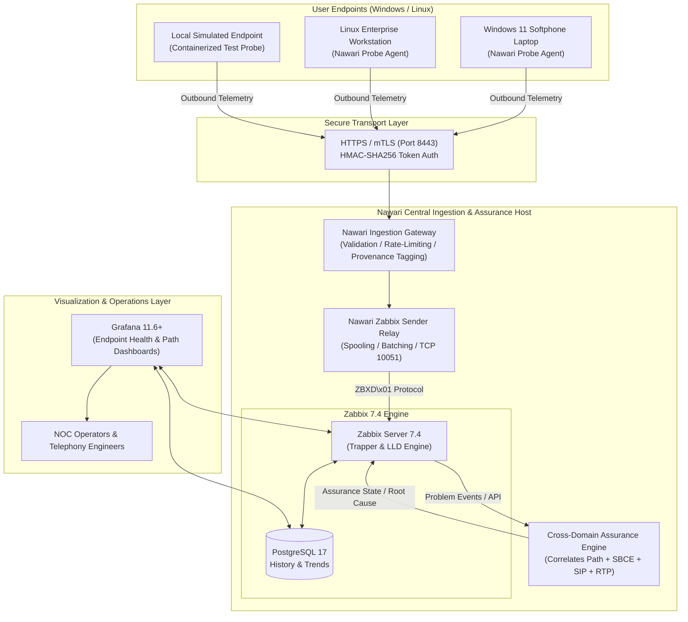
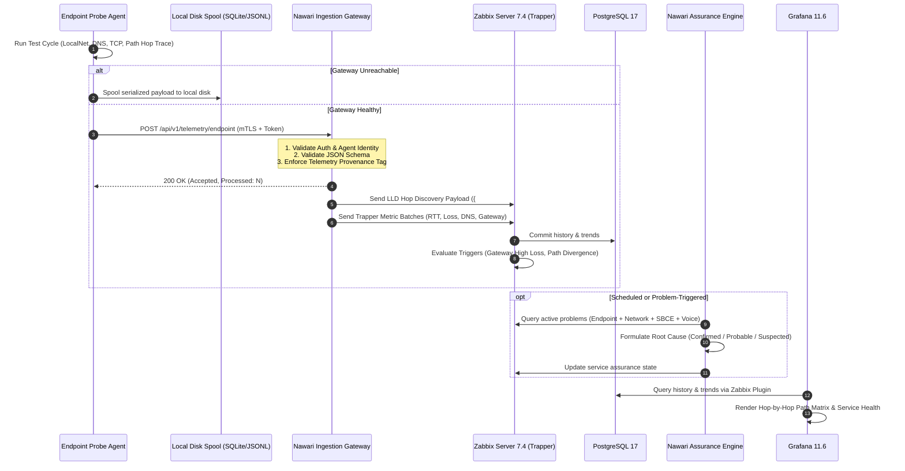

# Nawari Phase 7 Architecture Specification: Endpoint-to-Service Network Observability

**Document Version:** 1.0.0  
**Status:** Architectural Baseline for Review  
**Date:** 2026-11-07  
**Scope:** Endpoint Probing, Hop-by-Hop Path Discovery, Zabbix LLD Ingestion, and Cross-Domain Voice Assurance

---

## 1. Executive Summary & Strategic Objective

Phases 1 through 6 established Nawari's foundation for infrastructure monitoring (Zabbix 7.4 + PostgreSQL 17), Avaya SBCE appliance telemetry (SNMPv3), isolated synthetic voice testing (Asterisk 22 AMI), and cross-domain incident correlation (ITU-T G.107 E-model).

However, monitoring server infrastructure and core network interfaces leaves a major operational blind spot: **the user experience at the network edge**. When an employee reports poor softphone call quality (one-way audio, voice robotic distortion, or SIP registration drops), the underlying root cause can reside anywhere along the distributed delivery chain:
- On the local endpoint (Wi-Fi channel interference, CPU saturation, bad default gateway).
- In the local area network (LAN switch congestion, DHCP/DNS latency).
- In the transit network (WAN/MPLS latency spikes, asymmetrical route flapping, ISP packet drops).
- At the enterprise edge (SBCE interface discards, firewall NAT translation limits).
- At the application/signaling layer (SIP proxy timeouts, TLS negotiation failures).

**Phase 7 evolves Nawari into an endpoint-to-service observability platform (comparable to ThousandEyes or Cisco DNA Spaces)** that systematically instruments this path from distributed employee endpoints to enterprise voice and business services.

```
+----------------------------------------------------------------------------------------------------+
|                                      THE NAWARI OBSERVABILITY CONTINUUM                            |
|                                                                                                    |
|  [ User Endpoint ] ----> [ Local LAN/Wi-Fi ] ----> [ WAN/Internet ] ----> [ SBCE/Core ] --------+ |
|   * Wi-Fi RSSI            * Gateway RTT/Loss        * Hop Latency/Loss     * Interface Discards   | |
|   * CPU/Memory Load       * DNS Latency/Errors      * Route Changes        * SIP Signaling Errors | |
|   * Local Net State       * DHCP Availability       * MPLS Labels          * RTCP Jitter/MOS      | |
|                                                                                                   |
|                                                                                                   |
|                         CROSS-DOMAIN SERVICE ASSURANCE & CORRELATION                              |
|                "Isolate the exact hop, domain, and cause of user degradation"                     |
+----------------------------------------------------------------------------------------------------+
```

---

## 2. Core Architectural Principles

1. **Endpoint as a Sensor, Not a Target:** The endpoint runs a lightweight probe agent that reaches *outbound* to test service paths. The probe never listens on open inbound ports and accepts zero arbitrary remote command execution.
2. **Deterministic Metric Fidelity:** Telemetry distinguishes non-responsive intermediate hops (routers enforcing ICMP Control Plane Policing / rate limiting) from genuine packet loss affecting end-to-end user traffic.
3. **Zabbix Remains the Monitoring Engine:** Nawari does not construct an independent time-series database. Zabbix 7.4 Low-Level Discovery (LLD) and Trapper pipelines ingest dynamic endpoint hops, maintain historical trends, and evaluate trigger thresholds.
4. **Trusted Ingestion Gateway:** Endpoint telemetry passes through a hardened Nawari Ingestion Gateway. The gateway validates agent cryptographic identity, rate-limits payloads, enforces strict schema invariants, and tags telemetry with immutable provenance (`MOCK_SIMULATED` vs `PHYSICAL_PRODUCTION`).
5. **Calibrated Root-Cause Attribution:** A hop failure or gateway timeout is classified using the calibrated taxonomy established in Phase 6.1:
   - `CONFIRMED`: Deterministic protocol-level evidence (e.g., local gateway `EHOSTUNREACH` or DNS `SERVFAIL`).
   - `PROBABLE`: Cross-domain temporal and topological alignment (e.g., WAN hop packet loss coinciding with softphone RTCP jitter).
   - `SUSPECTED`: Uncorrelated, isolated, or single-sample deviations.

---

## 3. High-Level System Architecture



---

## 4. Component Responsibilities & Boundaries

| Component | Responsibility | Primary Protocol | Authority | Resource Footprint |
|---|---|---|---|---|
| **Endpoint Probe Agent** | Executes scheduled reachability, DNS, TCP handshake, HTTP, and Paris traceroute tests. Gathers Wi-Fi/NIC state. Spools locally if offline. | Local OS APIs, ICMP, UDP, TCP | Edge Telemetry | < 45 MiB RAM, < 1.5% CPU (idle/burst) |
| **Nawari Ingestion Gateway** | Terminating endpoint connections, verifying token/cert, validating telemetry against JSON schema, stamping provenance tags, rate-limiting. | HTTPS / REST / JSON | Security Boundary | ~65 MiB RAM, < 0.2 vCPU |
| **Nawari Zabbix Relay** | Translating validated endpoint metrics into Zabbix Sender tuples and LLD discovery JSON; batching transmission into Zabbix Trapper. | Zabbix Sender (`ZBXD\x01`) | Data Pipeline | Reuses Gateway runtime |
| **Zabbix Server 7.4** | Ingesting trapper items, running LLD discovery rules to dynamically create hop items, maintaining history/trends, evaluating triggers. | Native C / PostgreSQL | Monitoring & Storage Authority | Core Stack (~160 MiB RAM) |
| **PostgreSQL 17** | Retaining raw metrics (7 days) and hourly trend aggregates (365 days). | SQL | Persistence Authority | Core Stack (~180 MiB RAM) |
| **Grafana 11.6+** | Visualizing endpoint inventory, Wi-Fi health, gateway latency, DNS resolution, and multi-hop network paths. | Zabbix Plugin + SQL | Visualization Layer | Core Stack (~130 MiB RAM) |
| **Assurance Correlator** | Ingesting cross-domain alarms (Endpoint, Path, Interface, SBCE, SIP, RTP) and producing calibrated incident root-cause hypotheses. | Python Async / JSON-RPC | Incident Analysis | Extends `services.assurance` |

---

## 5. End-to-End Telemetry Pipeline & Data Flow



---

## 6. Dynamic Low-Level Discovery (LLD) Architecture

A static configuration model cannot handle network paths because:
1. Intermediate routers and routing paths vary by user location (headquarters vs branch office vs home broadband).
2. Routing dynamically shifts due to BGP convergence, MPLS fast reroute, or VPN reconnection.
3. Hardcoding 30 hops per destination creates thousands of dead, unpolled items in Zabbix.

### Zabbix Trapper-Based LLD Rule
Nawari Phase 7 leverages Zabbix's native **Trapper-type Low-Level Discovery rule**:
- **Discovery Rule Key:** `nawari.endpoint.path.discovery[{#TARGET_ID}]`
- **Discovery Type:** `Zabbix trapper` (Type 2)
- **Lifetime:** `7d` (retains historical metrics for hops that disappear, then safely purges them).

#### Discovery JSON Structure Pushed by Ingestion Gateway:
```json
{
  "request": "sender data",
  "data": [
    {
      "host": "endpoint-laptop-ke-0042",
      "key": "nawari.endpoint.path.discovery[avaya-sbce-a1]",
      "value": "{\"data\": [ {\"{#HOP_INDEX}\": \"1\", \"{#HOP_IP}\": \"192.168.1.1\", \"{#HOP_NAME}\": \"default-gw.local\"}, {\"{#HOP_INDEX}\": \"2\", \"{#HOP_IP}\": \"10.200.4.1\", \"{#HOP_NAME}\": \"wan-edge.kq.internal\"}, {\"{#HOP_INDEX}\": \"3\", \"{#HOP_IP}\": \"10.250.1.10\", \"{#HOP_NAME}\": \"sbce-a1-sig.kq.internal\"} ]}"
    }
  ]
}
```

#### Automatically Created Item Prototypes per Discovered Hop:
1. `nawari.path.hop.rtt[{#TARGET_ID},{#HOP_INDEX}]` (Numeric float, Unit: `s`, RTT to intermediate hop)
2. `nawari.path.hop.loss[{#TARGET_ID},{#HOP_INDEX}]` (Numeric float, Unit: `%`, packet loss to intermediate hop)
3. `nawari.path.hop.status[{#TARGET_ID},{#HOP_INDEX}]` (Numeric unsigned, `0=Responsive`, `1=CoPP Rate-Limited`, `2=Unreachable`)
4. `nawari.path.hop.ip[{#TARGET_ID},{#HOP_INDEX}]` (Character/Text, IP address at this hop index)

---

## 7. Production Resource Footprint Analysis

The target deployment host is a VMware VM running Ubuntu 24.04 with **2 vCPU** and **7.8 GiB RAM** (~17 GB free disk).

### Incremental Resource Impact of Phase 7:
| Component | Baseline Pre-Phase 7 | Incremental Addition (50 Endpoints) | Total Budget Post-Phase 7 | Host Headroom |
|---|---|---|---|---|
| **RAM (RSS)** | ~810 MiB (Core + Voice) | +85 MiB (Gateway + LLD Cache) | **~895 MiB** | **> 5.2 GiB Free RAM** |
| **CPU Usage** | < 4% (Baseline Polling) | +2% (Ingestion & Trapper batching) | **< 6% Total CPU** | **> 1.8 vCPU Headroom** |
| **PostgreSQL Disk**| ~4.3 GB (7d history + 365d trends) | +250 MB (Hop metrics, 7d history) | **~4.55 GB** | **> 12 GB Free Disk** |
| **Network Ingress**| ~50 Kbps | ~35 Kbps (compressed JSON batches) | **~85 Kbps** | Negligible |

*Conclusion:* The Phase 7 architecture has negligible impact on the target production VM, preserving over 5.2 GiB of unallocated memory and preventing any risk of OOM-killer activation.

---

## 8. Architectural Decision Records (ADRs)

### ADR-701: Python Modular Probe vs Native Compiled Agent
- **Context:** The endpoint agent must run on Windows 10/11 and Linux laptops.
- **Decision:** Implement Phase 7 as a modular Python package with platform abstraction layers, deployable via virtual environment or frozen standalone executable (PyInstaller).
- **Rationale:** Minimizes codebase fragmentation, directly reuses Nawari data models and validation logic, enables rapid integration testing, and provides an authoritative reference implementation. If large-scale rollout (>5,000 corporate laptops) requires lower memory footprint, the documented schema and contracts allow a drop-in Go rewrite.

### ADR-702: Central Ingestion Gateway vs Direct Zabbix Trapper Exposure
- **Context:** Endpoint agents must submit telemetry back to Nawari across untrusted enterprise subnets.
- **Decision:** Terminate endpoint connections on a dedicated Nawari Ingestion Gateway (HTTPS/mTLS) rather than exposing Zabbix Server Trapper port 10051 directly to user subnets.
- **Rationale:** Exposing raw Zabbix port 10051 lacks fine-grained endpoint authentication, rate-limiting, and schema validation. The Ingestion Gateway acts as a strict security barrier, authenticates agents, enforces the immutable `provenance` tag (preventing simulated payloads from claiming production status), and relays validated batches to Zabbix.

### ADR-703: Paris Traceroute Flow-Hashing vs Classic Traceroute
- **Context:** Enterprise WANs and cloud networks heavily utilize Equal-Cost Multi-Path (ECMP) routing.
- **Decision:** Implement Paris traceroute flow-hashing (constant UDP destination port / probe flow identifier) to ensure all probe packets in a path measurement traverse the exact same route.
- **Rationale:** Classic traceroute varies the UDP port per probe, causing intermediate ECMP routers to hash packets across different physical paths, producing artificial route flapping and phantom packet loss.

---

## 9. Boundary Enforcement: Local Testing vs Physical Enterprise Deployment

| Capability | Local Development & Verification | Physical Enterprise Deployment |
|---|---|---|
| **Endpoint Agent** | Containerized test probe / local Mac agent running against local Docker network. | Deployed on corporate Windows/Linux laptops connected to enterprise Wi-Fi/LAN. |
| **Target Probing** | Probing local containers (`nawari-asterisk`, `nawari-zabbix-web`, mock gateway). | Probing enterprise default gateways, internal DNS, and physical Avaya SBCE A1/B1 interfaces. |
| **Path Visualization** | Verified against simulated multi-hop Docker topologies and loopback routing. | Reflects real WAN/MPLS hops, ISP routing, and internal enterprise core switches. |
| **Telemetry Provenance** | Strictly tagged as `MOCK_SIMULATED` (`environment=0`). | Strictly tagged as `PHYSICAL_PRODUCTION` (`environment=1`) by the trusted Ingestion Gateway. |
