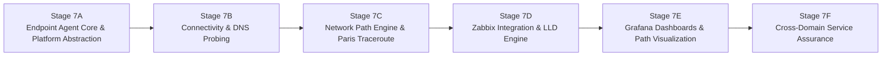

# Nawari Phase 7 Implementation Roadmap

**Document Version:** 1.0.0  
**Status:** Architectural Baseline for Review  
**Date:** 2026-11-07  
**Scope:** Staged Execution Plan for Endpoint-to-Service Network Observability

---

## 1. Roadmap Overview & Phased Methodology

Phase 7 is decomposed into six self-contained, testable stages (**7A through 7F**). Each stage has explicit architectural boundaries, isolated unit/integration test suites, and strict acceptance gates. 

In accordance with project guidelines, development proceeds strictly through local containerized testing, mock network topologies, and controlled local probes before any physical enterprise deployment is scheduled.

---

## 2. Stage Breakdown & Deliverables

### Stage 7A: Endpoint Agent Architecture & Core Platform Abstraction
- **Objective:** Establish the modular, cross-platform endpoint probe framework with zero-privilege execution and local network diagnostics.
- **Scope & Components:**
  - Package `services/endpoint/`:
    - `core/`: Agent runner, thread pool scheduler, circuit breaker, local disk spooler (SQLite/JSONL with exponential backoff).
    - `platform/`: OS abstraction layer:
      - `windows.py`: IP Helper (`Iphlpapi.dll`), Native Wifi API, PowerShell/WMI fallback.
      - `linux.py`: `iproute2`, `net.ipv4.ping_group_range`, `/sys/class/net`, `resolv.conf`.
      - `darwin.py`: `scutil`, `sysctl`, `netstat` (for local development/testing).
    - `collectors/local_network.py`: Gateway reachability, ICMP RTT/loss, NIC status, local IP/CIDR, DNS config, Wi-Fi RSSI/quality.
- **Acceptance Gate 7A:**
  - Automated tests verify non-admin execution across Linux and macOS.
  - Gateway discovery correctly locates local default route.
  - Offline spooling and replay ordering verified under simulated network cuts.

---

### Stage 7B: Network Connectivity & DNS Probing
- **Objective:** Implement application-layer and transport-layer service reachability tests.
- **Scope & Components:**
  - `probes/dns.py`: Resolver latency, query types (A, AAAA, SRV), failure classification (`NXDOMAIN`, `SERVFAIL`, `TIMEOUT`).
  - `probes/tcp.py`: Non-blocking 3-way handshake measurement (`connect()` duration) to SIP TLS (5061) and HTTPS (443).
  - `probes/tls.py`: TLS handshake timing, certificate expiry, cipher suite negotiation.
  - `probes/http.py`: HTTP status code verification, Time-To-First-Byte (TTFB), total transaction duration.
- **Acceptance Gate 7B:**
  - Verification against local `nawari-asterisk` (SIP 5060/5061) and `nawari-zabbix-web` (HTTP 8080).
  - Accurate distinction between DNS timeout, TCP connection refused, and HTTP 5xx error.

---

### Stage 7C: Network Path Monitoring & Paris Traceroute
- **Objective:** Build the directional hop-by-hop path tracing engine with flow-hashing and anomaly detection.
- **Scope & Components:**
  - `path/traceroute.py`: Paris traceroute engine (constant 5-tuple flow hash) supporting ICMP, UDP, and TCP SYN probing.
  - `path/hop_analyzer.py`:
    - Differentiating Control Plane Policing (CoPP) rate-limiting (`TIMEOUT_COPP`) from true path loss.
    - True loss onset hop identification ($Loss(k) > 0 \land Loss(\text{Dest}) > 0$).
    - Latency jump detection ($\Delta RTT_k > 40\text{ ms}$).
    - Path hashing and route change detection.
    - RFC 4950 MPLS label extraction parser.
- **Acceptance Gate 7C:**
  - Unit tests verifying multi-hop path analysis against synthetic topology with simulated CoPP rate-limiting and link congestion.
  - Verification that intermediate `* * *` does not trigger false-positive path failure alarms.

---

### Stage 7D: Zabbix Integration & Low-Level Discovery (LLD)
- **Objective:** Ingest endpoint and path telemetry into Zabbix 7.4 via a trusted gateway and trapper-based LLD.
- **Scope & Components:**
  - `services/gateway/`: Lightweight FastAPI/asyncio Ingestion Gateway terminating HTTPS/mTLS, validating agent authentication, enforcing schema invariants, stamping authoritative provenance (`MOCK_SIMULATED` vs `PHYSICAL_PRODUCTION`), and relaying batches to Zabbix Trapper.
  - Template `provisioning/zabbix/templates/nawari_endpoint_probe.yaml`:
    - Static endpoint items (Gateway RTT/loss, DNS latency, Wi-Fi RSSI).
    - Trapper-based LLD Rule: `nawari.endpoint.path.discovery[{#TARGET}]`.
    - Item Prototypes: `nawari.path.hop.rtt`, `nawari.path.hop.loss`, `nawari.path.hop.status`, `nawari.path.hop.ip`.
    - Triggers: Gateway loss > 5%, Path loss > 2%, Route changed, 15m staleness `nodata()`.
- **Acceptance Gate 7D:**
  - Synchronize template into live Zabbix Server 7.4 via `services.api.cli apply`.
  - Validate LLD dynamic item creation: sending a 5-hop path discovery automatically instantiates 20 dynamic hop items in PostgreSQL within 10 seconds.

---

### Stage 7E: Grafana Visualization & Path Dashboards
- **Objective:** Deliver intuitive, ThousandEyes-style dashboards for endpoint health and network path exploration.
- **Scope & Components:**
  - Dashboard `docker/grafana/dashboards/endpoint_network_experience.json`:
    - Endpoint inventory, online status, Wi-Fi link quality distribution.
    - Gateway RTT and loss trends, DNS resolution latency, TCP handshake times.
  - Dashboard `docker/grafana/dashboards/network_path_analysis.json`:
    - Hop-by-hop latency and loss matrix.
    - Visual timeline of intermediate hops (identifying responsive vs CoPP hops).
    - Route change history and ASN distribution.
    - Clear `SIMULATED / MOCK` vs `PHYSICAL PRODUCTION` provenance badges and `"noValue": "STALE / NO DATA"` guards.
- **Acceptance Gate 7E:**
  - Dashboard loads cleanly via Grafana API with zero panel errors.
  - Path matrix dynamically renders all LLD-discovered hops.

---

### Stage 7F: Cross-Domain Service Assurance Integration
- **Objective:** Correlate endpoint experience and path anomalies with Avaya SBCE infrastructure, SIP signaling, and voice RTP media quality.
- **Scope & Components:**
  - Extend `services/assurance/correlator.py`:
    - Ingest endpoint gateway/path problems alongside SBCE SNMP alarms, Asterisk synthetic call results, and RTCP jitter.
    - Enforce the 9-tier root cause hierarchy:
      1. `ENDPOINT_LOCAL` (High CPU, bad Wi-Fi RSSI)
      2. `LOCAL_LAN_GATEWAY` (Gateway RTT spike or loss)
      3. `TRANSIT_WAN_PATH` (Hop $K$ packet loss or latency jump)
      4. `DNS_INFRASTRUCTURE` (DNS resolution timeout/SERVFAIL)
      5. `SBCE_INFRASTRUCTURE` (SBCE CPU/Memory/Interface discard)
      6. `SIP_SIGNALING` (503 Service Unavailable, registration timeout)
      7. `RTP_MEDIA_IMPAIRMENT` (One-way audio, RTCP jitter, low MOS)
    - Apply strict hypothesis calibration (`CONFIRMED` vs `PROBABLE` vs `SUSPECTED`).
- **Acceptance Gate 7F:**
  - 3 comprehensive incident correlation scenarios tested:
    - Scenario 1: Wi-Fi degradation causing call jitter (Root cause: `PROBABLE Local Wi-Fi RSSI`).
    - Scenario 2: Intermediate WAN hop loss causing RTP packet drops (Root cause: `PROBABLE WAN Transit Hop 4`).
    - Scenario 3: SBCE interface discard causing SIP registration timeout (Root cause: `PROBABLE SBCE Appliance Ingress Discards`).
  - End-to-end verification script `scripts/verify_phase7.sh` passing all gates.

---

## 3. Timeline & Resource Allocation

| Stage | Estimated Effort | Core Deliverables | Testing Gate |
|---|---|---|---|
| **7A** | 2 Days | Agent Core, OS Abstraction, LocalNet Collector, Spooler | 12 Unit Tests, Spooling Integration |
| **7B** | 1.5 Days | DNS, TCP, TLS, HTTP Probing Engines | 15 Probe Tests vs Local Containers |
| **7C** | 2.5 Days | Paris Traceroute, Hop Analyzer, CoPP Filter | 18 Path Analysis Tests, Route Churn |
| **7D** | 2 Days | Ingestion Gateway, Zabbix LLD Template, Reconciler | Zabbix Dynamic Hop Discovery Test |
| **7E** | 1.5 Days | Grafana Endpoint & Path Dashboards | Grafana API Import & Panel Checks |
| **7F** | 2.5 Days | Cross-Domain Assurance Correlator, Scenario Verifications | 10-Gate End-to-End Acceptance Script |
| **Total**| **12 Working Days** | Complete Phase 7 Delivery | **Full Automated Verification** |
