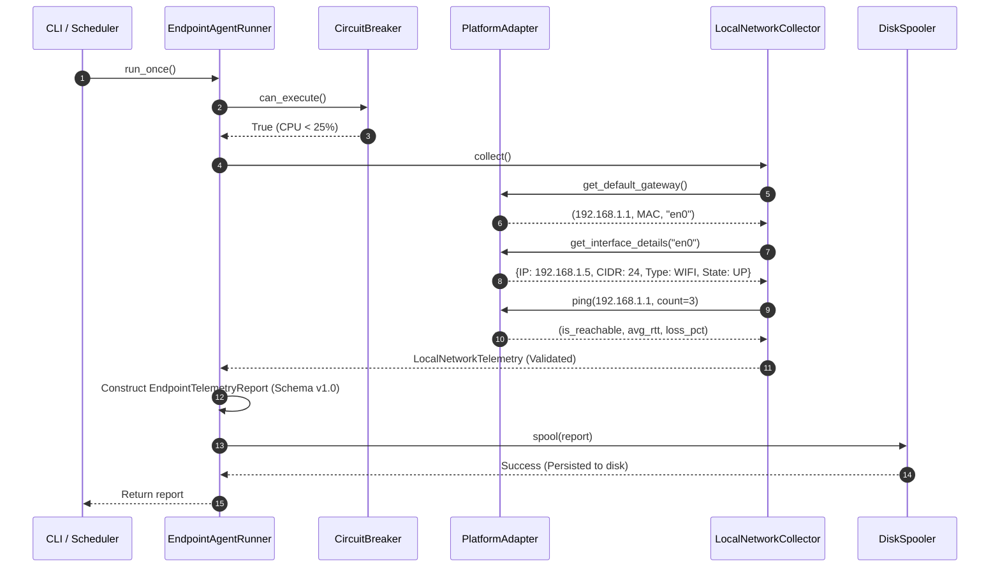

# Nawari Stage 7A: Endpoint Agent Architecture & Design

**Document Version:** 1.0.0  
**Status:** Implemented & Verified Baseline  
**Date:** 2026-11-07  
**Scope:** Endpoint Agent Core, OS Abstraction, Identity Lifecycle, and Probe Scheduler

---

## 1. Architectural Overview & Component Structure

Stage 7A establishes the core foundational runtime for the Nawari Endpoint Agent as a modular, lightweight Python package located at `services/endpoint/`. The agent acts as an autonomous outbound diagnostic sensor, executing non-privileged diagnostics against local network interfaces, default gateways, and configured service endpoints.

```
services/endpoint/
├── __init__.py                # Package exports and public interface
├── cli.py                     # Command-line entry point (run, run-once, info, health, re-register)
├── config.py                  # Typed configuration, bounds checking, and Zero-RCE target policy
├── models.py                  # Canonical telemetry models (nawari.endpoint.telemetry.v1)
├── runner.py                  # Runtime coordinator and probe orchestrator
├── os_platform/               # Platform abstraction layer
│   ├── __init__.py            # Dynamic platform detector & factory
│   ├── base.py                # Abstract PlatformAdapter & PlatformCapabilities
│   ├── darwin.py              # macOS implementation (route, ifconfig, scutil, airport)
│   ├── linux.py               # Linux implementation (procfs, sysfs, iproute2)
│   └── windows.py             # Windows implementation (Win32 IP Helper, netsh wlan)
├── core/                      # Core agent runtime services
│   ├── circuit_breaker.py     # CPU, memory, and cooldown protection
│   ├── identity.py            # Persistent UUIDv4 identity & corruption recovery
│   ├── lifecycle.py           # State management, health telemetry, and signal traps
│   ├── logger.py              # Structured logging with credential sanitization & UUID masking
│   ├── scheduler.py           # Asyncio scheduler with jitter, duplicate guards & backoff
│   └── spooler.py             # Bounded offline local disk spooler (0600 permissions)
└── collectors/
    └── local_network.py       # Default gateway, NIC state, and Wi-Fi performance collector
```

---

## 2. Core Architectural Decisions Implemented

### A. Dedicated OS Platform Abstraction (`services/endpoint/os_platform/`)
- Platform-specific operations are strictly isolated from the core agent engine.
- Every platform adapter explicitly declares its supported capabilities through `PlatformCapabilities`.
- Unsupported capabilities are reported explicitly (`supports_raw_icmp=False`, `requires_elevation_for=["raw_sockets"]`) rather than fabricating measurements or raising unhandled exceptions.
- Renamed from `platform/` to `os_platform/` to eliminate standard library namespace shadowing.

### B. Persistent Endpoint Identity (`services/endpoint/core/identity.py`)
- The agent **never** relies on MAC address, IP address, or hostname as primary identity.
- On initial startup, the agent generates a persistent, random UUIDv4 and commits it atomically to a local JSON state file (`~/.nawari/agent_identity.json`) using a temporary file rename pattern (`os.fsync` + `replace`) with `0600` file permissions.
- **Restart Persistence:** The identity survives application and host restarts.
- **Corruption Resilience:** If the identity file is truncated or corrupted, the agent detects the invalid state, backs up the corrupted file to `.corrupt.<timestamp>`, and safely generates a fresh identity with `re_registration_count=1`.
- **Masking:** Sensitive identifiers are masked in all standard logs (`mask_agent_id`, e.g. `e4b3****-****-****-****-****9abc`).

### C. Resource-Conscious Probe Scheduler (`services/endpoint/core/scheduler.py`)
- **Zero Concurrent Duplicate Execution:** If a probe cycle runs longer than its scheduled interval (e.g. DNS timeout on slow Wi-Fi), the scheduler skips the concurrent trigger, records `skipped_duplicates`, and logs a warning.
- **Randomized Startup Jitter:** Each registered probe task calculates an independent startup delay (0 to $T_{\text{jitter}}$) to prevent fleet-wide thundering herd synchronization.
- **Per-Probe Timeouts:** Every probe has an independent hard timeout (default: 2.0s to 5.0s), preventing hung network sockets from stalling the scheduler loop.
- **Exponential Failure Backoff:** Repeated target timeouts trigger backoff up to `max_backoff_seconds` (300s), preventing the agent from flooding degraded enterprise networks.
- **Clean Cancellation:** Responds immediately to `SIGTERM` / `SIGINT` signals, canceling pending tasks and releasing concurrency semaphores.

### D. Bounded Local Disk Spooler (`services/endpoint/core/spooler.py`)
- Telemetry records are spooled to local disk in append-only JSONL format with `0600` file permissions.
- **Capacity Limits:** Strictly bounded to `max_spool_records` (default: 1,000 records). When the threshold is reached, the oldest 20% of records are purged (FIFO) to prevent user disk saturation.
- **Corruption Recovery:** If a line is corrupted, the spool reader skips the malformed record and proceeds with remaining valid records.

---

## 3. Data Flow: Single Diagnostic Cycle


