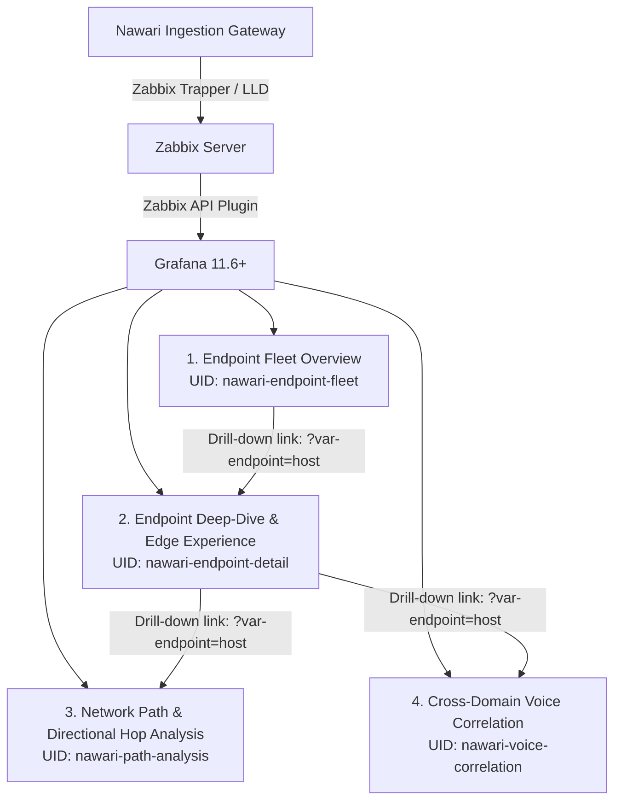

# Nawari Stage 7E: Grafana Endpoint and Network Experience Dashboards Specification

## 1. Executive Summary

Stage 7E completes the operational visualization layer for Nawari's Endpoint-to-Service Network Observability engine. It provides four production-grade Grafana dashboards built natively for Grafana 11.6+ and the Alexander Zobnin Zabbix App datasource plugin (`PA67C5EADE9207728`), enabling aviation network engineers, operations staff, and NOC teams to monitor edge device health, isolate network bottlenecks, and correlate edge impairments against voice services.

All dashboards are provisioned declaratively via Docker and loaded automatically into Grafana under the `Nawari` folder.

---

## 2. Dashboard Portfolio

### Dashboard 1: Endpoint Fleet Observability Overview (`nawari-endpoint-fleet`)
- **File:** `docker/grafana/dashboards/endpoint_fleet_overview.json`
- **Objective:** Macro fleet inventory, edge health, and degradation ranking across all enrolled workstations, check-in kiosks, and operations terminals.
- **Key Panels:**
  1. **Fleet Health KPIs:** Total Enrolled Endpoints, Active Reporting Endpoints, Degraded Edge Endpoints (loss > 0% or RTT > 50ms), and Stale Endpoints (>15m no telemetry heartbeat).
  2. **Composition & Provenance Distribution:** Donut charts for Active Primary Interface Type (Ethernet vs Wi-Fi vs VPN vs Other) and Telemetric Provenance (`MOCK_SIMULATED` vs `PHYSICAL_PRODUCTION`).
  3. **Fleet Edge Network Performance:** Aggregated timeseries for Fleet Default Gateway Latency and Packet Loss across all devices.
  4. **Probed Core Services Reachability Matrix:** Voice Gateway (5061/tcp) reachability, DNS query resolution latency, and corporate HTTP services TTFB.
  5. **Fleet Inventory & Status Table:** Interactive inventory table with contextual data links enabling one-click drill-down to individual endpoint details (`/d/nawari-endpoint-detail?var-endpoint=${__data.fields.host}`).
  6. **Active Endpoint Incidents Feed:** Embedded Zabbix Problems panel displaying active edge alarms (high loss, latency spikes, or stale agent heartbeat).

---

### Dashboard 2: Endpoint Deep-Dive & Edge Experience (`nawari-endpoint-detail`)
- **File:** `docker/grafana/dashboards/endpoint_detail.json`
- **Objective:** Granular, single-endpoint diagnostic view displaying physical link parameters, local network performance, and multi-protocol service timings.
- **Variables:** `$group` (Host Group filter), `$endpoint` (Endpoint Host filter).
- **Key Panels:**
  1. **Endpoint Metadata Card:** Host identity, agent version, operating system, and hardware architecture from `endpoint.info`.
  2. **Active Interface & Provenance:** Color-coded status badges for wired/wireless connectivity and environment authenticity.
  3. **First-Hop Gateway Quality:** Sub-second timeseries tracking default gateway round-trip time and packet loss percentage.
  4. **Physical Wi-Fi Health (Isolated):** Gauges and history for Wi-Fi RSSI (`dBm`) and Signal Quality (`%`). **Invariant:** strictly presents `"N/A (WIRED/VPN)"` when the active interface is Ethernet or VPN.
  5. **Edge DNS Diagnostics:** Resolution time timeseries by target hostname and DNS RCODE status mapping (`NOERROR`, `NXDOMAIN`, `SERVFAIL`, `TIMEOUT`, `REFUSED`).
  6. **Multi-Protocol Service Connectivity:** Layer-4/Layer-7 decomposed timing cards showing TCP 3-way handshake time, TLS session negotiation time, and HTTP TTFB.
  7. **Cross-Domain Navigation:** Contextual markdown action cards linking directly to network path analysis and voice service correlation for the selected endpoint.

---

### Dashboard 3: Network Path & Directional Hop Analysis (`nawari-path-analysis`)
- **File:** `docker/grafana/dashboards/network_path_analysis.json`
- **Objective:** Hop-by-hop network path visualization, Paris traceroute flow tracing, and route divergence detection from the edge to critical enterprise services.
- **Variables:** `$group`, `$endpoint`, `$target` (probed destination, e.g. `avaya-sbce`, `core-voice-gw`).
- **Key Panels:**
  1. **Path E2E Performance:** End-to-end path latency, packet loss percentage, total traversed hops, and route divergence index.
  2. **Control Plane Policing (CoPP) Guard Notice:** Prominent architectural callout explaining why intermediate rate-limiting routers displaying `*` or timeout status are **non-impairing** if downstream hops or the destination are healthy.
  3. **Discovered Hop Matrix Table:** Tabular listing of each hop: Hop Index, Router IP address, Average RTT, Packet Loss %, and Hop Status (`RESPONSIVE`, `COPP_RATE_LIMITED`, `UNREACHABLE`, `ANONYMOUS_MPLS`).
  4. **Hop Latency Waterfall Timeseries:** Progressive latency build-up timeseries across TTL hops, instantly pinpointing where latency jumps ($>40\text{ ms}$) occur along the route.
  5. **Route Divergence History:** State timeline tracking path signature SHA-256 transitions and ECMP route changes over time.

---

### Dashboard 4: Cross-Domain Voice & Endpoint Telemetry Correlation (`nawari-voice-correlation`)
- **File:** `docker/grafana/dashboards/endpoint_voice_correlation.json`
- **Objective:** Unified correlation between physical edge conditions, transport reachability, and synthetic Asterisk call quality.
- **Variables:** `$group`, `$endpoint`.
- **Key Panels:**
  1. **Architectural Domain Boundary Notice:** Mandatory callout explaining that TCP/TLS reachability on port 5061 **does not** verify SIP registration, authentication, SDP negotiation, or bi-directional RTP media flow.
  2. **Service Assurance Status Row:** Asterisk synthetic call outcome (`ANSWERED`, `BUSY`, `CONGESTION`, `TIMEOUT`, `FAILED`), ITU-T G.107 MOS score, SBCE port 5061 socket status, and local gateway loss.
  3. **Dual-Axis Correlation Timeseries:** Endpoint Default Gateway Latency (ms) plotted against Asterisk Synthetic Call MOS Score (1.0 - 4.5).
  4. **Cross-Domain Packet Loss Localization:** Multi-stream timeseries comparing:
     - Endpoint Gateway Loss (%)
     - Path Network Loss (%)
     - Voice RTCP Packet Loss (%)
     Instantly reveals whether audio degradation originated at the user's Wi-Fi link, the transit WAN, or the enterprise core PBX.
  5. **Jitter & Physical Layer Media Impact:** Correlates Wi-Fi link quality fluctuations against RTCP audio buffer jitter (ms).
  6. **SBCE Operational Context:** Correlates Avaya SBCE active call counts and appliance load against observed endpoint voice experience.

---

## 3. Reliability & Operational Invariants

1. **No-Data Staleness Guards:**
   Every metrics panel enforces `"noValue": "STALE / NO DATA"` (or `"N/A (WIRED/VPN)"` for non-Wi-Fi interfaces). Panels never display `0` or false green indicators when telemetry is missing or stale.
2. **CoPP Non-Impairment Invariant:**
   Routers rate-limiting ICMP TTL exceeded packets are designated as `COPP_RATE_LIMITED` (status code 1) and their RTT is omitted. The UI explicitly instructs operators not to open circuit trouble tickets for benign CoPP behavior.
3. **Transport vs Media Invariant:**
   TCP port 5061 connectivity is labeled as *Perimeter Socket Established* and never conflated with *Voice Service Available*.
4. **Data Link Navigation:**
   Fleet dashboards provide deep-linking into specific endpoint views with URL parameter propagation (`var-endpoint`).

