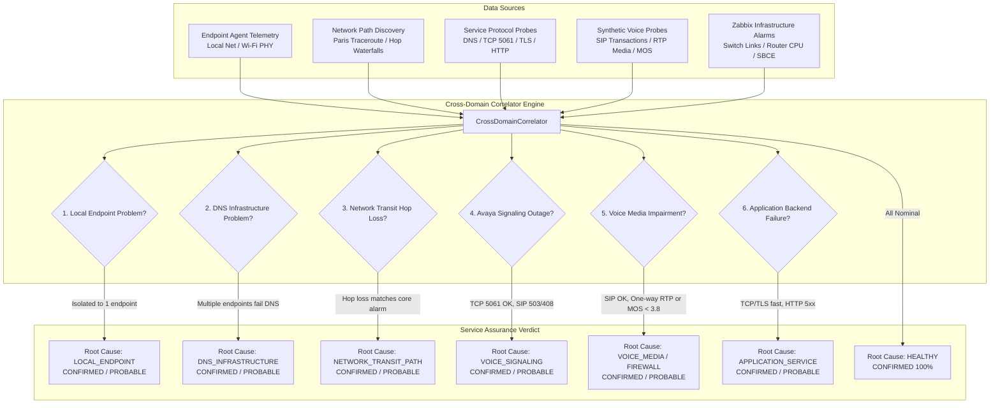

# Nawari Stage 7F: Cross-Domain Service Assurance & Automated Root-Cause Hierarchy Specification

## 1. Executive Summary

Stage 7F establishes the automated service assurance and cross-domain root-cause correlation engine of the Nawari platform. It synthesizes telemetric observations across five independent operational domains:
1. **Endpoint Edge Telemetry:** First-hop default gateway latency/loss, active interface types, and physical Wi-Fi PHY metrics (RSSI, signal quality).
2. **Network Path Topology:** Paris traceroute hop-by-hop latency waterfalls, loss onset detection, route divergence index, and CoPP rate-limiting guards.
3. **Core Services Reachability:** Decomposed L4/L7 protocol measurements including DNS query resolution, TCP 3-way handshakes, TLS session negotiation, and HTTP TTFB.
4. **Voice Signaling & Media Telemetry:** Synthetic Asterisk call transactions, SIP response codes, bidirectional RTP flow verification, RTCP packet loss/jitter, and ITU-T G.107 MOS scores.
5. **Infrastructure Monitoring Alarms:** Zabbix active problem states across enterprise switches, routers, and Avaya SBCE appliances.

Stage 7F rigorously calibrates diagnostic conclusions into a formal confidence hierarchy (`CONFIRMED` vs `PROBABLE` vs `SUSPECTED`), preventing speculative root-cause attribution and providing actionable remediation runbooks to NOC operators.

---

## 2. Cross-Domain Assurance Hierarchy

---

## 3. Six Evaluated Failure Scenarios

### Scenario 1: Local Endpoint Problem
- **Signature:** Isolated gateway latency (>50ms) or packet loss (>20%) or Wi-Fi signal quality (<40%) on a single workstation or kiosk, while peer endpoints on adjacent subnets report healthy gateway metrics.
- **Root Cause Domain:** `RootCauseDomain.LOCAL_ENDPOINT`.
- **Calibration:** `CONFIRMED` if physical Wi-Fi signal quality < 30% or peer comparison proves isolation; otherwise `PROBABLE`.
- **Actionable Remediation:** Inspect AP coverage, verify patch cord integrity, audit workstation NIC power-saving settings.

### Scenario 2: DNS Infrastructure Problem
- **Signature:** Multiple endpoints encounter DNS resolution failures (`NXDOMAIN`, `SERVFAIL`, `TIMEOUT`, `REFUSED`) or resolution latency > 500ms, while direct IP transport and default gateways are reachable.
- **Root Cause Domain:** `RootCauseDomain.DNS_INFRASTRUCTURE`.
- **Calibration:** `CONFIRMED` if explicit DNS RCODE (e.g. `SERVFAIL`, `NXDOMAIN`, `REFUSED`) returned from resolver; otherwise `PROBABLE`.
- **Actionable Remediation:** Verify recursive resolver daemons (named/CoreDNS), check upstream forwarders, inspect firewall UDP/TCP 53 inspection rules.

### Scenario 3: Network Infrastructure Problem (Transit Hop Degradation)
- **Signature:** Hop-by-hop Paris traceroute detects transit hop packet loss ($\ge 20\%$) or latency jumps ($> 40\text{ ms}$) coinciding with active Zabbix router/switch interface alarms.
- **Invariant:** Intermediate routers with `TIMEOUT_COPP` are excluded from loss calculations.
- **Root Cause Domain:** `RootCauseDomain.NETWORK_TRANSIT_PATH`.
- **Calibration:** `CONFIRMED` if hop loss coincides with active Zabbix interface problem; otherwise `PROBABLE`.
- **Actionable Remediation:** Inspect optical light levels (SFP DDM), audit WAN queue drops, escalate to transit ISP with hop IP.

### Scenario 4: Avaya Signaling Problem
- **Signature:** Perimeter transport to Avaya SBCE port 5061 (TCP 3-way handshake) succeeds cleanly, but synthetic voice call fails (SIP 503 Service Unavailable, 500 Server Error, or 408 Timeout).
- **Root Cause Domain:** `RootCauseDomain.VOICE_SIGNALING`.
- **Calibration:** `CONFIRMED` when explicit SIP error code is returned while L4 TCP port 5061 is reachable; otherwise `PROBABLE`.
- **Actionable Remediation:** Check Avaya Session Manager and Communication Manager service states, verify SIP digest authentication and TLS certificates.

### Scenario 5: Voice Media Problem
- **Signature:** SIP signaling handshake establishes cleanly (SIP 200 OK / `ANSWERED`), but RTP audio verification detects one-way audio (`TRANSMIT_ONLY` / `RECEIVE_ONLY`) or RTCP packet loss > 5% / jitter > 30ms causing MOS < 3.8.
- **Root Cause Domain:** `RootCauseDomain.FIREWALL_NAT_ASYMMETRY` (for one-way audio) or `RootCauseDomain.VOICE_MEDIA` (for QoS/jitter).
- **Calibration:** `PROBABLE` or `CONFIRMED`.
- **Actionable Remediation:** Audit firewall stateful UDP timeouts for RTP port ranges (10000-20000), verify symmetric RTP on SBCE, audit DSCP EF 46 markings.

### Scenario 6: Application Service Problem
- **Signature:** DNS lookup, TCP 3-way handshake, and TLS session negotiation all succeed quickly ($< 100\text{ ms}$), but application returns HTTP 5xx status codes (500, 502, 503) or severe TTFB latency ($> 1000\text{ ms}$).
- **Root Cause Domain:** `RootCauseDomain.APPLICATION_SERVICE`.
- **Calibration:** `CONFIRMED` if HTTP 5xx status code returned; otherwise `PROBABLE`.
- **Actionable Remediation:** Inspect application backend server logs, verify database connection pool limits, check reverse proxy upstream health checks.

---

## 4. Confidence Calibration Standards

| Status | Definition & Evidentiary Standard |
| :--- | :--- |
| `CONFIRMED` | Direct deterministic causal proof observed (e.g. server-returned protocol error code, explicit 0-byte packet capture, or telemetry matching active infrastructure alarm). |
| `PROBABLE` | Multiple independent, corroborating observations support the diagnosis without a direct deterministic proof trace. |
| `SUSPECTED` | Anomaly observed, but evidence is circumstantial, single-source, or limited by incomplete telemetry. |
| `HEALTHY` | All measured indicators across all domains are within defined SLA boundaries. |
| `INCONCLUSIVE` | Conflicting or insufficient data to isolate the root cause. |

