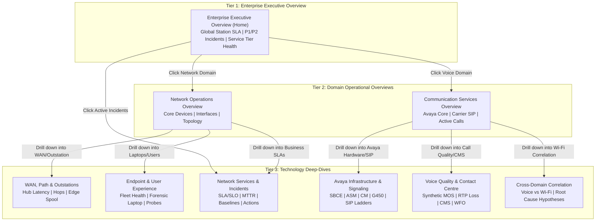

# Nawari Progressive Drill-Down Navigation Architecture

**Architecture Standard:** 4-Tier Progressive Observability Model
**Principle:** **One Operational Entry Point → Domain Overview → Technology Deep-Dive → Component Diagnostics**

---

## 1. The 4-Tier Progressive Drill-Down Model



---

## 2. Granular Drill-Down Navigation Pathways & Parameters

### Pathway 1: Executive → Network Domain → Outstation / WAN Hop
1. **Starting Point:** `Enterprise Executive Overview` (`nawari-enterprise-overview`)
   - Operator observes degraded station in *Regional Health Trends* (e.g. Mombasa MBA or London LHR).
2. **Step 1 Drill-Down:** Click data link on the station metric → Opens `WAN, Path & Outstation Observability` (`nawari-wan-path-outstation`).
   - *Parameters Passed:* `var-site=MBA`, `from=now-1h`, `to=now`.
3. **Step 2 Drill-Down:** Operator identifies high packet loss on Hop 4 of the directional path.
   - *Parameters Passed:* `var-endpoint=MBA-GW-01`, `var-target=HQ-DC-GW-01`.

### Pathway 2: Executive → Network Domain → Interface Port Congestion
1. **Starting Point:** `Network Operations Overview` (`nawari-network-operations`)
   - Operator notices high link utilization in the *Core Infrastructure Devices* summary table.
2. **Step 1 Drill-Down:** Click on the device name (e.g. `core-gw-01`).
   - *Action:* Automatically un-collapses the *Interface Health & Link Traffic* row.
   - *Parameters Passed:* `var-group=Core Network`, `var-host=core-gw-01`, `var-interface=All`.
3. **Step 2 Forensic Action:** Filter to affected uplink (e.g. `GigabitEthernet0/0/1`) to inspect 64-bit discards, CRC errors, and throughput.

### Pathway 3: Executive → Communication Domain → Avaya Appliance Failure
1. **Starting Point:** `Communication Services Overview` (`nawari-comm-overview`)
   - Operator notices Avaya Session Manager (ASM) signaling entity in *Degraded* state.
2. **Step 1 Drill-Down:** Click on the ASM status gauge → Opens `Avaya Infrastructure & Signaling` (`nawari-avaya-infrastructure`).
   - *Parameters Passed:* Preserves time range, navigates directly to the *Session Manager - ASM* row.
3. **Step 2 Forensic Action:** Inspect SIP transaction rate drop, JVM heap memory, and entity link latencies.

### Pathway 4: End-User Complaint → Endpoint Fleet → Single Laptop Forensic
1. **Starting Point:** `Endpoint & User Experience` (`nawari-endpoint-experience`)
   - Operator reviews the *Top Degraded Endpoints* table and spots `Jimmy_Laptop` reporting 20% gateway loss.
2. **Step 1 Drill-Down:** Click on `Jimmy_Laptop` in the table.
   - *Parameters Passed:* `var-endpoint=Jimmy_Laptop`, `from=now-1h`, `to=now`.
3. **Step 2 Forensic Action:** The *Forensic Endpoint Investigation* row displays Jimmy's Wi-Fi RSSI (88%), gateway RTT (5.2ms), corporate DNS status, and recent Windows EventLog 1074 lifecycle events.

### Pathway 5: Poor Call Audio → Voice Quality → Cross-Domain Root Cause
1. **Starting Point:** `Voice Quality & Contact Centre` (`nawari-voice-contact-centre`)
   - Operator notices synthetic MOS dropping below 3.5 in the *Voice Intelligence & Synthetic Testing* row.
2. **Step 1 Drill-Down:** Click *Correlate with Network Telemetry* link → Opens `Cross-Domain Correlation & Operations` (`nawari-voice-correlation`).
3. **Step 2 Root-Cause Identification:** Side-by-side time series reveals that jitter spiked at the exact minute the local access point experienced RF packet retransmissions, exonerating carrier SIP trunks.

---

## 3. Top-Level Header Navigation Matrix

Every consolidated dashboard includes standard header navigation pills at the top right of the viewport:

| Navigation Link | Target Dashboard UID | Purpose |
|---|---|---|
| **Home (Executive)** | `nawari-enterprise-overview` | Return to global Tier 1 executive dashboard |
| **Network Ops** | `nawari-network-operations` | Jump to Tier 2 Network Operations Overview |
| **WAN & Outstations** | `nawari-wan-path-outstation` | Jump to WAN and outstation latency telemetry |
| **Endpoints & Users** | `nawari-endpoint-experience` | Jump to laptop fleet and user experience monitoring |
| **Services & SLA** | `nawari-network-services-assurance` | Jump to business services, SLOs, and incidents |
| **Voice Overview** | `nawari-comm-overview` | Jump to Tier 2 Communication Services Overview |
| **Avaya Infrastructure** | `nawari-avaya-infrastructure` | Jump to Avaya appliances and SIP trunk ladders |
| **Voice Quality & CC** | `nawari-voice-contact-centre` | Jump to synthetic MOS, CMS queues, and WFO recording |
| **Cross-Domain Correlation** | `nawari-voice-correlation` | Jump to cross-domain voice/network correlation |
| **Browse All** | `/dashboards` | Open Grafana folder browser |

---

## 4. Variable Inheritance and Context Preservation Standard

To ensure seamless investigations without losing context, all data links conform to the following schema:
```
/d/${__dashboard.uid}/${__dashboard.slug}?var-group=${__data.fields.group}&var-host=${__data.fields.host}&from=${__from}&to=${__to}
```
Key rules enforced:
1. **Time Range Preservation:** Always inherit `${__from}` and `${__to}`.
2. **Device Identity Passing:** When clicking a device row or stat card, pass `var-host=${__data.fields.host}`.
3. **Interface Identity Passing:** When clicking an interface row, pass `var-interface=${__data.fields.interface}`.
4. **Endpoint Identity Passing:** When clicking an endpoint row, pass `var-endpoint=${__data.fields.endpoint}`.