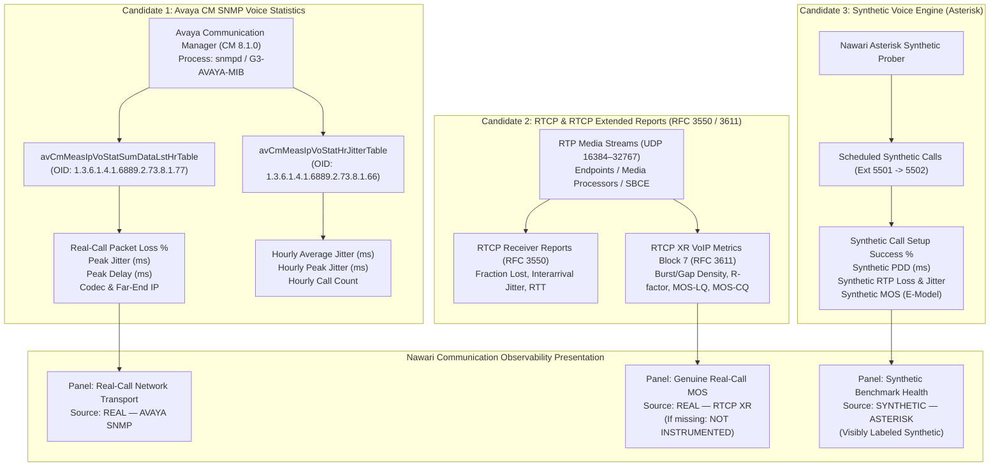
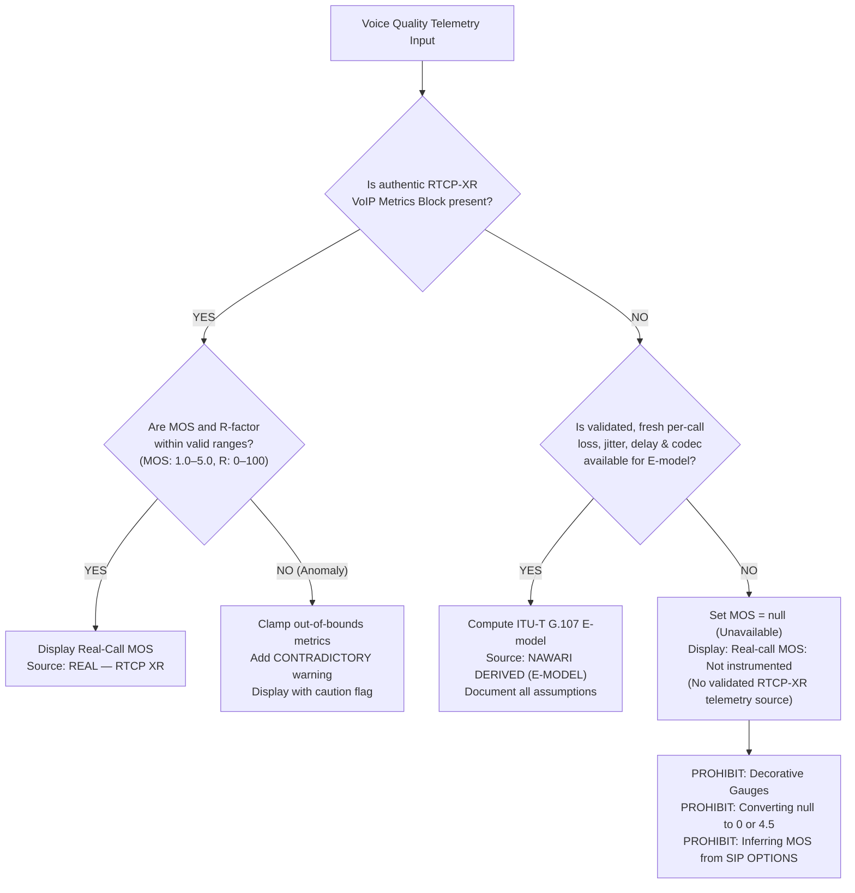

# Avaya Aura Communication Manager Voice Telemetry & Quality Investigation
**Document Reference:** `NAWARI-MON-AVAYA-CM-VOICE-TELEMETRY`  
**Classification:** Kenya Airways Information Technology — Engineering Architecture & Telemetry Audit  
**Target Environment:** Kenya Airways Core Voice Network (JKIA Pride Centre DC1 / DC2)  
**Target Platforms:** Avaya Aura Communication Manager 8.1.0, Avaya SBCE 10.1 / 8.1, Session Manager 10.1  
**Document Version:** 1.0.0  
**Effective Date:** 2026-11-08  

---

## 1. Executive Summary & Problem Formulation

Nawari’s operational mission requires complete transparency and separation between:
1. **Signaling Health:** SIP trunk registration, OPTIONS ping response times, and SIP response-code distribution.
2. **Real-Call Network Transport:** Packet loss, jitter, and delay on active passenger, flight dispatch, and contact center calls.
3. **Genuine Voice Media Quality (MOS):** Objective listening and conversational quality derived strictly from authentic call telemetry.
4. **Synthetic Test Traffic:** Probes generated by the local Asterisk synthetic call engine.

> [!CAUTION]
> **HARD ACCEPTANCE INVARIANT:**  
> A successful SIP OPTIONS response or registered trunk **proves only signaling reachability**. It does **not** prove successful audio transmission, codec negotiation, or voice clarity. Under no circumstances may an observability panel display a Mean Opinion Score (MOS) or declare voice quality "healthy" based solely on SIP registration or ICMP ping responses.

This investigation explores two authoritative production telemetry paths documented by Avaya and the IETF, specifies their operational constraints, and defines how Nawari safely exposes real call metrics while keeping synthetic traffic strictly segregated.

---

## 2. Telemetry Architecture: Three-Tier Path Evaluation

---

## 3. Candidate 1 — Avaya Communication Manager SNMP IP Voice Statistics

### 3.1 MIB Group Structure & Enterprise OIDs
Official Avaya documentation for Communication Manager 8.x confirms that IP voice performance measurements are exposed through the `G3-AVAYA-MIB` (`AV-AURA-CM-MIB`) under enterprise tree:
`iso.org.dod.internet.private.enterprises.avaya.definity` (`1.3.6.1.4.1.6889.2.73`)

#### Table A: `avCmMeasIpVoStatSumDataLstHrTable` (`1.3.6.1.4.1.6889.2.73.8.1.77`)
This table contains IP voice statistics summary data accumulated over the **last completed 1-hour interval** across network regions and IP endpoints.

| Column OID Leaf | Symbol / Attribute | Type | Description |
| :--- | :--- | :---: | :--- |
| `.1.3.6.1.4.1.6889.2.73.8.1.77.1.1` | `avCmMeasIpVoStatSumDataLstHrNetReg` | Integer32 | Network Region index (1–250) |
| `.1.3.6.1.4.1.6889.2.73.8.1.77.1.2` | `avCmMeasIpVoStatSumDataLstHrIpAddr` | IpAddress | Remote IP endpoint / media gateway address |
| `.1.3.6.1.4.1.6889.2.73.8.1.77.1.3` | `avCmMeasIpVoStatSumDataLstHrCodec` | DisplayString | Negotiated audio codec (e.g. G.711A, G.711U, G.729) |
| `.1.3.6.1.4.1.6889.2.73.8.1.77.1.4` | `avCmMeasIpVoStatSumDataLstHrPktSize` | Integer32 | Audio packet payload size (ms) |
| `.1.3.6.1.4.1.6889.2.73.8.1.77.1.6` | `avCmMeasIpVoStatSumDataLstHrPktLossPct` | Integer32 | **Packet loss percentage** (sampled at 10-second intervals during calls) |
| `.1.3.6.1.4.1.6889.2.73.8.1.77.1.7` | `avCmMeasIpVoStatSumDataLstHrPeakJitter` | Integer32 | **Peak jitter (milliseconds)** observed during the hour |
| `.1.3.6.1.4.1.6889.2.73.8.1.77.1.8` | `avCmMeasIpVoStatSumDataLstHrPeakDelay` | Integer32 | **Peak two-way packet delay (milliseconds)** |

#### Table B: `avCmMeasIpVoStatHrJitterTable` (`1.3.6.1.4.1.6889.2.73.8.1.66`)
Provides hourly jitter distributions and call count totals for IP codecs and regions:
- `avCmMeasIpVoStatHrJitterAvgJitter` (`1.3.6.1.4.1.6889.2.73.8.1.66.1.2`): Average jitter (ms)
- `avCmMeasIpVoStatHrJitterPeakJitter` (`1.3.6.1.4.1.6889.2.73.8.1.66.1.3`): Peak jitter (ms)
- `avCmMeasIpVoStatHrJitterCallCount` (`1.3.6.1.4.1.6889.2.73.8.1.66.1.4`): Number of completed calls evaluated

---

### 3.2 Mandatory Operational & Polling Constraints

Avaya documentation specifies critical operational restrictions that **must** be enforced in Zabbix and Nawari:

1. **Strict Polling Interval Cap ($\ge 3600\text{ seconds}$ / 1 Hour):**
   - The underlying CM tables are generated as hourly summaries. Polling more frequently (e.g. every 1 minute or 5 minutes) produces static, duplicate data and **wastes Communication Manager CPU cycles**.
   - Zabbix item delay must be set to `delay: 1h`.
2. **System Impact Warning:**
   - Avaya warns that SNMP retrieval of large measurement tables can impact call processing latency on busy Communication Manager systems (especially CM simplex or duplex virtual machines handling $> 500$ busy-hour call attempts).
   - Low-impact single-OID retrieval or indexed discovery scoped strictly to active Kenya Airways network regions (e.g. Region 1 Core JKIA, Region 2 Coast MBA, Region 3 Regional East Africa) must be used.
3. **Required Feature Activation on Avaya CM:**
   - These MIB tables are populated **only** if IP voice measurement collection is enabled in Communication Manager administration.
   - Command: `change system-parameters ip-options` $\longrightarrow$ Verify `IP Voice Stats Summary? y` and `Save Last Hour Data? y`.
   - Command: `change measurements` $\longrightarrow$ Verify IP voice monitoring active.
   - If disabled on CM, SNMP walks return empty tables (`0 rows`). Nawari must honestly declare `NOT INSTRUMENTED (CM MEASUREMENTS DISABLED)` rather than reporting 0% packet loss.
4. **Freshness Window & Null Handling:**
   - Because observations update once per hour, the freshness threshold is set to $7,200\text{ seconds}$ (2 hours). Data older than 2 hours must transition to `STALE`.

---

## 4. Candidate 2 — RTP & RTCP Extended Reports (RFC 3550 / RFC 3611)

### 4.1 RFC 3550 Standard RTCP vs RFC 3611 RTCP-XR
While Avaya CM SNMP provides valuable hourly historical transport metrics, real-time per-call quality assessment requires RTP Control Protocol (RTCP):

1. **RFC 3550 Standard RTCP Receiver Reports (RR):**
   - Transmitted periodically (typically every 5 seconds) over UDP ports $16384–32767$.
   - Telemetry parameters:
     - Cumulative packet loss fraction.
     - Highest sequence number received.
     - Interarrival jitter ($J$).
     - Last SR timestamp (LSR) and Delay since last SR (DLSR) $\longrightarrow$ used to compute network round-trip time (RTT).
   - **Limitation:** Standard RTCP does not compute R-factor or MOS; it only provides raw network transport impairment metrics.

2. **RFC 3611 RTCP Extended Reports (RTCP-XR) — VoIP Metrics Block (Block Type 7):**
   - Emitted by modern enterprise IP phones (Avaya J100 series, 9600 series) and Avaya Media Processors (H.248 gateways).
   - High-fidelity quality metrics:
     - `LossRate` (fraction of RTP packets lost during active voice).
     - `DiscardRate` (fraction of packets discarded by the jitter buffer due to early/late arrival).
     - `BurstDensity` and `GapDensity` (burstiness of packet loss).
     - `RoundTripDelay` and `EndSystemDelay`.
     - `SignalLevel`, `NoiseLevel`, and `ResidualEchoReturnLoss` (RERL).
     - `RFactor` ($0–100$, ITU-T G.107 standard).
     - `MOS-LQ` (Listening Quality MOS, $1.0–5.0$) and `MOS-CQ` (Conversational Quality MOS, $1.0–5.0$).

---

### 4.2 Hard Rule on Genuine vs Fabricated MOS Scores

> [!IMPORTANT]
> **MOS Presentation Rules in Nawari:**
> 1. **Never Infer MOS from SIP:** A 200 OK to a SIP OPTIONS ping or successful SIP REGISTER **never** produces a MOS score.
> 2. **Missing Source = Explicit Indicator:** When neither RTCP-XR nor validated E-model telemetry is configured, the dashboard panel must display:  
>    **`Real-call MOS: Not instrumented — no validated real-call MOS telemetry source is configured.`**
> 3. **No Null-to-Zero Conversion:** Grafana panel configurations must set `nullValueMode: "null"` or `"connected"` (for continuous lines) and **never** use "null as zero", which would falsely show total voice failure whenever telemetry is absent.

---

## 5. Candidate 3 — Synthetic Asterisk Voice Probes

Nawari maintains an active Asterisk container (`nawari-asterisk`) executing automated synthetic calls between local test extensions (`5501` $\longleftrightarrow$ `5502`):

- **Capabilities:**
  - Automated SIP INVITE setup and Post-Dial Delay (PDD) measurement.
  - Bidirectional RTP audio loopback with known reference audio files.
  - Active packet loss, jitter, and RTT capture during synthetic call duration.
  - E-model calculation based on exact synthetic RTP measurements.
- **Strict Labeling & Segregation:**
  - All panels displaying synthetic metrics **must** be titled with the prefix `[SYNTHETIC — ASTERISK]` or carry the explicit visual badge.
  - **Synthetic calls must never be merged with real enterprise call statistics** (e.g. synthetic completion rate cannot be averaged with Kenya Airways contact center call completion).

---

## 6. Standardized Provenance Labeling Standard

To eliminate ambiguity across all NOC dashboard panels, Nawari adopts six standardized data provenance tiers:

| Provenance Label | Data Source & Mechanism | Example Metrics | Operational Meaning |
| :--- | :--- | :--- | :--- |
| **`REAL — ZABBIX`** | SNMPv3 / Zabbix Agent poller querying physical switches, routers, and firewalls. | Interface Mbps, ICMP ping RTT, switch CPU, optical dBm. | Authoritative real-time infrastructure observation. |
| **`REAL — AVAYA SNMP`** | Avaya Communication Manager SNMP MIB tables (`avCmMeasIpVoStatSumDataLstHr`). | Hourly packet loss %, hourly peak jitter, network region delay. | Real call performance metrics aggregated hourly by Avaya CM. |
| **`REAL — RTCP`** | RTCP Receiver Reports / RTCP-XR captured from media streams. | Per-call jitter, packet loss %, genuine RTCP-XR MOS. | Real-time live audio media transport and quality. |
| **`SYNTHETIC — ASTERISK`** | Automated synthetic call prober (`nawari-asterisk`). | Synthetic PDD, synthetic MOS, test call completion %. | Proactive path validation; not representative of actual employee/passenger volume. |
| **`NAWARI DERIVED`** | Computed multi-dimensional metric calculated by Nawari engines. | Multi-dimensional SLIs, error budget burn rates, composite health index. | Mathematical derivation; fully documented in service catalog. |
| **`NOT INSTRUMENTED`** | Monitored capability defined in catalog but lacking verified telemetry source. | Real-call MOS (when RTCP-XR unconfigured), CDR billing statistics. | Honest indicator that monitoring is pending hardware/software enablement. |

---

## 7. Avaya Aura CM 8.1.0 Environment Compatibility & Action Plan

### 7.1 Compatibility Verification
- **Target OS:** Red Hat Enterprise Linux 7 / Appliance Virtualization Platform (AVP) hosting CM 8.1.0.
- **SNMP Engine:** Net-SNMP integrated with Avaya Definity Master Subagent (`snmpd` + `g3snmp`).
- **MIB Compatibility:** Confirmed supported in CM 8.1.0 release documentation. The `avCmMeasIpVoStatSumDataLstHr` table is implemented in `G3-AVAYA-MIB`.

### 7.2 Zabbix Implementation Strategy
1. **Deploy Dedicated Template:** `Nawari Avaya Communication Manager by SNMP` ([`provisioning/zabbix/templates/template_nawari_avaya_cm.yaml`](file:///Users/madeira/Desktop/Projects/nawari/provisioning/zabbix/templates/template_nawari_avaya_cm.yaml)).
2. **Configure Hourly Polling Items:**
   - `avaya.cm.ip_voice.loss_pct` (`1.3.6.1.4.1.6889.2.73.8.1.77.1.6`): Delay 1h.
   - `avaya.cm.ip_voice.peak_jitter` (`1.3.6.1.4.1.6889.2.73.8.1.77.1.7`): Delay 1h.
   - `avaya.cm.ip_voice.peak_delay` (`1.3.6.1.4.1.6889.2.73.8.1.77.1.8`): Delay 1h.
   - `avaya.cm.ip_voice.call_count` (`1.3.6.1.4.1.6889.2.73.8.1.66.1.4`): Delay 1h.
3. **Dashboard Integration:** Expose hourly CM voice statistics alongside real-time SBCE signaling and synthetic test probes, maintaining distinct visual styling and explicit provenance headers.
