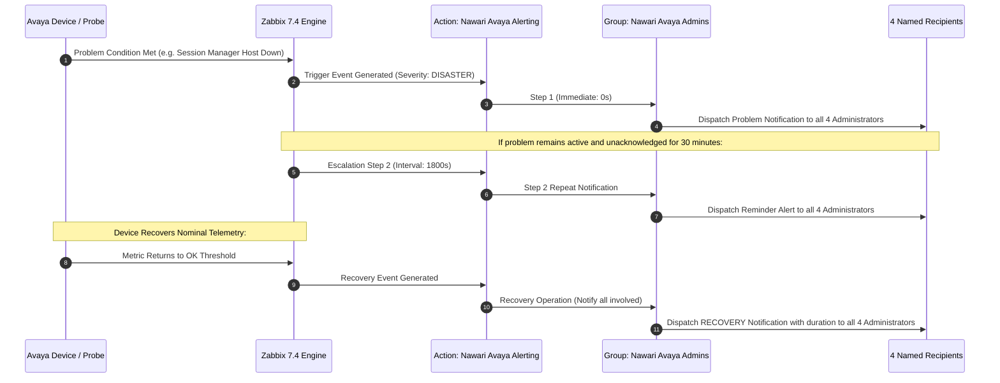

# Phase 13.4 — Zabbix Action & Notification Escalation Policy

## 1. Notification Policy Overview

In Zabbix 7.4, all device-level alerting, escalation, and recovery workflows for Avaya telephony, external SIP carrier interconnects, and synthetic voice probes are governed by the authoritative Zabbix Action:
`Nawari Avaya & Communication Alerting` (Action ID: `7`)

This action dispatches notifications exclusively to the dedicated Zabbix User Group:
**`Nawari Avaya & Communications Administrators`** (Group ID: `14`)

Notifications are delivered through **all enabled and applicable media types configured on each recipient's user profile** (`mediatypeid: 0`), ensuring notifications are never hardcoded to an individual or single delivery channel.

---

## 2. Designated Notification Recipients

The `Nawari Avaya & Communications Administrators` group contains the four designated voice engineering administrators:

| Administrator Name | Zabbix Username | Destination Email Address | User Role | Active Media Period | Severity Mask |
| :--- | :--- | :--- | :--- | :--- | :--- |
| **John Gacomo** | `john.gacomo` | `John.Gacomo@kenya-airways.com` | Admin role (type 2) | `1-7,00:00-24:00` (24x7) | 63 (All Severities) |
| **Robinson Wainaina**| `robinson.wainaina`| `Robinson.Wainaina@kenya-airways.com`| Admin role (type 2) | `1-7,00:00-24:00` (24x7) | 63 (All Severities) |
| **Pascal Gathungu** | `pascal.gathungu` | `Pascal.Gathungu@kenya-airways.com` | Admin role (type 2) | `1-7,00:00-24:00` (24x7) | 63 (All Severities) |
| **Mercy Vaati** | `mercy.vaati` | `Mercy.Vaati@kenya-airways.com` | Admin role (type 2) | `1-7,00:00-24:00` (24x7) | 63 (All Severities) |

### Recipient-to-Media-Type Delivery Matrix

| Recipient | Configured Media Type | Destination Address | Enabled in Zabbix | Operational Verification Status |
| :--- | :--- | :--- | :--- | :--- |
| **John Gacomo** | Built-in Email (`mediatypeid: 1`) | `John.Gacomo@kenya-airways.com` | Yes (`active: 0`) | `CONFIGURED_UNVERIFIED` |
| **Robinson Wainaina**| Built-in Email (`mediatypeid: 1`) | `Robinson.Wainaina@kenya-airways.com`| Yes (`active: 0`) | `CONFIGURED_UNVERIFIED` |
| **Pascal Gathungu** | Built-in Email (`mediatypeid: 1`) | `Pascal.Gathungu@kenya-airways.com` | Yes (`active: 0`) | `CONFIGURED_UNVERIFIED` |
| **Mercy Vaati** | Built-in Email (`mediatypeid: 1`) | `Mercy.Vaati@kenya-airways.com` | Yes (`active: 0`) | `CONFIGURED_UNVERIFIED` |

> [!IMPORTANT]
> **Delivery Status Classification:**
> - `CONFIGURED_UNVERIFIED`: The users, group, media profiles, and action operations are fully configured and verified in Zabbix 7.4 via API, but live external email transmission to `@kenya-airways.com` has not been dispatched to prevent unsolicited test emails without customer authorization.
> - `AUTHENTICATED`: SMTP / OAuth 2.0 handshake validated against customer Microsoft 365 tenant.
> - `DELIVERY_TESTED`: Controlled synthetic delivery confirmed to an authorized test recipient.
> - `PRODUCTION_VERIFIED`: End-to-end live alert delivery verified during on-site commissioning.

---

## 3. Communication Alert Action Specification

**Action Name:** `Nawari Avaya & Communication Alerting`  
**Event Source:** `TRIGGERS` (0)  
**Status:** `ENABLED` (0)  
**Maintenance Suppression:** `pause_suppressed: YES` (`1`)  
**Repeat Cooldown Interval:** `30m` (`1800s`)  

### Trigger Scope & Target Host Groups
The action matches any trigger meeting both criteria:
1. **Severity:** $\ge$ `WARNING` (Priority $\ge$ 2: Warning, Average, High, Disaster)
2. **Host Groups:** Trigger host belongs to any communication host group:
   - `Voice Infrastructure` (ID: 23)
   - `Edge SBC` (ID: 24)
   - `Communications Applications` (ID: 25)
   - `Synthetic Probes` (ID: 26)
   - `Avaya Infrastructure` (ID: 27)
   - `SIP Carrier Trunks` (ID: 28)

---

## 4. Problem, Escalation, Update and Recovery Operations

### Operation Breakdown

| Operation Type | Step | Delay / Interval | Target Recipient Group | Delivery Mechanism |
| :--- | :--- | :--- | :--- | :--- |
| **Initial Problem Notification** | Step 1 | Immediate (`0s`) | `Nawari Avaya & Communications Administrators` | All enabled user media (`mediatypeid: 0`) |
| **Escalation / Repeat Alert** | Step 2..$\infty$ | `1800s` (Every 30m) | `Nawari Avaya & Communications Administrators` | All enabled user media (`mediatypeid: 0`) |
| **Severity Update Notification** | Update | Upon acknowledgment / update | Notify all involved administrators | All enabled user media (`mediatypeid: 0`) |
| **Recovery Notification** | Recovery | Immediate upon resolution | Notify all involved administrators | Original problem reference + elapsed duration |

---

## 5. Zabbix Frontend Navigation Guide

When logging into the Zabbix 7.4 Frontend (`http://localhost:8088`):

1. **Viewing Templates & Trigger Definitions:**
   - Navigate to: **Data collection -> Templates**
   - Filter by name: `Nawari`
   - All 7 communication templates are listed here with their 59 triggers.
2. **Viewing Monitored Hosts & Linked Templates:**
   - Navigate to: **Data collection -> Hosts**
   - You will see:
     - `avaya-sbce-01` -> Linked: `Nawari Avaya SBCE by SNMP`
     - `avaya-sm-01` -> Linked: `Nawari Avaya Session Manager by SNMP`
     - `avaya-cm-01` -> Linked: `Nawari Avaya Communication Manager by SNMP`
     - `avaya-g450-01` -> Linked: `Nawari Avaya G450 Media Gateway by SNMP`
     - `sip-trunk-carrier-01` -> Linked: `Nawari SIP Trunk by Trapper`
     - `nawari-voice-probe-01` -> Linked: `Nawari Voice Synthetic Probe by Zabbix Trapper`
     - `avaya-cms-01` -> Linked: `Nawari Avaya CMS and WFO by Trapper`
3. **Viewing Administrator Users & Group:**
   - Navigate to: **Users -> User groups** -> select `Nawari Avaya & Communications Administrators` (shows 4 users).
   - Navigate to: **Users -> Users** -> click `John Gacomo`, `Robinson Wainaina`, `Pascal Gathungu`, or `Mercy Vaati` -> select the **Media** tab to view the enabled 24x7 email configuration.
4. **Viewing the Alert Action:**
   - Navigate to: **Alerts -> Actions -> Trigger actions**
   - Open `Nawari Avaya & Communication Alerting` to inspect conditions, steps, and recipient group.
5. **Why do Triggers NOT appear in "Monitoring -> Problems"?**
   - **Crucial operational principle:** In Zabbix, **Monitoring -> Problems** ONLY displays **currently firing, active problem incidents**.
   - If an Avaya host is healthy (or unpolled with no problem event raised), its triggers remain in the `NORMAL` (OK) state.
   - Triggers in `NORMAL` state do NOT appear under Monitoring -> Problems. To view all configured triggers for a host regardless of state, navigate to **Data collection -> Hosts -> Triggers**.
