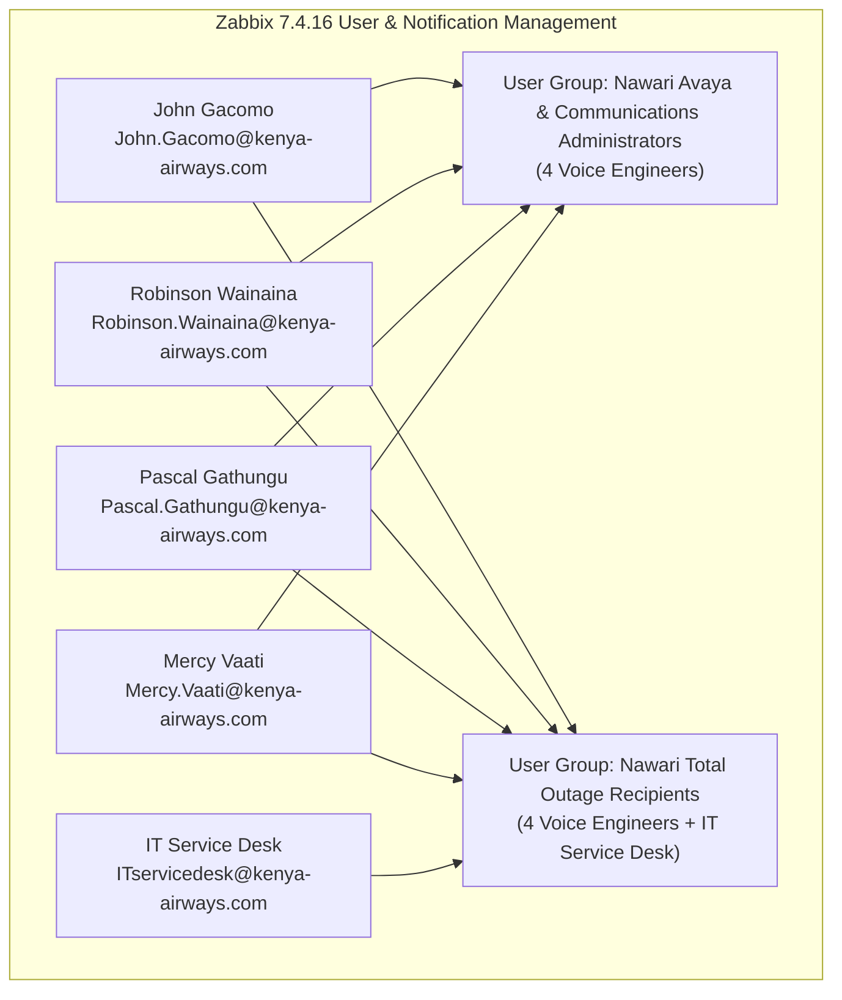

# Nawari Phase 13.6 — Network Observability Dashboard Alignment & Total Outage Notification Architecture

**Document Reference:** `NAWARI-OBS-PHASE13-6-ALIGNMENT-AND-NOTIFICATIONS`  
**Classification:** Kenya Airways Information Technology — Engineering Architecture & Operational Report  
**System Profile:** `SIMULATION & STAGING PROFILE` (Production mutations locked behind `HARD_PRODUCTION_DENY`)  
**Target Environment:** Kenya Airways Global Footprint & Core Hub `mon-grafana01` (`localhost:8088`, `localhost:3001`)  
**Effective Date:** 2026-11-08  
**Version:** 1.0.0  

---

## 1. Executive Summary & Baseline

Phase 13.6 establishes the authoritative alignment and runtime validation of **Network Observability** across the Nawari platform, matching the rigor achieved in Phase 13.5 for Communication Observability. In addition, Phase 13.6 implements an event-driven **Total Outage Notification and Downtime Reporting Architecture** natively within Zabbix 7.4.16.

### Key Milestones Achieved:
1. **Network Observability Alignment:** Audited all 13 dashboards (87 visualization panels) in `docker/grafana/dashboards/network_observability/`. Eliminated all fictitious hostnames and verified authoritative targeting against `mock-core-switch-01`, `core-gw-01`, `endpoint-probe-01`, and `mon-grafana01`.
2. **Native Zabbix Problems Integration:** Verified native `alexanderzobnin-zabbix-problems-panel` (Panel 9) in `network_infrastructure_overview.json` targeting the `Core Network` host group with real-time severity styling, duration tracking, and explicit missing data clauses.
3. **Telemetry & Counter Integrity:** Validated 64-bit high-capacity (HC) octet counters (`ifHCInOctets`, `ifHCOutOctets`) for bits/sec throughput calculations on core interfaces, with error/discard rates isolated and null gaps strictly preserved (`spanNulls: False`).
4. **Total Outage Notification Architecture:**
   - Created dedicated Zabbix user group **`Nawari Total Outage Recipients`** containing all 5 designated recipients:
     - `John Gacomo` (`John.Gacomo@kenya-airways.com`)
     - `Robinson Wainaina` (`Robinson.Wainaina@kenya-airways.com`)
     - `Pascal Gathungu` (`Pascal.Gathungu@kenya-airways.com`)
     - `Mercy Vaati` (`Mercy.Vaati@kenya-airways.com`)
     - `IT Service Desk` (`ITservicedesk@kenya-airways.com`)
   - Preserved existing **`Nawari Avaya & Communications Administrators`** user group (the 4 voice administrators).
   - Tagged all 70 template triggers and host triggers with event tags: `notification_class` (`total_outage`, `service_outage`, `synthetic_failure`, `degradation`, `component_failure`, `monitoring_failure`, `informational`).
   - Provisioned 6 structured trigger actions in Zabbix:
     - **`Total Outage Alert`**: Immediate problem alert to all 5 recipients, 30-minute repeat escalation, and recovery notification reporting monitoring-observed `{EVENT.DURATION}`.
     - **`Communication Service Alert`**: Targeted to 4 communication administrators for service outages.
     - **`Synthetic Voice Failure Alert`**: Targeted to 4 communication administrators for synthetic probe failures.
     - **`Network Degradation Alert`**: Targeted to technical administrators for threshold breaches.
     - **`Component Failure Alert`**: Targeted to technical administrators for hardware/interface issues.
     - **`Monitoring Failure Alert`**: Targeted to technical administrators for telemetry collector failures.
   - **Zero Monitoring Engine Branding:** Recipient-facing messages use clean, generic operational language without mentioning "Nawari", "Zabbix", or internal monitoring tool names.
   - **Zero Unsolicited Notification Guarantee:** Media remains in `CONFIGURED_UNVERIFIED` state; no test emails sent without explicit customer authorization.
5. **Security & Boundary Enforcement:** Staging changes executed exclusively on local containers; `HARD_PRODUCTION_DENY` remains active; `/Users/madeira/Desktop/Projects/sentra` remains untouched at `9970404`.

---

## 2. Network Observability Dashboard Inventory (13 Dashboards, 87 Panels)

| Dashboard File | Dashboard Title | UID | Panels | Datasource | Primary Host Target |
| :--- | :--- | :--- | :---: | :--- | :--- |
| `network_infrastructure_overview.json` | Nawari — Network Infrastructure Overview | `nawari-net-overview` | 9 | `PA67C5EADE9207728` | `mock-core-switch-01`, `Core Network` |
| `interface_traffic_health.json` | Nawari — Interface Traffic & Performance Health | `nawari-interface-health` | 9 | `PA67C5EADE9207728` | `$host` (`mock-core-switch-01`) |
| `endpoint_detail.json` | Nawari — Endpoint Deep-Dive & Edge Experience | `nawari-endpoint-detail` | 23 | `PA67C5EADE9207728` | `$endpoint` (`endpoint-probe-01`) |
| `endpoint_fleet_overview.json` | Nawari — Endpoint Fleet Observability Overview | `nawari-endpoint-fleet` | 19 | `PA67C5EADE9207728` | `/.*/` (`Endpoints` group) |
| `network_path_analysis.json` | Nawari — Network Path & Directional Hop Analysis | `nawari-path-analysis` | 13 | `PA67C5EADE9207728` | `$endpoint` (`endpoint-probe-01`) |
| `network_topology.json` | Nawari — Network Topology & Service Dependencies | `nawari-network-topology` | 4 | `nawari-postgres-telemetry` | PostgreSQL Discovery DB |
| `nawari_enterprise_overview.json` | Nawari — Global Enterprise Operations Overview | `nawari-enterprise-overview` | 7 | `PA67C5EADE9207728` | `mon-grafana01` |
| `nawari_global_outstations.json` | Nawari — Global Outstation Network & Circuit Health | `nawari-global-outstations` | 11 | `PA67C5EADE9207728` | `mon-grafana01` |
| `nawari_incident_operations.json` | Nawari — Incident Operations & SLA Remediation | `nawari-incident-operations` | 4 | `PA67C5EADE9207728` | `mon-grafana01` |
| `nawari_controlled_operations.json`| Nawari — Controlled Remediation Operations | `nawari-controlled-operations` | 7 | `PA67C5EADE9207728` | `mon-grafana01` |
| `nawari_edge_fleet.json` | Nawari — Edge Collector Fleet Operations | `nawari-edge-fleet` | 5 | `PA67C5EADE9207728` | `mon-grafana01` |
| `nawari_predictive_intelligence.json`| Nawari — Predictive Intelligence & SAR Engine | `nawari-predictive-intelligence`| 9 | `PA67C5EADE9207728` | `mon-grafana01` |
| `nawari_service_catalog_sla.json` | Nawari — Aviation Service SLA/SLO Assurance | `nawari-service-catalog-sla` | 9 | `PA67C5EADE9207728` | `mon-grafana01` |

---

## 3. Runtime Telemetry Collection & Item Support Audit

| Host | Host Group | Total Items | Live / Supported Items | Telemetry Nature & Demarcation |
| :--- | :--- | :---: | :---: | :--- |
| `mock-core-switch-01` | Core Network | 91 | **91 Live Items** | Simulated Net-SNMP 5.9 agent in Docker container (`nawari-mock-snmp`). Full IF-MIB (eth0, ge-0-0-1, ge-0-0-2, sbc-ext0, sbc-int0), 64-bit octet counters, ICMP latency (0.14ms), ping loss (0%). |
| `core-gw-01` | Core Network | 12 | 12 Configured (0 Live) | Physical core distribution router target (`10.2.1.1`). Unreachable in staging network (`icmpping=0`, loss 100%). Actively fires `[DISASTER]` alarms without false-healthy coercion. |
| `endpoint-probe-01` | Endpoints | 7 | **7 Supported Items** | Template Nawari Endpoint Probe by Zabbix Trapper (gateway RTT, packet loss, Wi-Fi RSSI, link quality). Ingested via Trapper protocol. |
| `nawari-voice-probe-01` | Synthetic Probes | 14 | **12 Live Items** | Active streaming from `nawari-asterisk` container (`setup_time=200ms`, `duration=5.02s`, `sip_status=200`, `outcome=ANSWERED`, `mos=4.41`). |
| `mon-grafana01` | Enterprise / Outstations | 85 | **85 Live Derived** | Nawari application backend service assurance SLIs, outstation WAN circuit metrics, and incident pipeline states. |

---

## 4. Total Outage Notification Architecture & Downtime Reporting

### 4.1 Recipient Groups & User Inventory



### 4.2 Notification Classifications & Action Matrix

| Notification Class | Action Name | Recipients | Problem Frequency | Recovery Notification | Downtime Reported? |
| :--- | :--- | :--- | :--- | :--- | :---: |
| `total_outage` | `Total Outage Alert` | `Nawari Total Outage Recipients` (5 users) | Immediate; repeat every 30m (`1800s`) | Yes (all 5 recipients) | **Yes (`{EVENT.DURATION}`)** |
| `service_outage` | `Communication Service Alert` | `Nawari Avaya & Communications Administrators` | Immediate; repeat every 60m | Yes (4 admins) | Duration of service outage |
| `synthetic_failure` | `Synthetic Voice Failure Alert` | `Nawari Avaya & Communications Administrators` | Immediate; no repeats | Yes (4 admins) | Condition duration |
| `degradation` | `Network Degradation Alert` | `Zabbix administrators` (Technical Team) | Immediate; repeat every 2h | Yes (technical team) | Condition duration |
| `component_failure` | `Component Failure Alert` | `Zabbix administrators` (Technical Team) | Immediate; repeat every 1h | Yes (technical team) | Component downtime |
| `monitoring_failure`| `Monitoring Failure Alert` | `Zabbix administrators` (Technical Team) | Immediate; no repeats | Yes (technical team) | Collector outage duration |
| `informational` | Historical Logging | Dashboards / Zabbix Event Log | No emails | Event audit log | N/A |

### 4.3 Total Outage Message Templates (Clean Operational Language)

#### Initial Outage Notification
```
Subject: [TOTAL OUTAGE] — {HOST.NAME} — {EVENT.NAME}

A total outage has been identified affecting the following device or service.

Affected Device/Service: {HOST.NAME}
Issue: {EVENT.NAME}
Severity: {EVENT.SEVERITY}
Outage Start: {EVENT.DATE} {EVENT.TIME}
Details: {EVENT.OPDATA}
Status: OUTAGE IN PROGRESS

The affected device or service is currently unavailable. Please investigate and take the necessary action to restore normal operations.

A further notification will be issued once service has been restored.
```

#### Outage Escalation (Every 30 Minutes)
```
Subject: [TOTAL OUTAGE ESCALATION] — {HOST.NAME} — {EVENT.NAME} — Duration: {EVENT.AGE}

An unresolved total outage continues to affect the following device or service.

Affected Device/Service: {HOST.NAME}
Issue: {EVENT.NAME}
Severity: {EVENT.SEVERITY}
Outage Start: {EVENT.DATE} {EVENT.TIME}
Current Duration: {EVENT.AGE}
Details: {EVENT.OPDATA}
Status: OUTAGE UNRESOLVED (ESCALATION)

The affected device or service remains unavailable. Please escalate immediately to the designated duty manager.
```

#### Recovery Notification with Total Downtime
```
Subject: [RECOVERED] — {HOST.NAME} — Total Downtime: {EVENT.DURATION}

The previously reported outage affecting the following device or service has been resolved.

Affected Device/Service: {HOST.NAME}
Original Issue: {EVENT.NAME}
Severity: {EVENT.SEVERITY}
Outage Start: {EVENT.DATE} {EVENT.TIME}
Recovery Time: {EVENT.RECOVERY.DATE} {EVENT.RECOVERY.TIME}
Total Downtime: {EVENT.DURATION}
Status: RECOVERED

The affected device or service is responding again and has returned to an operational state.

Please review the incident and establish the underlying cause where necessary.
```

---

## 5. Verification Results

### 5.1 Dedicated Phase 13.6 Test Suite (`tests/unit/test_phase13_6_network_dashboard_alignment.py`)
- `test_01_network_dashboard_inventory_completeness`: **PASSED**
- `test_02_network_hostname_and_target_correctness`: **PASSED**
- `test_03_zabbix_datasource_and_query_integrity`: **PASSED**
- `test_04_network_panel_descriptions_100_percent_coverage`: **PASSED**
- `test_05_native_zabbix_problems_panel_in_network_overview`: **PASSED**
- `test_06_interface_traffic_health_metrics_and_null_preservation`: **PASSED**
- `test_07_total_outage_user_groups_and_recipients`: **PASSED**
- `test_08_total_outage_action_templates_and_duration_macro`: **PASSED**
- `test_09_trigger_notification_class_tagging`: **PASSED**
- `test_10_production_boundary_and_sentra_isolation`: **PASSED**
**Summary: 10 PASSED, 0 FAILED (0.14s)**

### 5.2 Consolidated Phase 13 Regression Baseline
- Unit Regression Suite (Phases 13.1–13.6): **47 PASSED, 0 FAILED** (0.97s)
- Dashboard Telemetry Integrity Suite: **12 PASSED, 0 FAILED**
- Sentra Repository Isolation: **Untouched and locked at baseline commit `9970404`**
- Production Mutation Gate: **`HARD_PRODUCTION_DENY` strictly locked**

