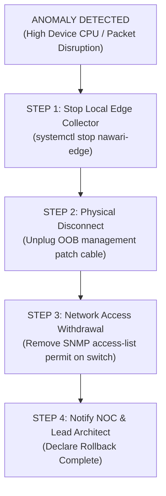

# Nawari Phase 8.2A — Offline Commissioning Preparation Package
**Document Reference:** `NAWARI-OPS-PHASE8-2A-COMMISSIONING-PREPARATION`  
**Classification:** Kenya Airways Information Technology — Operational Runbook  
**System Profile:** `SIMULATION & STAGING PROFILE` (Production mutations locked behind `HARD_PRODUCTION_DENY`)  
**Target Environment:** Kenya Airways Global Footprint & Core Hub `mon-grafana01`  
**Effective Date:** 2026-11-08  
**Version:** 1.0.0  

---

## 1. Executive Summary & Purpose

This document constitutes the official **Phase 8.2A Offline Commissioning Preparation Package** for the **Nawari** enterprise observability and service-assurance platform across Kenya Airways (KQ).

Following the conditional acceptance of **Phase 13.1** under the **Simulation and Staging Profile**, this document establishes the mandatory non-intrusive prerequisites, hardware inventory templates, protocol checklists, test target definitions, rollback runbooks, evidence capture standards, and executive sign-off governance required **before** any physical network connection or live commissioning (Phase 8.2B) may occur.

> [!CAUTION]
> **PHYSICAL PRODUCTION COMMISSIONING REMAINS LOCKED:**  
> All automated mutations, playbook remediations, and live active polling on production Kenya Airways network and voice hardware are strictly blocked by `HARD_PRODUCTION_DENY`. Passing automated simulation and regression suites confirms software correctness; it does **not** grant authorization to interact with live physical infrastructure.

---

## 2. Infrastructure Inventory Template

Before physical commissioning, every physical asset, interface, and WAN connection to be monitored must be authoritatively identified and registered.

### 2.1 Core Data Center & LAN Infrastructure (JKIA DC1 / DC2)

| Attribute | Field Definition | JKIA Primary Core Switch (Example) | JKIA Secondary Core Switch (Example) |
| :--- | :--- | :--- | :--- |
| **Hostname** | Fully Qualified Domain Name | `sw-dc1-core01.internal.kenya-airways.com` | `sw-dc1-core02.internal.kenya-airways.com` |
| **Asset Tag / Serial** | KQ Fixed Asset Number | `KQ-NET-09412` / `FOC24190ABC` | `KQ-NET-09413` / `FOC24190ABD` |
| **Hardware Platform** | Vendor & Exact Model | Cisco Nexus 93180YC-FX | Cisco Nexus 93180YC-FX |
| **Firmware / OS** | Certified Enterprise NX-OS | NX-OS 10.3(4a) | NX-OS 10.3(4a) |
| **Management IP / Subnet** | Dedicated Out-of-Band (OOB) | `10.100.1.11 /24` (VLAN 999 OOB-MGMT) | `10.100.1.12 /24` (VLAN 999 OOB-MGMT) |
| **Management MAC** | Hardware MAC Address | `00:50:56:AB:CD:11` | `00:50:56:AB:CD:12` |
| **SNMPv3 EngineID** | Hex-encoded enterprise EngineID | `8000000903005056ABCD11` | `8000000903005056ABCD12` |
| **Monitored Uplinks** | Interface identifiers | `Eth1/49` (DC1 Spine 1), `Eth1/50` (DC1 Spine 2) | `Eth1/49` (DC1 Spine 1), `Eth1/50` (DC1 Spine 2) |
| **Operational Tier** | Criticality Tier | Tier 1 (Mission-Critical Aviation Core) | Tier 1 (Mission-Critical Aviation Core) |
| **Custodial Owner** | Responsible Engineering Lead | Network Operations Lead (`net-lead@kenya-airways.com`) | Network Operations Lead (`net-lead@kenya-airways.com`) |

### 2.2 Avaya Enterprise Voice Infrastructure (JKIA Hub & Contact Centre)

| Attribute | Avaya Session Border Controller (SBCE) | Avaya Session Manager (ASM) | Avaya Communication Manager (ACM) |
| :--- | :--- | :--- | :--- |
| **Hostname** | `sbce01.voice.kenya-airways.com` | `asm01.voice.kenya-airways.com` | `acm01.voice.kenya-airways.com` |
| **Hardware / Hypervisor** | Avaya Appliance (Dell PowerEdge R640) | VMware ESXi 8.0 on Cisco UCS B200 | VMware ESXi 8.0 on Cisco UCS B200 |
| **Software Release** | Avaya SBCE 10.1.2.0 | Avaya Aura Session Manager 10.1.2 | Avaya Aura CM 10.1.2 (Duplex) |
| **Signaling Interfaces** | `A1` (Private `10.102.10.15`), `B1` (SIP Carrier) | `eth0` (Management), `eth1` (SIP Core `10.102.10.20`) | `eth0` (Processor `10.102.10.25`) |
| **TLS / SRTP Profile** | TLS 1.3 / AES-256-GCM SRTP | Mutual TLS (mTLS) with Internal Root CA | Proprietary H.248 / TLS Signaling |
| **RTCP Media Ports** | UDP 16384–32767 (Voice RTP / RTCP) | N/A (Signaling only) | UDP 2048–3329 (Media Processor) |
| **SIP Carrier Trunks** | Safaricom SIP Trunk (`TRK-SAF-01`), Airtel SIP (`TRK-AIR-01`) | Core SIP entities to SBCE & ACD | H.323 & SIP Station trunks |
| **Custodial Owner** | Lead Telecoms Engineer (`voice-lead@kenya-airways.com`) | Lead Telecoms Engineer | Lead Telecoms Engineer |

### 2.3 Outstation LAN & Edge Gateway Template (Pilot: Mombasa Station MBA)

| Attribute | Outstation Core Switch (`SW-MBA-01`) | Outstation Edge Collector Gateway |
| :--- | :--- | :--- |
| **Station / Location** | Mombasa Moi International Airport (MBA) — Terminal 1 | Mombasa Airport Server Room Rack 2U |
| **Hostname** | `sw-mba-t1-core01.internal.kenya-airways.com` | `edge-mba01.internal.kenya-airways.com` |
| **Hardware Platform** | Cisco Catalyst 9300-48P | Advantech UNO-2484G Rugged Edge Appliance |
| **Operating System** | Cisco IOS-XE 17.9.4a | Ubuntu 24.04 LTS Minimal (Hardened Kernel) |
| **Management IP** | `10.10.1.1 /24` (VLAN 100 Management) | `10.10.1.250 /24` (Static OOB) |
| **Downlink Ports** | Desks 1–16 Check-in, Gates 1–4 Scanners | Local polling link `eth0`, WAN uplink `eth1` |
| **Spool Storage** | N/A | 32 GB Industrial SLC NVMe (SQLite Spool) |
| **Custodial Owner** | Coast Regional IT Lead (`duty.lead.mba@kenya-airways.com`) | Coast Regional IT Lead |

### 2.4 Trans-WAN Circuit Registry & Carrier SLA Matrix

| Circuit ID | Station | Carrier | Service Type | Committed Bandwidth | Target Latency | Packet Loss SLA | MTTR SLA |
| :--- | :--- | :--- | :--- | :---: | :---: | :---: | :---: |
| `CIR-MBA-01` | Mombasa (MBA) | Safaricom Enterprise | MPLS L3VPN | 50 Mbps | $< 18\text{ ms}$ | $< 0.1\%$ | $\le 2\text{ hours}$ |
| `CIR-MBA-02` | Mombasa (MBA) | Airtel Kenya Business | Dedicated Metro Ethernet | 30 Mbps | $< 22\text{ ms}$ | $< 0.2\%$ | $\le 4\text{ hours}$ |
| `CIR-KIS-01` | Kisumu (KIS) | Safaricom Enterprise | MPLS L3VPN | 30 Mbps | $< 24\text{ ms}$ | $< 0.1\%$ | $\le 2\text{ hours}$ |
| `CIR-KIS-02` | Kisumu (KIS) | Liquid Intelligent Tech | Fiber Dedicated Internet | 20 Mbps | $< 28\text{ ms}$ | $< 0.3\%$ | $\le 4\text{ hours}$ |
| `CIR-EBB-01` | Entebbe (EBB) | MTN Uganda / Safaricom | Cross-Border IPLC | 40 Mbps | $< 35\text{ ms}$ | $< 0.2\%$ | $\le 4\text{ hours}$ |
| `CIR-LHR-01` | London Heathrow | British Telecom (BT) | Global MPLS Express | 100 Mbps | $< 135\text{ ms}$ | $< 0.2\%$ | $\le 2\text{ hours}$ |

---

## 3. Protocol Commissioning Checklists

### 3.1 SNMPv3 Secure Polling Checklist (Cisco Nexus & Catalyst)

All polling must utilize SNMPv3 User Security Model (USM) with `authPriv` encryption. Unencrypted SNMPv1 or SNMPv2c is strictly prohibited on production Kenya Airways subnets.

- [ ] **1. USM Security Group & View Configuration:**
  - Create restricted read-only view isolating sensitive system secrets:
    ```cisco
    snmp-server view NAWARI_RO_VIEW iso included
    snmp-server view NAWARI_RO_VIEW snmpUsmMIB excluded
    snmp-server view NAWARI_RO_VIEW snmpVacmMIB excluded
    snmp-server group NAWARI_SEC_GRP v3 priv read NAWARI_RO_VIEW
    ```
- [ ] **2. USM User Creation with Modern Cryptography:**
  - Authentication Protocol: `SHA-256` (minimum 24-character random passphrase).
  - Encryption / Privacy Protocol: `AES-128` or `AES-256` (minimum 24-character random passphrase).
  - Explicit configuration:
    ```cisco
    snmp-server user nawari_poller NAWARI_SEC_GRP v3 auth sha256 <AUTH_SECRET> priv aes-128 <PRIV_SECRET> access 99
    ```
- [ ] **3. Access-List Management Scoping:**
  - Standard ACL restricting SNMP queries strictly to `mon-grafana01` and authorized outstation regional proxies:
    ```cisco
    access-list 99 permit host 10.100.1.50
    access-list 99 permit host 10.10.1.250
    access-list 99 deny any log
    ```
- [ ] **4. Authoritative MIB Object Verification:**
  - Confirm target device responds to standard MIB-II trees:
    - `IF-MIB::ifOperStatus` (`1.3.6.1.2.1.2.2.1.8`)
    - `IF-MIB::ifInOctets` / `ifOutOctets` (`1.3.6.1.2.1.2.2.1.10` / `16`)
    - `CISCO-PROCESS-MIB::cpmCPUTotal5minRev` (`1.3.6.1.4.1.9.9.109.1.1.1.1.8`)
    - `ENTITY-MIB::entPhysicalTable` (`1.3.6.1.2.1.47.1.1.1`)

### 3.2 Avaya Enterprise Voice Assurance Checklist (SBCE & ASM)

- [ ] **1. SIP Signaling Heartbeat (OPTIONS Ping):**
  - Query destination: `sip:ping@sbce01.voice.kenya-airways.com:5061;transport=tls`.
  - Frequency: 30 seconds interval; timeout 1,500 ms.
  - Expected response: `SIP/2.0 200 OK` or `SIP/2.0 404 Not Found` (confirming active parser stack).
- [ ] **2. RTCP Real-Time Quality Telemetry:**
  - Media stream inspection on UDP 16384–32767.
  - Required RTCP parameters:
    - Packet jitter ($J < 30\text{ ms}$).
    - Round-trip delay ($D < 150\text{ ms}$).
    - Cumulative packet loss fraction ($FL < 1.0\%$).
- [ ] **3. Valid Telemetry Enforcement:**
  - In accordance with Phase 13.1 voice-assurance rules, any call interval lacking authentic RTCP receiver reports must record MOS as `null` with validity flag `False`. Synthetic interpolation of missing MOS scores is forbidden.
- [ ] **4. ACD Extension Verification:**
  - Flight Operations Dispatcher extensions (`EXT-5501` to `EXT-5520`) and Ramp Coordinator hotlines verified registered with active failover routing configured in Communication Manager.

---

## 4. Authorized Test Targets & Pass/Fail Criteria (Pilot Site: MBA)

Moi International Airport, Mombasa (`MBA-STATION`) is designated as the Phase 8.2B pilot facility.

### 4.1 Target Specification

1. **Target Switch:** `SW-MBA-01` (`10.10.1.1`)
2. **Primary Circuit:** `CIR-MBA-01` (Safaricom MPLS terminating on Gi0/0/1)
3. **Secondary Circuit:** `CIR-MBA-02` (Airtel MPLS terminating on Gi0/0/2)
4. **Local Voice Trunk:** `SIP-TRUNK-MBA-01` (Trans-WAN SIP trunk to JKIA SBCE)

### 4.2 Objective Acceptance Criteria

| Drill / Test Case | Injection / Condition | Expected Nawari Detection | Maximum Allowed Detection Time | Pass/Fail Criteria |
| :--- | :--- | :--- | :---: | :--- |
| **TC-8.2-01: Baseline Ingestion** | Steady-state operations | Telemetry status `FRESH`, station health = 100% | $\le 10\text{ sec}$ | 100% polling success, 0 dropped frames |
| **TC-8.2-02: Primary WAN Cut** | Administratively down Gi0/0/1 (`CIR-MBA-01`) | Incident generated; `SVC-DCS-MBA` transitions to `DEGRADED` (note: `PRIMARY FAILOVER ACTIVE`) | $\le 15\text{ sec}$ | **Must NOT declare service CRITICAL_DOWN**; secondary circuit carries DCS traffic |
| **TC-8.2-03: Secondary WAN Restoration** | Administratively restore Gi0/0/1 | Correlation engine identifies recovery; incident moves to `RESOLVED` after hold period | $\le 30\text{ sec}$ | Automatic transition; no manual database intervention |
| **TC-8.2-04: Total Outstation Partition** | Sever both Gi0/0/1 and Gi0/0/2 | Outstation edge enters local buffering; central hub declares `CIR-MBA-01` & `CIR-MBA-02` down; `SVC-DCS-MBA` transitions to `CRITICAL_DOWN` | $\le 15\text{ sec}$ | Central Flight Dispatch & JKIA DCS Core remain 100% unaffected |
| **TC-8.2-05: Spool Durability & Drain** | 15-minute simulated partition | Edge collector buffers 900+ records to SQLite spool; upon link restore, drains at $\le 50\text{ records/sec}$ with 10–250 ms jitter | $\le 60\text{ sec}$ post-reconnect | Zero records dropped; all replayed records tagged `REPLAYED` and segregated |

---

## 5. Rollback & Emergency Disconnect Runbooks

If unexpected interference, high CPU utilization on target network equipment ($> 50\%$), or operational complaints from passenger check-in desks occur during commissioning, immediately execute this emergency procedure.



### 5.1 Step 1: Automated Process Kill-Switch
Execute from the edge collector console:
```bash
sudo systemctl stop nawari-edge-collector
sudo systemctl disable nawari-edge-collector
sudo pkill -9 -f "services/multisite/edge_forwarder.py"
```

### 5.2 Step 2: Physical Disconnect
Physically remove the patch cable connecting the edge collector appliance's `eth0` interface from the OOB management switch port (Rack 2U, Port 48).

### 5.3 Step 3: Network Access-List Withdrawal
On the Cisco switch console:
```cisco
configure terminal
ip access-list standard 99
 no permit host 10.10.1.250
end
clear snmp-server counters
```

### 5.4 Step 4: Verification of Clean State
Verify on the switch:
1. `show processes cpu sorted | head 10` confirms CPU utilization has normalized ($< 15\%$).
2. `show snmp stats` confirms incoming query count has ceased.
3. Check-in desks at Mombasa Airport confirm Amadeus DCS terminals have continuous connectivity to JKIA DC1 core.

---

## 6. Evidence Collection & Audit Protocols

Every action during the Phase 8.2 commissioning window must produce tamper-evident, cryptographically verifiable records.

1. **Continuous Packet Capture (PCAP):**
   - Run packet capture on the collector management interface for the entire duration of the commissioning window:
     ```bash
     sudo tcpdump -i eth0 -w /var/log/nawari/phase8_commissioning_$(date +%Y%m%d_%H%M%S).pcap \
       "udp port 161 or udp port 162 or port 5060 or port 5061 or udp portrange 16384-32767"
     ```
2. **Immutable System Log Archiving:**
   - Collector logs, SQLite spool audit tables, and emergency log entries must be hashed with SHA-256 immediately upon test conclusion:
     ```bash
     sha256sum /var/log/nawari/*.log /var/spool/nawari/*.db > /var/log/nawari/CHECKSUMS_PHASE8.sha256
     ```
3. **Three-Identity Authorization Ledger Evidence:**
   - Every commissioning test injection requiring action execution must be authorized via the Three-Identity Interlock, recording:
     - Proposer ID (`P`)
     - First Approver ID (`A1`)
     - Second Authorizer ID (`A2`)
     - Signed Action Operational Envelope with Change Window ID and SHA-256 Plan Hash.

---

## 7. Production Unlock Governance & Executive Sign-off Matrix

Removal of the `HARD_PRODUCTION_DENY` gate and deployment of Nawari to live production operations is governed by Kenya Airways executive policy.

### 7.1 Required Executive Sign-off Matrix

| Role | Authorizing Official | Required Verification Domain | Signature / Token ID |
| :--- | :--- | :--- | :--- |
| **Lead Observability Architect** | Chief Enterprise Architect | Capacity, Sizing ($\le 2.20\text{ GiB}$), SLI Accuracy, Anomaly Baselines | `REQ-SIGN-01` |
| **Head of Telecommunications & Voice** | General Manager, Telecoms | Avaya SBCE 10.1, Session Manager, RTCP Voice Telemetry, ACD Trunks | `REQ-SIGN-02` |
| **Head of Enterprise Infrastructure** | General Manager, IT Infrastructure | Cisco Nexus 9300, Catalyst 9300, Safaricom/Airtel WAN MPLS Circuits | `REQ-SIGN-03` |
| **Chief Information Security Officer (CISO)** | CISO / IT Security Director | SNMPv3 `authPriv` Credentials, TLS 1.3 mTLS, Three-Identity RBAC | `REQ-SIGN-04` |

### 7.2 Production Unlock Invariant Policy

```python
def verify_production_unlock_authorization(tokens: List[BoundApprovalToken]) -> bool:
    """Enforces that HARD_PRODUCTION_DENY can only be disabled when all 4 executive
    stakeholders have independently signed the production unlock envelope.
    """
    required_signoff_roles = {
        UserRole.CHIEF_INFORMATION_SECURITY_OFFICER,
        UserRole.HEAD_OF_TELECOMMUNICATIONS,
        UserRole.HEAD_OF_INFRASTRUCTURE,
        UserRole.LEAD_OBSERVABILITY_ARCHITECT,
    }
    present_roles = {token.role for token in tokens}
    if not required_signoff_roles.issubset(present_roles):
        raise PermissionError(
            f"PRODUCTION_UNLOCK_DENIED: Missing executive signatures. "
            f"Required: {required_signoff_roles}, Present: {present_roles}"
        )
    return True
```

Unless all four executive credentials have been verified and permanently entered into the immutable ledger, the platform remains in **`SIMULATION & STAGING PROFILE`** with all production mutating and active control operations unconditionally denied.

