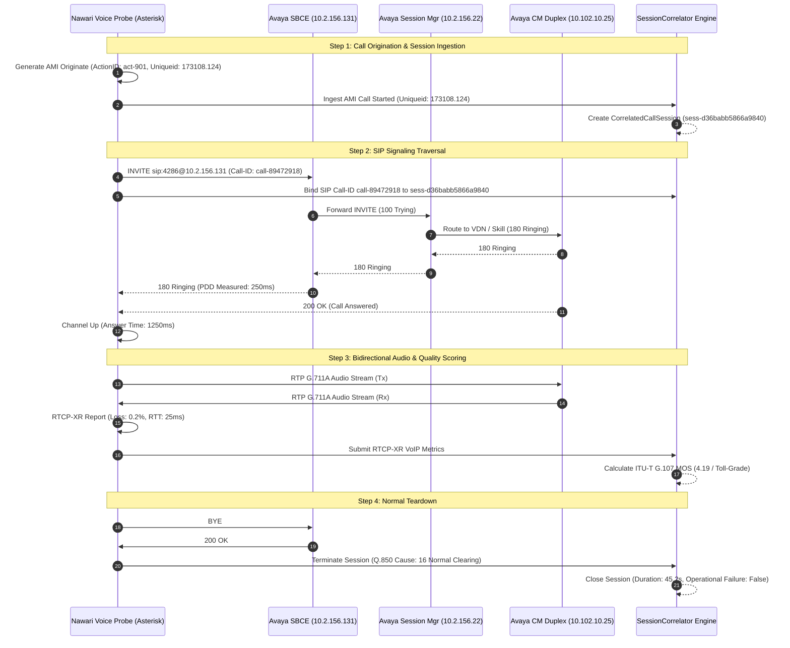

# Phase 13.10 — SIP and Asterisk AMI Multi-Leg Correlation Specification

**Author:** Antigravity Engineering (pair programming with Kenya Airways Project Team)  
**Date:** 2026-11-08  
**Status:** Implemented & Verified  
**Platform:** Asterisk 22.11 / Zabbix 7.4.16 Engine  
**Source Module:** `services/voice/correlation/session_correlator.py`

---

## 1. Executive Summary

In multi-vendor telephony environments, individual call events originate from disparate protocols and management layers:
- The carrier leg generates an external SIP dialog.
- The Asterisk synthetic probe generates Asterisk Manager Interface (AMI) events (`Newchannel`, `DialState`, `Hangup`).
- Avaya SBCE translates headers and generates internal SIP dialogs.
- Avaya Session Manager routes via SIP Call-ID and proprietary session identifiers.

Phase 13.10 standardizes the **deterministic cross-protocol correlation engine** within Nawari, linking these disparate streams into unified, auditable `CorrelatedCallSession` objects.

---

## 2. Correlation Identifier Mapping

```
+-----------------------------------+-----------------------------------+-----------------------------------+
| Identifier Field                  | Originating Subsystem             | Role in Correlation Engine        |
+-----------------------------------+-----------------------------------+-----------------------------------+
| `sip_call_id`                     | SIP Header (RFC 3261 `Call-ID`)   | Binds dialogs across SIP hops     |
| `asterisk_uniqueid`               | Asterisk AMI Channel Engine       | Primary internal leg identifier   |
| `asterisk_linkedid`               | Asterisk AMI Channel Bridge       | Binds multi-party/transferred legs|
| `ami_action_id`                   | Nawari Synthetic Probe Driver     | Correlates test dispatch to result|
| `avaya_session_id`                | Avaya SM/SBCE Proprietary Header  | Maps core enterprise legs         |
| `session_id` (`sess-xxxxxxxx`)    | Nawari `SessionCorrelator`        | Canonical enterprise incident ID  |
+-----------------------------------+-----------------------------------+-----------------------------------+
```

### Deterministic Session Hash Formula
When an event arrives without an existing mapped identifier, the `SessionCorrelator` generates a deterministic 16-character hexadecimal identifier:
$$\text{session\_id} = \text{"sess-"} + \text{SHA256}(\text{sip\_call\_id} + \text{":"} + \text{uniqueid} + \text{":"} + \text{timestamp})[:16]$$

---

## 3. End-to-End Call Flow Sequence Diagram



---

## 4. Idempotency & Out-of-Order Handling

In high-concurrency environments, SIP UDP packets and AMI TCP notifications can arrive in variable sequence:
1. **Late AMI Arrival:** If SIP packets arrive before the AMI `OriginateResponse`, the session is keyed by `sip_call_id`. When the AMI message subsequently arrives containing both `ActionID` and `Uniqueid`, the correlator resolves the cross-reference and merges legs without creating duplicate sessions.
2. **Duplicate Retransmissions:** SIP `INVITE` retransmissions sharing identical `Call-ID` and `CSeq` are identified by `SIPTransaction` and processed as retransmissions without distorting post-dial delay calculations.
3. **Graceful Teardown Completion:** Once marked `TERMINATED`, subsequent `ACK` or `200 OK` packets for the teardown handshake update leg completion timestamps without re-opening the session.

