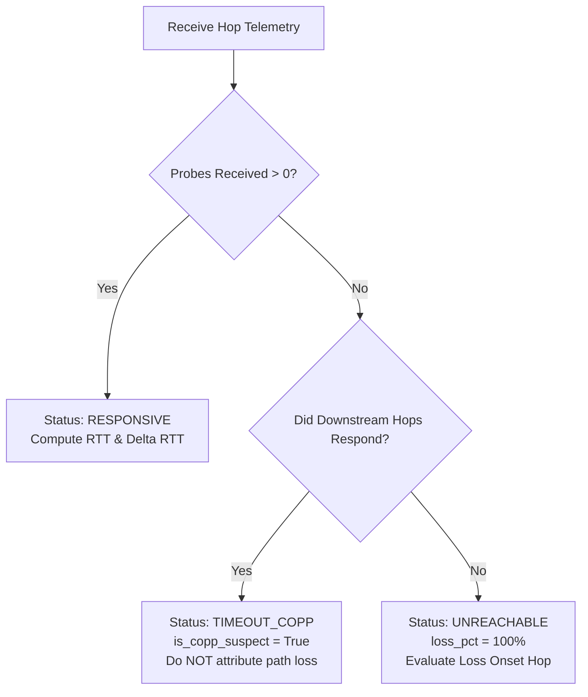

# Phase 13.11 — Path Measurement Standard

## Standard Objective

This standard defines the mathematical algorithms, threshold constants, classification rules, and operational policies governing all network path measurements within the Nawari observability platform.

---

## 1. Paris Traceroute Algorithmic Specification

### Checksum Invariance Rule
When crafting synthetic probe packets (ICMP Echo Request or UDP probe), the payload compensation algorithm must ensure that the RFC 1071 16-bit one's complement sum remains strictly constant:
$$\sum_{i} \text{Word}_i \pmod{2^{16} - 1} = C_{target}$$

For probe sequence number $S$ and flow identifier $F$:
1. Write 32-bit flow identifier $F$ at byte offset 0.
2. Write 16-bit sequence number $S$ at byte offset 4.
3. Compute the 16-bit compensating word $W_{comp}$ such that the overall packet checksum matches $C_{target}$.
4. Insert $W_{comp}$ at byte offset 6.

All router hashing algorithms evaluating $(\text{Header} + \text{Payload})$ will calculate an identical flow bucket, preventing false multi-path divergence.

---

## 2. Hop Classification & CoPP Guard Decision Logic

### Invariants:
1. **CoPP Invariant**: An intermediate router with $100\%$ loss whose subsequent hops or final destination respond successfully MUST NOT be flagged as a packet drop failure.
2. **Loss Onset Invariant**: `loss_onset_hop` must be set to the **first** hop where packet loss begins and continues through the final hop.

---

## 3. Threshold Register

| Telemetry Element | Metric | Warning Threshold | Critical Threshold | Hysteresis / Recovery |
| :--- | :--- | :--- | :--- | :--- |
| **Hop Transit Delay** | $\Delta\text{RTT}$ (adjacent hop) | $> 25.0\text{ms}$ | $> 40.0\text{ms}$ | $\Delta\text{RTT} \le 15.0\text{ms}$ for 3 samples |
| **Path Route Churn** | `path_hash` mismatch | Divergent hop identified | Route flapping $> 3$ changes / hr | Hash stable for 15 minutes |
| **Trans-WAN Voice MOS** | $MOS$ (ITU-T G.107) | $MOS < 4.0$ | $MOS < 3.8$ | $MOS \ge 4.1$ for 5 consecutive probes |
| **Trans-WAN Voice Loss** | RTP Packet Loss Rate | $> 1.0\%$ | $> 3.0\%$ | Loss $\le 0.5\%$ |
| **Trans-WAN Voice Delay** | One-Way Delay ($T$) | $> 150.0\text{ms}$ | $> 250.0\text{ms}$ | $T \le 120.0\text{ms}$ |
| **Application TCP SYN** | Connect RTT | $> 100.0\text{ms}$ | $> 500.0\text{ms}$ (or Timeout) | Connect RTT $< 50.0\text{ms}$ |

