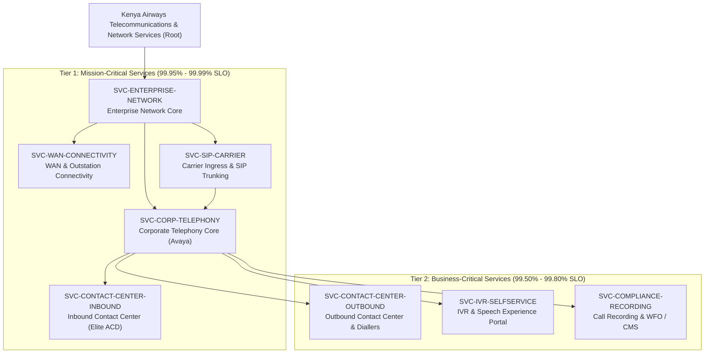

# Phase 13.12 — Service Dependency Architecture & Hierarchy

## Executive Summary

Phase 13.12 establishes the formal service dependency hierarchy and topological correlation architecture for Kenya Airways' enterprise network, cloud edge, and Avaya Aura communications infrastructure.

Rather than treating alerts as isolated threshold alarms across disparate network switches and PBX servers, Nawari structures IT and telecom infrastructure into a **Directed Acyclic Graph (DAG)** of 8 core business services. This guarantees that infrastructure failures propagate cleanly according to strict dependency logic (`MANDATORY_AND`, `QUORUM`, `OR_REDUNDANT`, `WEIGHTED`) without circular dependencies or alert storms.

---

## 1. Kenya Airways Business Service Hierarchy (DAG)

---

## 2. Core Service Definitions & Redundancy Models

| Service ID | Service Name | Tier | SLO | Dependency Logic | Underlying Components & Redundancy |
| :--- | :--- | :--- | :--- | :--- | :--- |
| `SVC-ENTERPRISE-NETWORK` | Enterprise Network Core | Tier 1 | 99.99% | `QUORUM` (1 of 2) | Dual spine/core switches: `jkia-core-sw01` (primary), `jkia-core-sw02` (secondary). |
| `SVC-WAN-CONNECTIVITY` | WAN & Outstation Connectivity | Tier 1 | 99.95% | `QUORUM` (1 of 2) | Multi-carrier MPLS/DIA: `CIR-MPLS-SAFARICOM-01`, `CIR-MPLS-TELKOM-01`. |
| `SVC-SIP-CARRIER` | Carrier Ingress & SIP Trunking | Tier 1 | 99.99% | `QUORUM` (1 of 2) | Active/Standby SBCE cluster: `avaya-sbce-01`, `avaya-sbce-02`. |
| `SVC-CORP-TELEPHONY` | Corporate Telephony Core | Tier 1 | 99.95% | `QUORUM` (1 of 2) | Avaya Aura CM duplex (`avaya-cm-01`/`02`), Session Manager duplex (`avaya-sm-01`/`02`). |
| `SVC-CONTACT-CENTER-INBOUND` | Inbound Contact Center | Tier 1 | 99.90% | `MANDATORY_AND` | Avaya Elite ACD, VDN queues, G450 media gateways (`avaya-g450-01`/`02`). |
| `SVC-CONTACT-CENTER-OUTBOUND`| Outbound Contact Center | Tier 2 | 99.50% | `MANDATORY_AND` | Campaign Manager, Predictive diallers, `avaya-sm-01`, `avaya-g450-01`. |
| `SVC-IVR-SELFSERVICE` | Interactive Voice Response | Tier 2 | 99.80% | `MANDATORY_AND` | Avaya Experience Portal (AAEP), Flight status speech recognition, `avaya-sm-01`. |
| `SVC-COMPLIANCE-RECORDING` | Call Recording & WFO | Tier 2 | 99.80% | `MANDATORY_AND` | Verint WFO recording cluster, CMS reporting (`avaya-cms-01`), PCI-DSS mute. |

---

## 3. High-Availability (HA) Pair Fault Semantics

A critical requirement enforced in Phase 13.12 is that **partial component failure within an HA cluster must never trigger a Total Outage alert**:
1. **Single Member Failure**: When `avaya-sbce-01` experiences a hardware, power, or link failure, traffic automatically fails over to `avaya-sbce-02`.
   - Classification: `REDUNDANCY_FAILOVER`.
   - Service Impact: `DEGRADED`.
   - Notification Action: Action 12 (Telephony Administrators).
   - Action 10 (Total Outage) is **strictly suppressed**.
2. **Dual Member Exhaustion**: Only when both `avaya-sbce-01` and `avaya-sbce-02` fail simultaneously is redundancy exhausted.
   - Classification: `ROOT_CAUSE`.
   - Service Impact: `TOTAL_OUTAGE`.
   - Notification Action: Action 10 (Broadcast to 5 recipients including Service Desk).

