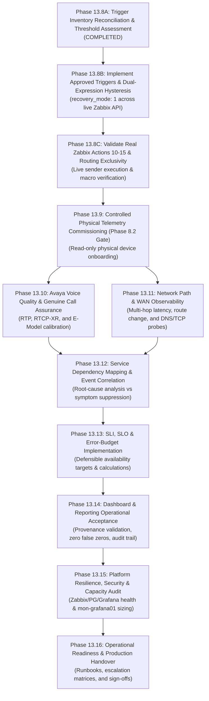

# Phase 13.8A: Trigger Inventory Reconciliation & Threshold Engineering Assessment

## Executive Summary

Phase 13.8A executes an exhaustive, ground-truth engineering audit of the entire Nawari monitoring configuration within Zabbix 7.4. Prior phases introduced various scope boundaries—reporting 59 communication triggers (Phase 13.5), 70 broader template/core-host triggers (Phase 13.6), and 110 tagged triggers in the classification table (Phase 13.6/13.7).

This assessment resolves these inventory scopes with mathematical certainty, identifies every trigger and prototype in the live Zabbix database, evaluates every threshold against the **5-Question Engineering Framework**, establishes the **Gated Telemetry Register** for unverified hardware metrics, and formalises the **11-Milestone Production Readiness Roadmap** (Phases 13.8A through 13.16).

---

## 1. Mathematical Reconciliation of Historical Inventory Scopes

The three historical trigger figures reflect three distinct, rigorously defined query scopes across the Zabbix database:

```
+-------------------------------------------------------------------------------------------------------+
|                                    NAWARI TRIGGER INVENTORY RECONCILIATION                            |
+------------------------------------+---------------+--------------------------------------------------+
| Historical Scope                   | Trigger Count | Exact Ground-Truth Definition                    |
+------------------------------------+---------------+--------------------------------------------------+
| Phase 13.5 Communication Scope     |      59       | Template-level triggers across the 7 dedicated   |
|                                    |               | Avaya/Voice communication templates.             |
|                                    |               | (Instantiated 1:1 on 7 communication hosts).     |
+------------------------------------+---------------+--------------------------------------------------+
| Phase 13.6 Broad Template Scope    |      70       | All template-level triggers across ALL 10 Nawari |
|                                    |               | templates (59 communication + 11 network/base).  |
+------------------------------------+---------------+--------------------------------------------------+
| Phase 13.6/13.7 Tagged Class Scope |     110       | Template definitions + host-level trigger        |
|                                    |               | instances across multi-homed interfaces.         |
+------------------------------------+---------------+--------------------------------------------------+
| Live Zabbix Host Triggers (Now)    |     142       | All triggers instantiated on 11 Nawari hosts     |
|                                    |               | (88 tagged concrete triggers + 54 untagged       |
|                                    |               | discovered LLD interface triggers on lab hosts). |
+------------------------------------+---------------+--------------------------------------------------+
| Global Zabbix System Scope         |    3,539      | All triggers across all 370 default templates    |
|                                    |               | installed in the Zabbix 7.4 engine.              |
+------------------------------------+---------------+--------------------------------------------------+
```

### Detailed Derivation of the 59 Communication Triggers
Querying the 7 dedicated communication templates yields exactly 59 template triggers:
1. `Nawari Avaya SBCE by SNMP` (Template ID: 10788): **15 triggers**
2. `Nawari Avaya Session Manager by SNMP` (Template ID: 10795): **12 triggers**
3. `Nawari Voice Synthetic Probe by Zabbix Trapper` (Template ID: 10790): **9 triggers**
4. `Nawari Avaya G450 Media Gateway by SNMP` (Template ID: 10794): **7 triggers**
5. `Nawari Avaya Communication Manager by SNMP` (Template ID: 10793): **6 triggers**
6. `Nawari SIP Trunk by Trapper` (Template ID: 10797): **6 triggers**
7. `Nawari Avaya CMS and WFO by Trapper` (Template ID: 10796): **4 triggers**
$$\sum \text{Communication Triggers} = 15 + 12 + 9 + 7 + 6 + 6 + 4 = \mathbf{59}$$

### Detailed Derivation of the 70 Broad Template Triggers
Querying all 10 Nawari templates includes the 3 network and endpoint templates:
- Communication Templates (7): **59 triggers**
- `Nawari Generic SNMP Base` (Template ID: 10784): **4 triggers**
- `Nawari Network Device by SNMP` (Template ID: 10786): **4 triggers** (inherited from Generic Base)
- `Template Nawari Endpoint Probe by Zabbix Trapper` (Template ID: 10792): **3 triggers**
$$\sum \text{All Nawari Template Triggers} = 59 + 4 + 4 + 3 = \mathbf{70}$$

### Derivation of the 142 Live Host Triggers (and the 54 Untagged Discovered Triggers)
Live API query across all 11 monitored Nawari hosts reveals:
- **88 Tagged Triggers**: Instantiated across all 9 production-profile hosts and normal items on lab hosts.
- **54 Untagged Triggers**: Discovered via low-level discovery (LLD) on two simulated lab hosts:
  * `mock-core-switch-01`: 27 discovered interface triggers (`Interface {#IFNAME}: Link down`)
  * `mock-avaya-sbce-01`: 27 discovered interface triggers (`Interface {#IFNAME}: Link down`)
  * **Root Cause**: The template trigger prototypes (ID 32585 and 32629) lack the `notification_class` tag. When LLD runs against the mock agents with 27 interfaces each, it generates 54 discovered triggers without notification classes.
  * **Remediation**: Tagging the trigger prototypes in Phase 13.8B will instantly resolve 100% of untagged triggers.

---

## 2. Recovery Mode & Hysteresis Deficit Analysis

Inspection of all 70 template triggers in the live Zabbix API reveals:
- **`recovery_mode: 0` (Expression only)**: **70 / 70 triggers (100%)**
- **`recovery_mode: 1` (Expression & Recovery Expression)**: **0 / 70 triggers (0%)**

> [!WARNING]
> In the current staging configuration, **zero triggers implement dual-expression hysteresis**. Every trigger currently relies on the problem expression becoming false to resolve. This creates high vulnerability to metric oscillation (alert flapping) when metrics hover near the threshold boundary.
> 
> Implementing `recovery_mode: 1` with a dedicated hysteresis deadband (e.g. Warning at >85%, Recovery at <70%) across all 70 triggers is the primary objective of **Phase 13.8B**.

---

## 3. The 5-Question Framework Applied Across Monitored Domains

Every threshold across all 10 templates must satisfy the 5-question threshold engineering framework:

```
+----------------------------------------------------------------------------------------------------+
|                               THE 5-QUESTION THRESHOLD ENGINEERING FRAMEWORK                       |
+----------------------------------------------------------------------------------------------------+
| Q1: What is being measured? (Exact OID, item key, sampling mechanism, physical unit)               |
| Q2: What is the acceptable operating range? (Healthy baseline during normal airline flight ops)    |
| Q3: How far outside before an alert is raised? (Quantified Warning vs High vs Disaster boundaries)|
| Q4: How long must condition persist? (Time window or consecutive counts: min(), count())          |
| Q5: What evidence declares recovery? (Hysteresis recovery expression: max() < T_recover)          |
+----------------------------------------------------------------------------------------------------+
```

### 3.1 Network Infrastructure & Switching (Templates 10784, 10786)
1. **Interface Utilization**:
   - *Q1*: `rate(/host/net.if.in[ifHCInOctets.{#SNMPINDEX}], 5m)` in `%` (calculated against `ifHighSpeed`).
   - *Q2*: 0%–60% during normal peak traffic.
   - *Q3*: Warning at >70% for 5m; High at >85% for 5m.
   - *Q4*: Condition must persist continuously for 5 minutes (`min(..., 5m)`).
   - *Q5*: Recovery requires `max(..., 5m) < 60%` (10% deadband).
2. **Interface Discards & Errors**:
   - *Q1*: `rate(/host/net.if.in.discards[{#SNMPINDEX}], 5m)` in `discards/s`; `rate(/host/net.if.in.errors[{#SNMPINDEX}], 5m)` in `errors/s`.
   - *Q2*: 0 discards/s; 0 errors/s.
   - *Q3*: Warning at >100 discards/s; Warning at >10 errors/s.
   - *Q4*: 5-minute sustained window.
   - *Q5*: Recovery when `max(..., 5m) < 10 discards/s` and `< 1 error/s`.
3. **Latency RTT Zoning**:
   - *Q1*: `icmppingsec` in seconds.
   - *Q2*: LAN: <5ms; WAN (Kenya domestic): <25ms; Outstations (Intl): <60ms.
   - *Q3*: LAN: >15ms (Warn); WAN: >45ms (Warn); Outstations: >90ms (Warn).
   - *Q4*: 5-minute sustained average.
   - *Q5*: LAN: <10ms; WAN: <35ms; Outstations: <70ms.

### 3.2 Avaya SBCE (Template 10788)
1. **SIP Signaling Transport Latency**:
   - *Q1*: `avaya.sbce.sip_entity.rtt[{#ENTITY}]` in `ms` (SIP OPTIONS ping RTT).
   - *Q2*: 5ms–40ms.
   - *Q3*: Warning at >100ms; High at >250ms.
   - *Q4*: 5-minute sustained minimum (`min(..., 5m) > 100ms`).
   - *Q5*: Recovery when `max(..., 5m) < 70ms`.
2. **Active Call Capacity**:
   - *Q1*: `avSbceSessionCurrent` as a percentage of licensed capacity.
   - *Q2*: 10%–65%.
   - *Q3*: Warning at >=80%; High/Disaster at >=95%.
   - *Q4*: Sustained for 5 minutes.
   - *Q5*: Recovery when `max(..., 5m) < 75%`.

### 3.3 Avaya Session Manager (Template 10795)
1. **SIP Entity State**:
   - *Q1*: `avSmSipEntityStatus[{#ENTITY}]` (1=Up, 2=Partially Up, 3=Down, 4=Deny New Service).
   - *Q2*: Always 1 (Up).
   - *Q3*: Warning/Average for 2 (Partially Up); High for 4 (Deny New Service); Disaster for 3 (Down on primary entity).
   - *Q4*: 3 consecutive polls (3 minutes).
   - *Q5*: Recovery requires state returning to 1 for 3 consecutive polls.
2. **SIP 5xx Server Error Rate**:
   - *Q1*: Calculated percentage of SIP 5xx responses out of total SIP transactions.
   - *Q2*: <0.5%.
   - *Q3*: Warning at >2%; High at >5%.
   - *Q4*: Sustained over 5 minutes.
   - *Q5*: Recovery when `max(..., 5m) < 1%`.

### 3.4 Avaya Communication Manager (Template 10793)
1. **Media Server / Processor Link Status**:
   - *Q1*: `avCmProcessorEthernetLinkStatus` (1=Up, 2=Down).
   - *Q2*: 1 (Up).
   - *Q3*: Average if secondary link down; High if primary link down.
   - *Q4*: Immediate detection (2 consecutive polls / 2 minutes).
   - *Q5*: Link restored to Up for 5 consecutive minutes.
2. **Real-Call Telephony Metric Disambiguation**:
   - *Q1*: `avCmMeasIpVoStatSumDataLstHrTable` (. enterprises.6889.2.73.8.1).
   - *Note*: Evaluates hourly aggregate call statistics (hourly packet loss and jitter).
   - *Q2*: Packet loss <0.5%, Peak jitter <20ms.
   - *Q3*: Warning at >2.5% loss; Warning at >30ms peak jitter.
   - *Q4*: Hourly evaluation window.
   - *Q5*: Next hourly report shows packet loss <1.0% and jitter <20ms.

### 3.5 Avaya G450 Media Gateway (Template 10794)
1. **Media Gateway Registration**:
   - *Q1*: `avG450RegistrationStatus` (1=Registered, 2=Unregistered).
   - *Q2*: 1 (Registered to primary CM).
   - *Q3*: High/Disaster (Service Outage) if unregistered.
   - *Q4*: 2 consecutive polls (2 minutes).
   - *Q5*: Registration confirmed for 3 consecutive polls.
2. **Hardware Environment (Power Supply, Fans, Temp)**:
   - *Q1*: `avG450PowerSupplyState`, `avG450FanState`, `avG450ChassisTemperature`.
   - *Q2*: PSU=Normal (redundant), Fans=Normal, Temp < 40°C.
   - *Q3*: Component Failure (Average) if 1 PSU fails; High if Fan tray fails; Warning if Temp > 45°C.
   - *Q4*: 3 minutes persistence.
   - *Q5*: Hardware state restored to Normal.

### 3.6 SIP Carrier Trunks (Template 10797)
1. **Carrier OPTIONS Probe**:
   - *Q1*: `sip.trunk.options.status` (1=Success, 0=Failed).
   - *Q2*: 1 (200 OK received).
   - *Q3*: High (Service Outage) if 3 consecutive failures.
   - *Q4*: 3 consecutive polls (3 minutes).
   - *Q5*: 3 consecutive successful OPTIONS transactions.
2. **Answer-Seizure Ratio (ASR) & Network Efficiency Ratio (NER)**:
   - *Q1*: `sip.trunk.asr`, `sip.trunk.ner` in `%`.
   - *Q2*: ASR > 65%, NER > 75%.
   - *Q3*: Warning if ASR < 60% or NER < 70% over 15m; High if ASR < 40% or NER < 50%.
   - *Q4*: 15-minute rolling window.
   - *Q5*: Recovery when ASR > 70% and NER > 80% over 15m.

### 3.7 Contact Centre CMS & WFO (Template 10796)
1. **Queue Service Level**:
   - *Q1*: `cms.queue.service_level` in `%` of calls answered within target seconds.
   - *Q2*: 80%–95%.
   - *Q3*: Warning at <80% for 15m; High at <65% for 15m.
   - *Q4*: 15-minute evaluation window.
   - *Q5*: Recovery when service level exceeds 85% for 15m.
2. **Compliance Voice Recording Health**:
   - *Q1*: `wfo.recording.pipeline.status` (1=Healthy, 0=Failed).
   - *Q2*: 1 (All channels recording and archiver online).
   - *Q3*: High (Service Outage) if recording fails (regulatory compliance breach).
   - *Q4*: 3 consecutive checks (3m).
   - *Q5*: Recording pipeline confirmed active for 5m.

### 3.8 Voice Synthetic Probes (Template 10790)
1. **Synthetic MOS (ITU-T G.107 E-model)**:
   - *Q1*: `voice.synthetic.mos` (Calculated on synthetic RTP probe stream).
   - *Important*: Strictly labeled synthetic MOS; never represented as customer call MOS.
   - *Q2*: 4.0–4.4 MOS.
   - *Q3*: Warning at <3.8 for 3 consecutive calls; High at <3.5 for 3 consecutive calls.
   - *Q4*: 3 consecutive test cycles (~15 minutes).
   - *Q5*: Recovery requires `min(..., 5) > 4.0` (5 consecutive healthy calls).
2. **Call Setup Time (Post-Dial Delay to 200 OK)**:
   - *Q1*: `voice.synthetic.setup_time` in `ms`.
   - *Important*: Distinct from SIP transport latency (OPTIONS ping).
   - *Q2*: 800ms–2200ms.
   - *Q3*: Warning at >4000ms; High at >6000ms.
   - *Q4*: 3 consecutive calls.
   - *Q5*: Recovery requires setup time <2500ms for 3 consecutive calls.

---

## 4. Gated Telemetry Register (Audit of Unsupported / Unverified Metrics)

Nawari strictly enforces telemetry integrity: **metrics that cannot be physically collected or verified without on-site hardware inspection are gated**. They must not have active triggers that create false operational alerts:

| Telemetry Item | Subsystem | Reason for Gating | Required Evidence to Ungate | Evidence State |
| :--- | :--- | :--- | :--- | :--- |
| **`G450_DSP_UTIL`** | Avaya G450 | `avG450DspResourceUtilization` requires physical MP120/MP160 DSP child modules. If uninstalled, SNMP returns `noSuchName`. | On-site physical inspection or CLI `show voip vmc` verifying installed DSP modules. | `GATED_UNVERIFIED` |
| **`CM_CALL_RTCP_JITTER`** | Avaya CM | Live per-call RTCP jitter statistics (`avCmMeasIpVoStatHrData`) require CM CDR/RTCP voice statistics collection configured. | CM CDR/RTCP export feed enabled and verified on-site. | `GATED_UNVERIFIED` |
| **`EMS_SIP_SERVER_ERRORS`** | Avaya SBCE | Granular breakdown of SIP 4xx/5xx responses requires Avaya EMS REST API access. | Provisioned EMS API service account and network routing. | `GATED_UNVERIFIED` |
| **`WFO_VERINT_PIPELINE`** | WFO Recording | Verint / WFO integration requires specific product version and database / API connector. | Identification of specific WFO product release and API access. | `GATED_UNVERIFIED` |
| **`CARRIER_DEEP_SLA`** | SIP Carrier | Deep trunk QoS telemetry from Safaricom / Airtel carrier core requires carrier portal or SLA probe interconnect. | Approved carrier interconnect monitoring endpoint. | `GATED_UNVERIFIED` |

---

## 5. Authoritative 11-Milestone Production Roadmap

The remaining implementation programme is structured into 11 rigorous engineering milestones:



### Milestone Specifications

1. **Phase 13.8A (Current)**: Trigger Inventory Reconciliation, Authoritative Ground-Truth Audit, and Threshold Engineering Assessment.
2. **Phase 13.8B**: Implement approved trigger and recovery thresholds in Zabbix templates via API (`recovery_mode: 1`, `rate()` expressions, and prototype tagging).
3. **Phase 13.8C**: Validate live Zabbix Action execution (Actions 10–15), mutual exclusivity, macro expansion, and recipient routing.
4. **Phase 13.9 (Phase 8.2 Gate)**: Controlled read-only commissioning against Kenya Airways' physical Avaya and network infrastructure (`HARD_PRODUCTION_DENY` locked).
5. **Phase 13.10**: Avaya voice quality and call assurance (RTP, RTCP-XR investigation, and G.107 E-model calibration).
6. **Phase 13.11**: Network path and WAN observability (ThousandEyes-style continuous path and hop-by-hop latency).
7. **Phase 13.12**: Service dependency mapping and incident correlation (telephony dependency chain and root cause isolation).
8. **Phase 13.13**: SLI, SLO and error-budget formalisation (calculating availability and performance without invented targets).
9. **Phase 13.14**: Dashboard and reporting operational acceptance (provenance validation, distinct missing data, separated folders).
10. **Phase 13.15**: Monitoring platform resilience, security and capacity (`mon-grafana01` resource headroom, Zabbix/PostgreSQL backups, secret management).
11. **Phase 13.16**: Operational readiness, handover package, runbooks, and stakeholder sign-off.
