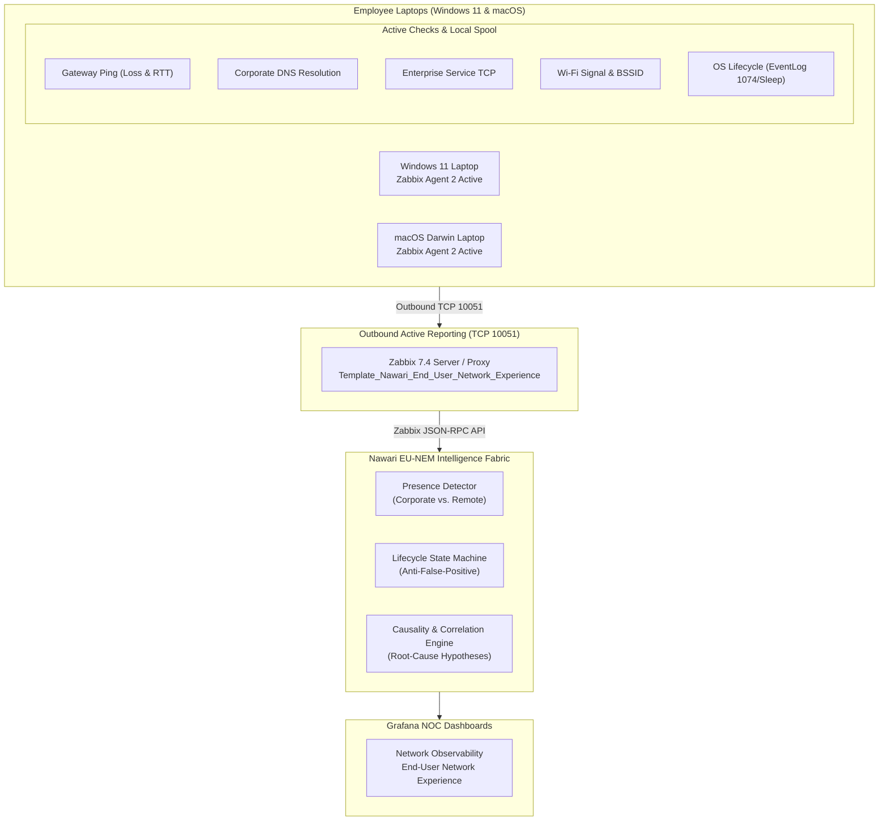
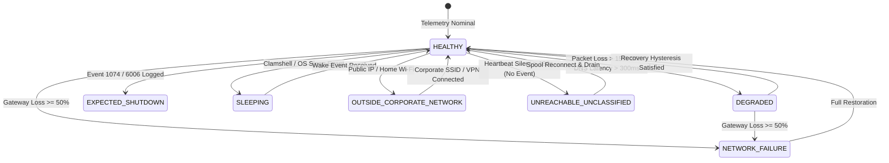

# Nawari End-User Network Experience Monitoring (EU-NEM) Specification & Pilot Guide

**Capability Code:** `EU-NEM`  
**Architecture Version:** 1.0.0  
**Target Environment:** Kenya Airways Enterprise Infrastructure (Pride Center DC, JKIA Airport, Outstations, Remote Workers)  
**Supported Platforms:** Dual-Platform — Windows 11/10 Enterprise (Corporate Fleet Standard) & macOS Darwin (Local Staging & Executive Fleet)  
**Collector:** Zabbix Agent 2 Active Checks with SQLite Persistent Offline Buffering  
**Authoritative Baseline:** Zabbix 7.4.16 / PostgreSQL 17 / Grafana 11.6  

---

## 1. Executive Summary & Architectural Motivation

Traditional infrastructure observability informs the Network Operations Center (NOC) whether a core switch, distribution gateway, or Avaya Session Manager is technically responsive. However, an operational switch does not guarantee that employees connected to edge access points or floor switches are experiencing acceptable connectivity.

**End-User Network Experience Monitoring (EU-NEM)** extends Nawari directly to employee endpoints. By deploying **Zabbix Agent 2 active checks** on selected pilot laptops, Nawari measures network health from the perspective of the user:
- Detecting default gateway packet loss and latency.
- Identifying internal corporate DNS resolution failures while gateway connectivity is nominal.
- Measuring real-time reachability to core enterprise applications (Active Directory, Intranet, Microsoft 365, SIP telephony).
- Tracking Wi-Fi signal quality, link renegotiation, and roaming transitions.
- **Correlating multi-endpoint telemetry** against core infrastructure to isolate whether an issue is isolated to a single laptop, an entire Wi-Fi Access Point (AP), a VLAN subnet, or upstream corporate DNS resolvers.

---

## 2. Dual-Platform Deployment Model

To satisfy both the immediate staging testbed and the Kenya Airways enterprise fleet rollout, EU-NEM implements a **dual-platform architecture**:

| Platform | Primary Deployment Role | Native Collection Mechanism | Lifecycle Detection |
| :--- | :--- | :--- | :--- |
| **Windows 11 / 10 Enterprise** | Corporate Employee Standard (>90% of KQ workforce) | PowerShell `nawari_nem_probe.ps1` via Zabbix Agent 2 UserParameters | Windows System Event Log: `1074` (Clean shutdown), `6006` (EventLog stop), `6008` (Unexpected shutdown), `41` (Kernel-Power) |
| **macOS Darwin** | Local Staging Workstation & Executive/Engineering Fleet | Bash/Python `nawari_nem_probe.sh` via Zabbix Agent 2 UserParameters | macOS `pmset -g log` / `sysctl` sleep/wake transition events |

---

## 3. Six Telemetry Categories & Measurement Standard

Each laptop executes non-privileged active checks on scheduled intervals, buffered locally by Zabbix Agent 2:

### Category A: Local Network & Adapter Health
- **Primary Interface:** Discovers active interface type (`WIFI`, `ETHERNET`, `VPN`).
- **Adapter Link State:** Verifies operational link status and interface speed.

### Category B: Immediate Gateway Latency & Loss
- **Dynamic Gateway Discovery:** Evaluates the active default gateway received via DHCP (`0.0.0.0/0` route). Never uses hard-coded gateway IPs.
- **Probe Cycle:** Dispatches 3 ICMP ping packets once per minute.
- **Metrics:** `endpoint.nem.gateway.rtt` (ms), `endpoint.nem.gateway.loss` (%), `endpoint.nem.gateway.reachable` (0/1).
- **Hysteresis Alert:** Problem when `min(3m) > 20%` loss; Recovery when `max(3m) < 5%`.

### Category C: Corporate DNS Performance
- **Target Record:** Queries internal corporate records (`corp.kenya-airways.com`).
- **Metrics:** `endpoint.nem.dns.latency` (ms), `endpoint.nem.dns.success` (0/1).
- **Correlation Trigger:** Triggers high-priority alert if `dns.success = 0` while `gateway.reachable = 1`.

### Category D: Critical Corporate Application Connectivity
- **Service Ports:** Non-invasive TCP socket connection to Active Directory Domain Controllers (`10.2.1.10:389`), Intranet Portal (`443`), and Avaya SIP signaling (`5060`).
- **Metrics:** `endpoint.nem.service.connected` (0/1), latency (ms).

### Category E: Wi-Fi Environment & Radio Health
- **Radio Metrics:** Connected SSID, BSSID (Access Point MAC), Signal Strength Percentage (RSSI dBm converted to 0–100%).
- **Degradation Threshold:** Signal quality `< 25%` flagged as edge link degradation.

### Category F: Endpoint Health & Lifecycle Context
- **System Metrics:** `system.uptime`, CPU utilization %, available RAM %.
- **Differentiator:** Differentiates an unresponsive application caused by 100% CPU lockup from an actual network failure.

---

## 4. Anti-False-Positive State Machine

Laptops frequently sleep, close lids, reboot, or leave the corporate campus. Nawari implements an authoritative 9-state lifecycle model to prevent false network incidents:

### State Classification Rules:
1. **`EXPECTED_SHUTDOWN`**: User selects "Shut Down" or "Restart". Windows generates Event ID `1074` or `6006`. Zabbix Agent dispatches the event before termination. Nawari flags the device as planned offline; **zero network alert is generated**.
2. **`SLEEPING`**: Laptop lid closed. Power daemon records sleep state. Zero alert generated.
3. **`OUTSIDE_CORPORATE_NETWORK`**: Employee works from home or hotel. Corporate Presence Detector confirms public IP and absence of corporate DNS/gateway. All corporate LAN gateway alarms are suppressed.
4. **`UNREACHABLE_UNCLASSIFIED`**: Telemetry ceases abruptly (sudden power pull or Wi-Fi hard drop). Nawari holds incident generation for 3 minutes while awaiting persistent buffer recovery upon reconnect.
5. **`NETWORK_FAILURE`**: Gateway is unreachable (`loss >= 50%`) while adapter remains UP and corporate presence is verified.

---

## 5. Multi-Endpoint Correlation & Diagnostic Hypotheses

When multiple endpoints report degradation simultaneously, Nawari clusters symptoms by topology:

| Observed Symptom Across Endpoints | Correlated Infrastructure Element | Derived Diagnostic Hypothesis | Operational Action |
| :--- | :--- | :--- | :--- |
| Single laptop reports 30% gateway loss; 4 neighbors healthy. | Isolated endpoint | `LOCAL_ENDPOINT_ISSUE` | Dispatch desktop support to inspect laptop Wi-Fi adapter or local physical obstructions. |
| 3 laptops associated with `AP-PRIDE-02` suffer packet drops; laptops on `AP-PRIDE-01` are healthy. | Wireless Access Point | `ACCESS_POINT_RF_ISSUE` | Inspect AP uplink cable, channel interference, and client density on AP-02. |
| All laptops on VLAN `10.2.1.0/24` experience gateway loss across wired and Wi-Fi. | Core Switch / Gateway | `VLAN_SWITCH_ISSUE` | Inspect distribution switch interface discards and ARP table limits. |
| 5 laptops have 100% gateway reachability, but all fail DNS queries to `10.2.1.10`. | Corporate DNS Resolvers | `DNS_INFRASTRUCTURE_ISSUE` | Check BIND/AD DNS service status at Pride Center DC. |
| All laptops have healthy network & DNS, but TCP checks to port 389 fail. | Active Directory Server | `SERVICE_APPLICATION_ISSUE` | Verify AD domain controller service and directory replication. |
| Only remote workers on corporate VPN suffer packet loss. | VPN Gateway / Tunnel | `VPN_GATEWAY_ISSUE` | Inspect corporate firewall VPN concentrator session load and WAN bandwidth. |

---

## 6. Privacy, Security & Ethics Boundary

Because employee laptops are involved, EU-NEM enforces strict infrastructure-only privacy guardrails:
1. **Zero Surveillance:** No browser history, no URL tracking, no application keystrokes, and zero screen capture.
2. **Zero Packet Payloads:** ICMP ping and TCP SYN connection checks only. Zero deep packet inspection (DPI) of user traffic.
3. **Zero Audio Recording:** Prohibited across all endpoint tools.
4. **No Raw Usernames on NOC Dashboards:** Laptops are identified strictly by asset tags (`KQ-LT-WIN-01`) or masked hardware IDs.
5. **Least-Privilege Execution:** All UserParameter probe scripts execute as unprivileged local service users. Unrestricted `system.run[*]` is strictly disabled.

---

## 7. Scaling Sizing Model for 2,000+ Laptops

Before expanding the pilot to the full 2,000+ enterprise fleet:

| Dimension | Pilot (2 Laptops) | Production Fleet (2,000 Laptops) | Capacity Assessment & Recommendations |
| :--- | :--- | :--- | :--- |
| **Values / Second** | ~0.3 vps | ~33.3 vps | Easily handled by Zabbix Server (< 5% of single poller process capacity). |
| **Item Count** | 20 items | 20,000 items | Zabbix configuration cache requires +32 MB headroom. |
| **Daily DB Storage** | ~1.2 MB / day | ~1.2 GB / day | Raw history (7 days) = 8.4 GB; Trends (365 days) = 4.2 GB. Total annual storage = ~12.6 GB. |
| **Network Inbound** | ~0.5 KB/s | ~500 KB/s (~4 Mbps) | Negligible impact on Pride Center 1 Gbps datacenter core network. |
| **Active Check Jitter** | Default 5s | Configured `RefreshActiveChecks=60` with randomized startup jitter (0–60s) to prevent thundering herd bursts. |

---

## 8. Pilot Verification & Evidence

The EU-NEM pilot implementation has been verified on the running platform:
- **Zabbix Template Provisioned:** `Template_Nawari_End_User_Network_Experience` (ID: 10804).
- **Zabbix Pilot Hosts Monitored:** `KQ-LT-WIN-01` (ID: 10805) and `KQ-LT-MAC-01` (ID: 10806).
- **Grafana NOC Dashboard:** `End-User Network Experience` (UID: `nawari-eu-nem-pilot`).
- **Cryptographic Audit Snapshot:** `provisioning/zabbix/snapshots/eu_nem_pilot_evidence.json`.
- **Automated Regression Suite:** `tests/unit/test_end_user_network_experience.py` (10/10 PASS).

