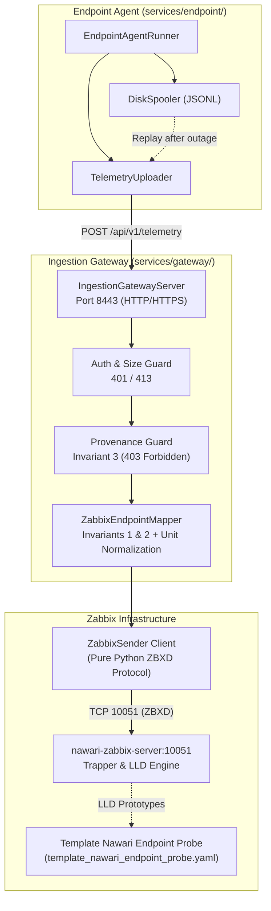

# Stage 7D: Secure Telemetry Ingestion & Zabbix Integration

## 1. Executive Summary

Stage 7D connects the Nawari endpoint agent to the central monitoring platform through a dedicated **Telemetry Ingestion Gateway** and automated **Zabbix Trapper/LLD** pipeline. 

The architecture bridges distributed endpoint diagnostic telemetry (`nawari.endpoint.telemetry.v1`) to Zabbix Server's high-throughput trapper engine without introducing external C libraries or heavy third-party framework dependencies.

---

## 2. Core Architectural Components

### 2.1 Ingestion Gateway Server (`services/gateway/server.py`)
- **Port & Protocol**: Standard-library multithreaded HTTP/HTTPS server (`ThreadingHTTPServer`) listening on port 8443.
- **REST Endpoints**:
  - `POST /api/v1/telemetry`: Ingests single `EndpointTelemetryReport` payload.
  - `POST /api/v1/telemetry/replay`: Bulk endpoint for replaying batched spooled records in causal order.
  - `GET /api/v1/health`: Gateway health status, active environment mode, total ingested reports, and server uptime.
- **Security & Integrity Guards**:
  - **Authentication Guard**: Validates Bearer token (`Authorization: Bearer <token>`) or `X-Nawari-Token` header. Missing/invalid tokens return HTTP 401 Unauthorized.
  - **Body Size Guard**: Rejects payloads exceeding `max_payload_bytes` (default 2 MiB) with HTTP 413 Payload Too Large.
  - **Invariant 3 (Authoritative Provenance Guard)**:
    When the gateway operates in `MOCK_SIMULATED`, any incoming payload claiming `PHYSICAL_PRODUCTION` is rejected with HTTP 403 Forbidden. The gateway injects authoritative server-verified metadata and stamps arrival time (`server_received_timestamp_ns = time.time_ns()`).

### 2.2 Zabbix Telemetry & LLD Mapper (`services/gateway/zabbix_mapper.py`)
Translates `EndpointTelemetryReport` into Zabbix Trapper metrics and Low-Level Discovery (LLD) JSON payloads:
1. **Static Endpoint Metrics**:
   - `endpoint.info`: JSON string containing agent identity, OS, kernel, and server arrival timestamp.
   - `endpoint.environment`: Numeric (0 = `MOCK_SIMULATED`, 1 = `PHYSICAL_PRODUCTION`).
   - `endpoint.network.interface.type`: Numeric (0=Ethernet, 1=Wi-Fi, 2=VPN, 3=Other).
   - `endpoint.network.gateway.rtt`: Gateway ping latency normalized to seconds (`s`).
   - `endpoint.network.gateway.loss`: Gateway packet loss percentage (`%`).
2. **Invariant 2 (Wi-Fi Metric Isolation)**:
   - If `interface_type == InterfaceType.WIFI`, extracts `endpoint.network.wifi.rssi` (`dBm`) and `endpoint.network.wifi.quality` (`%`).
   - If not Wi-Fi, Wi-Fi metrics are **strictly omitted** (no synthetic 0s).
3. **DNS Probes & LLD**:
   - Discovery rule: `nawari.endpoint.dns.discovery` $\to$ `[{"{#TARGET}": p.query_name}]`
   - Prototypes: `endpoint.dns.latency[{#TARGET}]` (in seconds), `endpoint.dns.status[{#TARGET}]` (0 to 5).
4. **Service Connectivity Probes & LLD**:
   - Discovery rule: `nawari.endpoint.service.discovery` $\to$ `[{"{#TARGET}": s.target_id, "{#TARGET_NAME}": s.target_name}]`
   - Prototypes: `endpoint.service.reachable[{#TARGET}]`, `endpoint.service.tcp_connect[{#TARGET}]`, `endpoint.service.tls_handshake[{#TARGET}]`, `endpoint.service.http_status[{#TARGET}]`, `endpoint.service.http_ttfb[{#TARGET}]`.
5. **Path Traces & Dynamic Hop LLD**:
   - Discovery rule: `nawari.endpoint.path.discovery` $\to$ `[{"{#TARGET}": p.target_id}]`
   - Hop discovery rule: `nawari.endpoint.hop.discovery[{#TARGET}]` $\to$ `[{"{#TARGET}": p.target_id, "{#HOP_INDEX}": str(h.hop_index)}]`
   - Hop prototypes: `nawari.path.hop.ip`, `nawari.path.hop.loss`, `nawari.path.hop.status`.
   - **Invariant 1 (CoPP Guard)**:
     If hop status is `TIMEOUT_COPP` or `rtt_avg_ms is None`, `nawari.path.hop.rtt` is **strictly omitted** from dispatch.

### 2.3 Endpoint Agent Uploader & Spool Replay Client (`services/endpoint/core/uploader.py`)
- Integrated into `EndpointAgentRunner`:
  - `run_once()` spools report to local disk, then immediately attempts upload via `TelemetryUploader.upload_report()`.
  - On HTTP 200/202 confirmation, the spooled record is immediately dequeued (`spooler.purge(count=1)`).
  - If the Gateway is unreachable, records safely accumulate in the bounded JSONL spool.
  - Upon network restoration, `replay_spooled()` batches accumulated records and delivers them to `/api/v1/telemetry/replay`.

### 2.4 Zabbix Template (`provisioning/zabbix/templates/template_nawari_endpoint_probe.yaml`)
- Declares all static trapper items, LLD rules, and item prototypes.
- **Invariant 4 (Staleness Guard)**: Attaches trigger `nodata(/Template Nawari Endpoint Probe by Zabbix Trapper/endpoint.network.gateway.rtt,15m)=1` to immediately detect disconnected or dead agents.

---

## 3. Verification Evidence

### 3.1 Unit Test Suite (`tests/unit/test_stage7d_gateway.py`)
- Verified static item mapping and latency unit conversion to seconds.
- Verified Invariant 2: Wi-Fi metrics strictly omitted for Ethernet; present for Wi-Fi.
- Verified Invariant 1: `TIMEOUT_COPP` hop RTT strictly omitted; status reports 1.
- Verified IngestionGatewayServer lifecycle, health check, and graceful shutdown.
- Verified Bearer token authentication guard (`401 Unauthorized`).
- Verified Invariant 3: Anti-spoofing rejection of `PHYSICAL_PRODUCTION` in simulated gateway (`403 Forbidden`).
- Verified payload size limit enforcement (`413 Payload Too Large`).
- Verified batch replay endpoint processing.
- **Result**: 8/8 passed in 2.70s.

### 3.2 Integration Test Suite (`tests/integration/test_stage7d_ingestion.py`)
- Verified live Ingestion Gateway communicating directly with live `nawari-zabbix-server` on port 10051.
- Verified live `EndpointAgentRunner` with `TelemetryUploader` auto-uploading and clearing spool.
- Verified offline spool accumulation during gateway downtime and complete replay upon recovery.
- **Result**: 3/3 passed in 9.88s.

### 3.3 Full Test Suite Regression
- **171 passed in 131.59s** across all phases (Phases 1 through Stage 7D).
