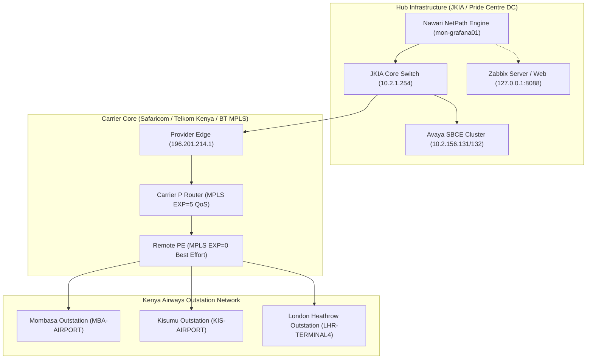

# Phase 13.11 — Network Path & WAN Observability Architecture

## Executive Summary

Phase 13.11 establishes the end-to-end network path and WAN observability architecture for Kenya Airways' distributed network footprint. While traditional ICMP ping and standard traceroute fail across equal-cost multi-path (ECMP) routing and carrier MPLS cores, Nawari integrates **Paris Traceroute** flow-invariant probing, **RFC 4950 MPLS ICMP extension** parsing, **Control Plane Policing (CoPP) Guard**, **Loss and Latency Onset Localization**, and a distributed **Trans-WAN Voice Prober**.

This architecture directly addresses the unique topological challenges of KQ's airline infrastructure: connecting the central Pride Centre DC and JKIA hub with domestic outstations (Mombasa MBA, Kisumu KIS, Eldoret EDL), regional outstations (Entebbe EBB, Dar es Salaam DAR, Kigali KGL), and international stations (London Heathrow LHR, Dubai DXB, Amsterdam AMS, Johannesburg JNB, Mumbai BOM).

---

## 1. Topological Scope & Path Architecture

### Core Components

1. **Paris Traceroute Engine (`services.endpoint.path.traceroute`)**:
   - Computes RFC 1071 16-bit one's complement payload compensation.
   - Preserves constant checksum across varying TTLs and sequence numbers, guaranteeing packet flows traverse the exact same ECMP hashing bucket and MPLS label-switched path (LSP).

2. **RFC 4950 MPLS Label Stack Parser (`services.endpoint.path.mpls`)**:
   - Decodes ICMP multi-part extensions (Class-Num 1, Class-Type 1).
   - Extracts 20-bit MPLS Label, 3-bit Traffic Class (EXP), 1-bit Bottom of Stack (BOS), and 8-bit Time-to-Live (TTL).
   - Verifies whether voice traffic is properly honored with EXP=5 (Expedited Forwarding) or erroneously marked with EXP=0 (Best Effort).

3. **CoPP Guard (`services.endpoint.path.hop_analyzer`)**:
   - Detects intermediate transit routers dropping ICMP Time Exceeded packets due to Control Plane Policing (CoPP).
   - Prevents false total outage alerts and false link drop alarms when downstream transit hops and the target destination respond with 0% loss.

4. **Loss & Latency Onset Localization**:
   - Flags delta RTT jumps exceeding 40.0 ms across adjacent hops.
   - Pins the exact hop index where packet drop originates when downstream packet loss persists.

5. **Trans-WAN Voice Quality Prober (`services.multisite.wan_voice_probes`)**:
   - Synthesizes voice traffic across active and standby MPLS/DIA circuits.
   - Computes ITU-T G.107 E-model transmission rating factor ($R$) and listening MOS ($MOS$).
   - Recommends automatic circuit failover when MOS degrades below operational thresholds.

---

## 2. Path Telemetry Model & Status Matrix

| Metric / Attribute | Definition | Operational Threshold | Diagnostic Action |
| :--- | :--- | :--- | :--- |
| `path_hash` | SHA-256 digest of ordered hop IPs | Hash mismatch vs baseline | Alerts on route churn / flapping |
| `divergent_hop_index` | 1-based index where path diverges | Any divergence | Pinpoints route divergence router |
| `latency_onset_hop` | Hop with $\Delta\text{RTT} > 40\text{ms}$ | $> 40.0\text{ms}$ | Localizes WAN congestion or suboptimal peering |
| `loss_onset_hop` | Hop where downstream loss starts | Downstream loss $> 0\%$ | Localizes damaged physical link or carrier policing |
| `status == TIMEOUT_COPP` | Intermediate hop timeout | Destination responsive | CoPP guard prevents false ticket creation |
| `mpls_exp` | Traffic Class bits | EXP $\neq 5$ on voice path | Localizes carrier QoS remarking/mismatch |

---

## 3. Paris Traceroute Algorithmic Proof

In standard traceroute, varying the ICMP sequence number or UDP destination port alters the packet's 5-tuple hash ($(\text{Src IP}, \text{Dst IP}, \text{Protocol}, \text{Src Port}, \text{Dst Port})$) or IP/ICMP header checksum. This causes different probes to take different parallel links across carrier ECMP networks, generating false diamond topologies or phantom loops.

Paris Traceroute eliminates this by adjusting the payload to compensate for the sequence number change:
$$\text{Checksum}(\text{Payload}) = \text{TargetConstantSum}$$
Every probe maintains an identical 16-bit 1's complement sum (verified in staging: `0x5432`). Transit routers hashing on packet header fields calculate the exact same hash, enforcing path invariance.
